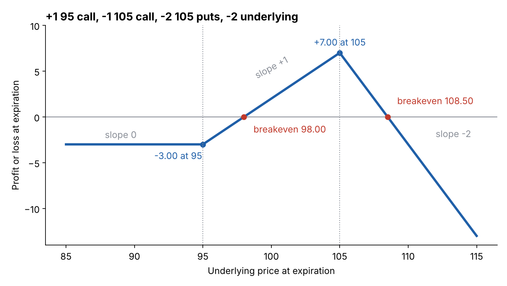

# Chapter 4: Expiration Profit and Loss

## Summary
At expiration an option is worth exactly its intrinsic value, so everyone can agree on what an option position is worth at that moment. Plotting that value against the underlying price gives a **parity graph** (the "hockey sticks"). Adding up **slopes** lets you draw the graph of any combination of options and underlying contracts, and shows that the same strategy can be built in several ways. Shifting the graph down by what you paid, or up by what you received, gives the **expiration profit and loss (P&L) graph**, from which you read **breakeven prices**. Buyers of options have limited risk and unlimited profit potential; sellers have the reverse, which raises the question of why anyone sells options. The answer, probability, is where the book heads next.

## Key concepts
- **Parity graph** - value of an option position at expiration against the underlying price; the four basic ones are called hockey-stick diagrams. [[concepts/04-expiration-profit-and-loss/parity-graphs]]
- **Slope** - change in position value per 1 change in the underlying. Out-of-the-money options: 0; long ITM call +1, short ITM call -1, long ITM put -1, short ITM put +1; long underlying +1, short underlying -1.
- **Slope method** - add contract slopes stretch by stretch to graph any position. [[concepts/04-expiration-profit-and-loss/slope-method-for-combined-positions]]
- **Equivalent positions** - different combinations with the same graph (e.g. long call + short put = long underlying). [[concepts/04-expiration-profit-and-loss/equivalent-positions]]
- **Debit / credit** - buying creates a debit, selling a credit.
- **Expiration P&L graph** - the parity graph shifted by the debit (down) or credit (up). [[concepts/04-expiration-profit-and-loss/expiration-pnl-and-breakeven]]
- **Breakeven price** - underlying price at which the P&L is zero.
- **Limited vs unlimited risk** - buyers lose at most the premium; sellers can lose without limit (puts are capped at the strike, since the underlying cannot go below zero).
- **Walking the slopes** - from one known P&L point, use the slopes to get P&L everywhere and all breakevens. [[concepts/04-expiration-profit-and-loss/complex-position-pnl-walkthrough]]

## Formulas
**Value at expiration** (long one contract; negate for short)

$$\text{call} = \max(0,\, S - X) \qquad \text{put} = \max(0,\, X - S)$$

**P&L at expiration**

$$\text{P\&L}_{\text{long}} = \text{value} - \text{price paid} \qquad \text{P\&L}_{\text{short}} = \text{price received} - \text{value}$$

**Breakevens for single options** (premium $p$)

$$\text{call: } S = X + p \qquad\qquad \text{put: } S = X - p$$

**Slope**

$$\text{slope} = \frac{\text{change in position value}}{\text{change in underlying price}}$$

**Walking along a stretch, and breakeven within it**

$$y_{\text{new}} = y_{\text{old}} + m \times \Delta x \qquad\qquad x_{\text{breakeven}} = x_0 - \frac{y_0}{m}$$

**Long call + short put at the same exercise price** (our derivation)

$$\max(0, S - X) - \max(0, X - S) = S - X$$

Full list in [[formulas]].

## Worked example
Underlying at 98.00. Position: +1 95 call at 6.25, -1 105 call at 1.75, -2 105 puts at 7.75, -2 underlying at 98.00.

- Slopes: below 95: $0 + 0 + 2 - 2 = 0$; 95 to 105: $+1 + 0 + 2 - 2 = +1$; above 105: $+1 - 1 + 0 - 2 = -2$.
- P&L at 95: $-6.25 + 1.75 - 4.50 + 6.00 = -3.00$.
- Walk: P&L at 105 $= -3.00 + 1 \times 10 = +7.00$.
- Breakevens: $95 + 3.00/1 = 98.00$ and $105 + 7.00/2 = 108.50$.

Single options from the same price list: a long 100 call at 3.50 breaks even at $100 + 3.50 = 103.50$; a short 95 put at 2.25 breaks even at $95 - 2.25 = 92.75$.

Everything above (plus the 8-option position) is recomputed in [[code/expiration_pnl.ipynb]].

## Concepts explained in detail
- [[concepts/04-expiration-profit-and-loss/parity-graphs]]
- [[concepts/04-expiration-profit-and-loss/slope-method-for-combined-positions]]
- [[concepts/04-expiration-profit-and-loss/equivalent-positions]]
- [[concepts/04-expiration-profit-and-loss/expiration-pnl-and-breakeven]]
- [[concepts/04-expiration-profit-and-loss/complex-position-pnl-walkthrough]]

## Maths I needed to recall
- [[00-maths-refresher/slope-and-straight-lines]] - slope, walking along a line, zero-crossings
- [[00-maths-refresher/max-function]] - the $\max(0, \cdot)$ in option values (from Chapter 3)
- [[00-maths-refresher/rearranging-formulas]] - solving for the breakeven

## Code
- [[code/expiration_pnl.ipynb]] - values, P&L, slopes and breakevens for any list of legs, with plots

## Notes on the book's text
- In the 62.00-to-81.50 walk-through the PDF prints "+3.50" twice where the correct value is +3.10.
- The legend of Figure 4-15 lists -5 75 calls and +3 80 calls, while the text position has -6 and +4.

## Open questions
- [ ] Why would anyone sell an option, given limited profit and unlimited risk? (The book says probability decides; Chapter 5 onward)
- [ ] Why are the parity graphs of "long call + short put" and "long underlying" the same, and how are their prices linked? (Chapter 14, where the book returns to building the same position in different ways)
- [ ] How does "speed" of the underlying (not just direction) affect option profits before expiration? (Chapter 5)
