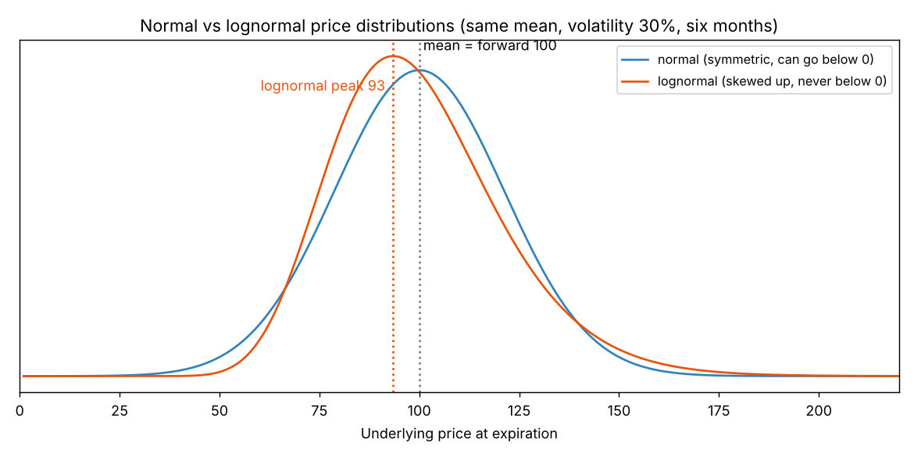
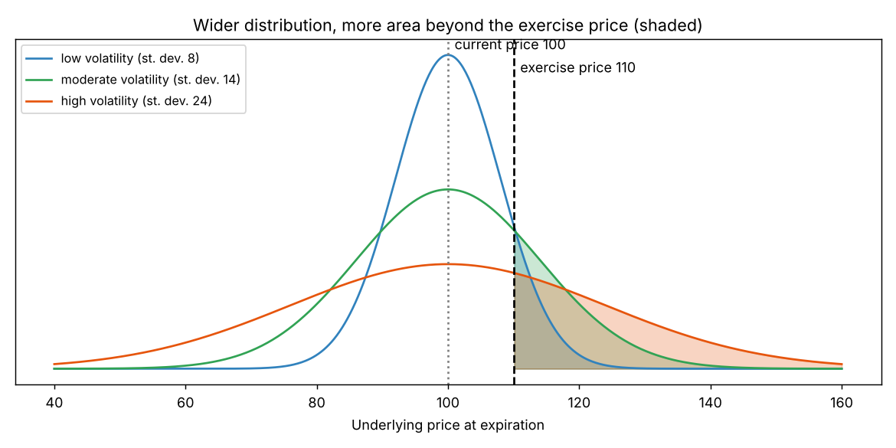

# Chapter 6: Volatility

## Summary
Volatility is the number that measures the **speed** of the market: how fast and how far the underlying price tends to move. If we assume the underlying price at expiration follows a bell-shaped **normal distribution**, two numbers describe it completely: the **mean** (centre) and the **standard deviation** (spread). The mean is the **forward price**, and the standard deviation is the **volatility**, quoted as an annual percentage. Volatility scales with the **square root of time** (daily volatility is annual volatility divided by about 16), so an annual figure tells you the likely daily, weekly or yearly price range. Real prices cannot go below zero, so models use a **lognormal** distribution (skewed upward) instead. Traders talk about two kinds of volatility: **realized** (what the underlying actually does) and **implied** (what an option's market price implies). Volatility drives option values: it matters most for at-the-money options in points, for out-of-the-money options in percent, and more for long-dated than short-dated options.

## Key concepts
- **Random walk** - a path where each step is random (the pinball maze); many walks form a bell curve. [[concepts/06-volatility/random-walks-and-normal-distributions]]
- **Normal distribution** - the symmetric bell curve described by a mean and a standard deviation. [[concepts/06-volatility/random-walks-and-normal-distributions]]
- **Mean and standard deviation** - the centre and the spread; $\pm 1$, $\pm 2$, $\pm 3$ standard deviations cover about 68.3%, 95.4%, 99.7% of outcomes. [[concepts/06-volatility/mean-and-standard-deviation]]
- **Volatility** - a trader's word for standard deviation, written $\sigma$; annualized and expressed as a percentage of the price. [[concepts/06-volatility/volatility-as-a-standard-deviation]]
- **Forward price as the mean** - the distribution is centred on the forward price, not today's price. [[concepts/06-volatility/volatility-as-a-standard-deviation]]
- **Scaling volatility for time** - multiply by $\sqrt{t}$; daily $\approx \sigma/16$, weekly $\approx \sigma/7.2$. [[concepts/06-volatility/scaling-volatility-for-time]]
- **Checking volatility against observed price changes** - are the daily moves we see consistent with the volatility we assumed? [[concepts/06-volatility/checking-volatility-against-price-changes]]
- **Rate volatility vs price volatility** - for Eurodollar-type contracts, use the rate ($100 -$ price). [[concepts/06-volatility/interest-rate-products-and-rate-volatility]]
- **Lognormal distribution** - prices bounded by zero, skewed up; follows from continuously compounded returns. [[concepts/06-volatility/lognormal-distributions]]
- **Realized volatility** - annualized standard deviation of percent price changes (historical or future). [[concepts/06-volatility/realized-volatility]]
- **Implied volatility** - the volatility that makes the model value equal the option's market price. [[concepts/06-volatility/implied-volatility]]
- **Volatility and option values** - three principles on which options react most to volatility. [[concepts/06-volatility/volatility-and-option-values]]

## Formulas
**Range of likely prices** (mean $F$, volatility $\sigma$ per year, one year ahead)

$$F \pm k \times (\sigma \times F), \qquad k = 1, 2, 3 \;\Rightarrow\; 68.3\%,\; 95.4\%,\; 99.7\%$$

**Forward price of a stock with no dividend** (simple interest $r$, time $t$ in years)

$$F = S\,(1 + r\,t)$$

**Volatility over a different period** (time $t$ in years)

$$\sigma_t = \sigma_{\text{annual}} \times \sqrt{t}$$

**Daily and weekly one-standard-deviation price moves** (price $S$, 256 trading days, 52 weeks)

$$\text{daily} \approx S \times \frac{\sigma}{16} \qquad\qquad \text{weekly} \approx S \times \frac{\sigma}{7.2}$$

**Compounding** (principal $P$, annual rate $r$, $n$ payments a year, one year)

$$P\left(1 + \frac{r}{n}\right)^{n} \;\longrightarrow\; P\,e^{r} \quad\text{as } n \text{ grows without limit}$$

**Realized volatility** (daily log changes $u_i = \ln(P_i / P_{i-1})$, standard deviation $s$ of those changes)

$$\sigma_{\text{realized}} = s \times \sqrt{\text{trading days per year}} \;\approx\; s \times 16$$

**Implied volatility** (the $\sigma$ that solves this, all other inputs known)

$$\text{model}(S, X, t, r, \sigma) = \text{market price}$$

Symbols and intuition for each are in [[formulas]].

## Worked example
**Daily and weekly ranges (stock at 45, annual volatility 37%).**

| | One standard deviation | Range, 1 st. dev. (about 68%) | Range, 2 st. dev. (about 95%) |
|---|---|---|---|
| One day | $45 \times 0.37/16 = 1.04$ | 43.96 to 46.04 | 42.92 to 47.08 |
| One week | $45 \times 0.37/7.2 = 2.31$ | 42.69 to 47.31 | 40.38 to 49.62 |

**Are five daily changes consistent with 37%?** The changes were $+0.98, -0.65, -0.70, +0.25, -0.85$. A move bigger than 1.04 should occur about one day in three, so we expect one or two in five days. We saw none. The realized volatility of those five changes is **27.8%**, which is well below 37%, so either it was an unusual week or 37% is too high. Five days is a small sample; traders look at 20, 50 or 100 days.

**Implied volatility of the 105 call.** Stock 98.50, three months, 6% interest, no dividend.
1. Our volatility estimate of 25% gives a theoretical value of **2.94**.
2. The market price is **3.60**, so the option looks 0.66 overpriced.
3. What input could explain 3.60? The stock would have to be 100.16 (outside any bid-ask spread), or interest 13.30% (absurd), so the explanation is volatility.
4. Raise volatility until the model gives 3.60: **28.50%**. That is the implied volatility.
5. In volatility terms the call is $28.50 - 25.00 = 3.50$ volatility points overpriced.

**Normal vs lognormal.** Forward 100, six months, volatility 30%. A 90 put and a 110 call are both 10% out of the money. A normal distribution gives them the same value (the book: 4.37 each). A lognormal one gives the call more (book: 90 put 4.00, 110 call 4.74), because upside has no limit while downside stops at zero.

**More volatility, more value, for every option.** More of a wider distribution lies beyond the exercise price, so calls and puts both gain.

Everything is recomputed in [[code/volatility.ipynb]], including the gold-option tables.

## Concepts explained in detail
- [[concepts/06-volatility/random-walks-and-normal-distributions]]
- [[concepts/06-volatility/mean-and-standard-deviation]]
- [[concepts/06-volatility/volatility-as-a-standard-deviation]]
- [[concepts/06-volatility/scaling-volatility-for-time]]
- [[concepts/06-volatility/checking-volatility-against-price-changes]]
- [[concepts/06-volatility/interest-rate-products-and-rate-volatility]]
- [[concepts/06-volatility/lognormal-distributions]]
- [[concepts/06-volatility/realized-volatility]]
- [[concepts/06-volatility/implied-volatility]]
- [[concepts/06-volatility/volatility-and-option-values]]

## Maths I needed to recall
- [[00-maths-refresher/standard-deviation-and-variance]] - how a standard deviation is calculated; why spread grows with $\sqrt{t}$
- [[00-maths-refresher/normal-distribution-and-z-scores]] - the bell curve, "how many standard deviations away", probabilities from the 68-95-99.7 rule
- [[00-maths-refresher/exponentials-and-natural-logs]] - $e^x$, $\ln x$, continuous compounding, log returns
- [[00-maths-refresher/probability-and-expected-value]] - mean as expected value (from Chapter 5)
- [[00-maths-refresher/rearranging-formulas]] - solving for a quantity inside a formula

## Code
- [[code/volatility.ipynb]] - normal probabilities, scaling, the five-day check, compounding, normal vs lognormal values, implied volatility by bisection, the gold-option tables, and all figures

## Notes on the book's text
- The book says crude oil "rose 58 percent" from 99 to 144. By our arithmetic $144/99 - 1 = 45\%$. The fall from 144 to 45 is $-69\%$ as stated.
- The book rounds the maze's mean and standard deviation to 7.50 and 3.00 (actual 7.49 and 3.02) and says the maze could "also represent" 15 coin flips. Our check: 15 fair flips have mean 7.5 but standard deviation $\sqrt{15 \times 0.25} = 1.94$, so the maze in the figure is wider than a real 15-flip experiment. It is only an illustration of the shape.
- Weekly standard deviation: the book writes $20\%/7.2 \approx 2.78$; exactly, $\sqrt{52} = 7.211$, giving 2.77.
- Our recomputed values differ slightly from the book in places (the book does not state every convention): normal-model option values 4.39 (book 4.37); lognormal 90 put 3.99 (4.00) and 110 call 4.75 (4.74); implied volatility of the stale-price case 26.93% (26.95%); 100 call 27.53% (27.51%); interest rate needed 13.29% (13.30%). The gold tables match to within a few hundredths.
- Percent changes in the gold tables are computed from rounded values in the book, so a few differ by a point or two from ours (for example the 1800 October call: 291% printed, 293% from unrounded values).

## Open questions
- [ ] How is the Black-Scholes value actually calculated from $\sigma$, and what are $d_1$ and $d_2$? (Later chapters; the notebook uses the formula as a tool)
- [ ] The book says implied volatility differs across exercise prices (the 22.36% to 17.68% to 20.46% pattern in the gold table). Why? (this pattern is often called the volatility skew; the book does not explain it here)
- [ ] Put-call parity: why do calls and puts with the same exercise price have almost the same implied volatility? (Chapter 15)
- [ ] How do you forecast volatility rather than just measure past volatility? (the book says later chapters)
- [ ] How do risk measures like the vega quantify "which options react most to volatility"? (Chapter 7)
- [ ] When the book moves from price changes to log changes, how large is the difference? (footnote says usually small; we saw 27.8% with log changes versus about 27.9% by dollar changes)
