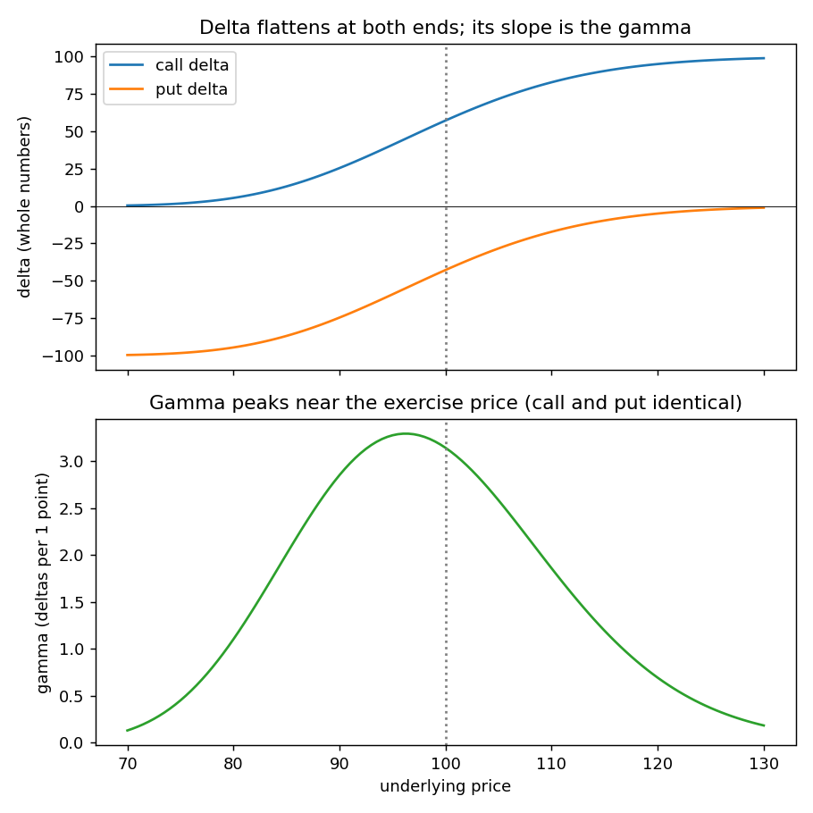

# Chapter 7: Risk Measurement I

## Summary
A stock position has one risk: direction. An option position has many, because every model input (underlying price, volatility, time, interest rate, dividends) can change or be estimated wrongly. The chapter first gives the **directions** each input pushes option values, including the surprisingly tricky effects of interest rates and dividends through the **forward price**, and why the right interest rate depends on whether a trader hedges with **long or short stock**. It then introduces the **risk measures** ("the Greeks") that put numbers on the sizes: **delta** (direction), **gamma** (how fast delta changes), **theta** (time decay), **vega** (volatility) and **rho** (interest rates). Risk measures **add up** across a position, so a trader can read a complex position as five numbers plus the **theoretical edge**, and ask what the market must do for the position to profit. The chapter ends on interpreting a table of five example positions.

## Key concepts
- **Direction rules** - calls rise with the underlying and volatility, puts fall with the underlying, both lose to time. [[concepts/07-risk-measurement-i/what-moves-option-values]]
- **Interest rates and dividends** - act through the forward price and the present value; for stock options the forward effect wins. [[concepts/07-risk-measurement-i/interest-rates-dividends-and-option-values]]
- **Long vs short stock** - a short-stock hedge earns the lower short rate, which lowers the forward price, so calls are worth less and puts more; avoid short stock when possible. [[concepts/07-risk-measurement-i/long-vs-short-stock-and-option-values]]
- **Call plus short put is a forward** - the idea behind "lower forward means lower $C - P$". [[concepts/07-risk-measurement-i/synthetic-forward-and-put-call-parity]]
- **Futures and currency options** - settlement type and two rates change the interest-rate story. [[concepts/07-risk-measurement-i/futures-and-currency-options-interest-rates]]
- **Delta** - option's slope; also hedge ratio, equivalent underlying position and (roughly) probability of finishing in the money. [[concepts/07-risk-measurement-i/delta]]
- **Gamma** - slope of delta; positive for long options (calls and puts), negative for short; measure of speed and magnitude. [[concepts/07-risk-measurement-i/gamma]]
- **Estimating a new option value** - use the average delta: $C + \Delta S \times \Delta + \tfrac12 (\Delta S)^2 \times \Gamma$. [[concepts/07-risk-measurement-i/estimating-option-value-with-delta-and-gamma]]
- **Theta** - value lost per day; grows near expiration; rarely positive. [[concepts/07-risk-measurement-i/theta]]
- **Vega** - value change per volatility point; positive for all long options; largest near the money. [[concepts/07-risk-measurement-i/vega]]
- **Rho** - value change per interest-rate point; sign depends on the underlying and settlement. [[concepts/07-risk-measurement-i/rho]]
- **The underlying's risk measures and position sums** - underlying is delta 100, all else 0; measures add. [[concepts/07-risk-measurement-i/risk-measures-of-the-underlying-and-signs]]
- **Theoretical edge** - how far above theoretical value you sell or below you buy; check it first. [[concepts/07-risk-measurement-i/theoretical-edge]]
- **Reading a position's risk table** - sum the measures, then read the signs. [[concepts/07-risk-measurement-i/reading-a-position-risk-table]]
- **Gamma and theta trade off** - opposite signs, sizes move together. [[concepts/07-risk-measurement-i/gamma-and-theta-trade-off]]
- **Breakeven volatility** - the implied volatility of a position: $\sigma_0 - E / \text{vega}$. [[concepts/07-risk-measurement-i/breakeven-volatility-of-a-position]]

## Formulas
**Forward price with a financing rate** (stock, dividend $D$, rate $r$ for time $t$; $r = r_l$ if long stock, $r = r_s$ if short)

$$F = S\,(1 + r\,t) - D$$

**Call minus put** (simple interest, preview of put-call parity)

$$C - P = \frac{F - K}{1 + r\,t}$$

**Delta as a hedge ratio** and **neutral position**

$$\text{underlying per option} = \frac{100}{\Delta} \qquad \text{position delta} = \sum (\text{quantity} \times \Delta)$$

**New delta after a move** ($\Delta S = S_2 - S_1$)

$$\Delta_{\text{new}} = \Delta + \Delta S \times \Gamma$$

**New option value with delta and gamma**

$$C_{\text{new}} \approx C + \Delta S \times \Delta + \tfrac12 (\Delta S)^2 \times \Gamma$$

**Revaluing with vega and breakeven volatility**

$$\text{new value} \approx \text{old value} + \Delta\sigma \times \text{vega} \qquad \sigma_{\text{breakeven}} \approx \sigma_0 - \frac{E}{\text{vega}}$$

**Theoretical edge**

$$E = \sum \text{quantity} \times (\text{theoretical value} - \text{price}) \qquad (+\ \text{bought},\ -\ \text{sold}; \text{underlying has } E = 0)$$

Symbols and intuition for each are in [[formulas]].

## Worked example
**A position's risk (Position 1, Figures 7-13 and 7-14).** Sell 10 June 95 calls at 8.55 (theoretical 8.33, delta 71, gamma 2.8, theta $-0.034$, vega 0.170, rho 0.155) and buy 7 underlying contracts.

| Measure | Calculation | Total |
|---|---|---|
| Edge | $10 \times (8.55 - 8.33)$, plus 0 for the underlying | $+2.20$ |
| Delta | $-10 \times 71 + 7 \times 100 = -710 + 700$ | $-10$ |
| Gamma | $-10 \times 2.8$ | $-28$ |
| Theta | $-10 \times (-0.034)$ | $+0.34$ |
| Vega | $-10 \times 0.170$ | $-1.70$ |
| Rho | $-10 \times 0.155$ | $-1.55$ |

Reading it: delta about neutral; **negative gamma** and **positive theta** say "I want a quiet market and I earn about 0.34 a day if nothing moves"; **negative vega** says I want implied volatility to fall; the worst case is a swift upward move (wrong on direction and speed). With delta $-10$ and gamma $-28$: the delta path is $-10 \to -38 \to -66$ as the stock rises two points, and $-10 \to +18 \to +46$ as it falls two. The breakeven volatility is $25 - 2.20/(-1.70) = 26.29\%$ (the book prints 27.29%).

**New value from delta and gamma.** The book's example: call 3.65, delta 40, gamma 2.5, the underlying rises 4.00. New delta $40 + 4 \times 2.5 = 50$; average delta 45; new value $3.65 + 4 \times 0.45 = 5.45$.

**Long vs short stock.** Forward with $r_l = 6\%$: 69.02; with $r_s = 4\%$: 68.13. A lower forward means calls are worth less, puts more.

Everything is recomputed in [[code/risk_measures.ipynb]].

## Concepts explained in detail
- [[concepts/07-risk-measurement-i/what-moves-option-values]]
- [[concepts/07-risk-measurement-i/interest-rates-dividends-and-option-values]]
- [[concepts/07-risk-measurement-i/long-vs-short-stock-and-option-values]]
- [[concepts/07-risk-measurement-i/synthetic-forward-and-put-call-parity]]
- [[concepts/07-risk-measurement-i/futures-and-currency-options-interest-rates]]
- [[concepts/07-risk-measurement-i/delta]]
- [[concepts/07-risk-measurement-i/gamma]]
- [[concepts/07-risk-measurement-i/estimating-option-value-with-delta-and-gamma]]
- [[concepts/07-risk-measurement-i/theta]]
- [[concepts/07-risk-measurement-i/vega]]
- [[concepts/07-risk-measurement-i/rho]]
- [[concepts/07-risk-measurement-i/risk-measures-of-the-underlying-and-signs]]
- [[concepts/07-risk-measurement-i/theoretical-edge]]
- [[concepts/07-risk-measurement-i/reading-a-position-risk-table]]
- [[concepts/07-risk-measurement-i/gamma-and-theta-trade-off]]
- [[concepts/07-risk-measurement-i/breakeven-volatility-of-a-position]]

## Maths I needed to recall
- [[00-maths-refresher/derivatives-and-rates-of-change]] - slope of a curve, second derivative, partial derivatives, using slopes to estimate changes
- [[00-maths-refresher/slope-and-straight-lines]] - slope of a line (Chapter 4)
- [[00-maths-refresher/present-value-and-discounting]] - dividing by $1 + rt$
- [[00-maths-refresher/rearranging-formulas]] - solving for the breakeven volatility
- [[00-maths-refresher/simple-interest-and-time-fractions]] - $1 + rt$ in the forward price

## Code
- [[code/risk_measures.ipynb]] - recomputes Figure 7-13 (all risk measures), checks every total in Figure 7-14, the delta-plus-gamma estimate, theta near expiration and positive theta, position 1's breakeven volatility, rho, and all four figures

## Notes on the book's text
We found several slips while recomputing. None affects the ideas, but note them when checking arithmetic.
- **Formulas for estimating option value** use $S_1 - S_2$ for the price change; it should be $S_2 - S_1$ (the prose and example use the latter). [[concepts/07-risk-measurement-i/estimating-option-value-with-delta-and-gamma]]
- **Breakeven volatility of Position 1** is printed as 27.29%; the arithmetic gives $25 + 2.20/1.70 = 26.29\%$ (exact model: 26.31%). [[concepts/07-risk-measurement-i/breakeven-volatility-of-a-position]]
- **Figure 7-13 prices for the June 100 call and put** (5.35 and 4.35) look like typos: Figure 7-14 positions 2, 4 and 5 are only consistent with 5.55 and 4.55. This also explains the negative edge in Position 2, which the book says "is not a misprint". [[concepts/07-risk-measurement-i/theoretical-edge]]
- **Figure 7-14 totals:** Position 2 rho (+0.30 printed, +0.03 computed), Position 3 delta ($-10$ vs $-20$) and rho (+0.11 vs $-0.11$), Position 4 gamma ($-12$ vs +12). [[concepts/07-risk-measurement-i/reading-a-position-risk-table]]
- **Figure 7-13:** put 105 vega 0.195 (should be 0.192) and put 95 theta printed "$-0.0.19$".
- **Delta-neutral example:** the book appears to print "$+4 \times -75$" for the four *sold* puts; the sign of the 4 should be negative. [[concepts/07-risk-measurement-i/delta]]
- **Figures 7-2 and 7-12 as extracted from the PDF** seem to contain a few sign slips (futures option, stock-type, rates falling; delta of a short underlying; rho of short stock puts); the notes follow the logic. [[concepts/07-risk-measurement-i/futures-and-currency-options-interest-rates]], [[concepts/07-risk-measurement-i/risk-measures-of-the-underlying-and-signs]]
- **Negative time value example** (60 call, underlying 100): works cleanly for an option on a *futures* contract; for a no-dividend stock call the forward price is above the stock price and theta stays negative. [[concepts/07-risk-measurement-i/theta]]
- Footnotes 5 and 6 in the book are the same text repeated.

## Open questions
- [ ] Where do the formulas for delta, gamma, theta, vega and rho come from? (The chapter treats them as numbers a model produces; later chapters and the Black-Scholes formula.)
- [ ] Why is the delta only approximately the probability of finishing in the money, and what number is the exact probability? (Footnote: "we will see later that the Black-Scholes model generates a number that more precisely reflects this probability.")
- [ ] How are gamma and theta linked mathematically, and does the relation hold for all options? (We gave the Black-Scholes equation as a pointer in [[concepts/07-risk-measurement-i/gamma-and-theta-trade-off]].)
- [ ] Why can a European option have negative time value, in general? (Chapter 16; this chapter only gave the futures-option example.)
- [ ] How do the risk measures change as market conditions change (Chapter 9), and how are they used to keep a hedge neutral (Chapter 8)?
- [ ] Which hedge rate would I really face as an individual trader (long stock only)? Is the short-stock effect irrelevant for me?
