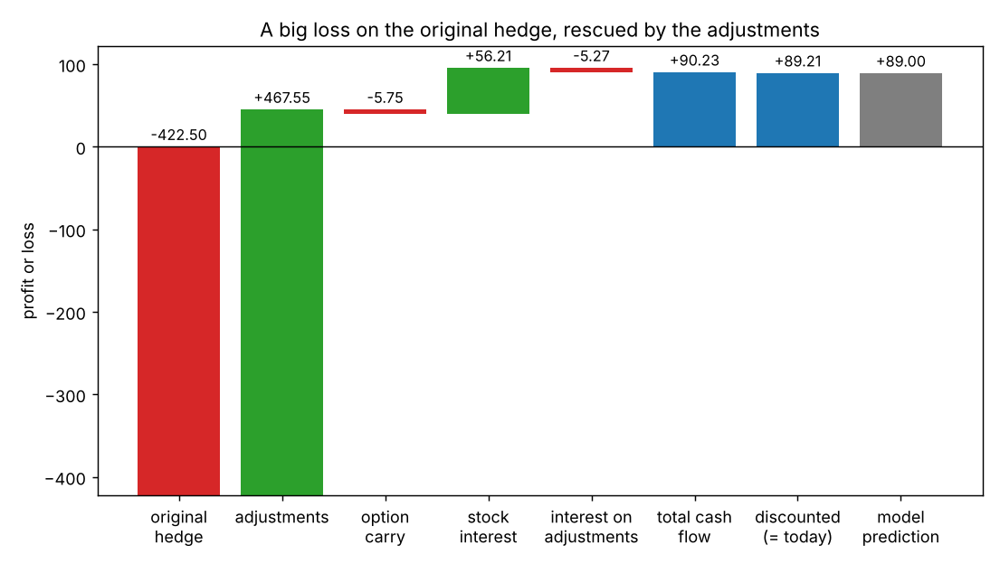
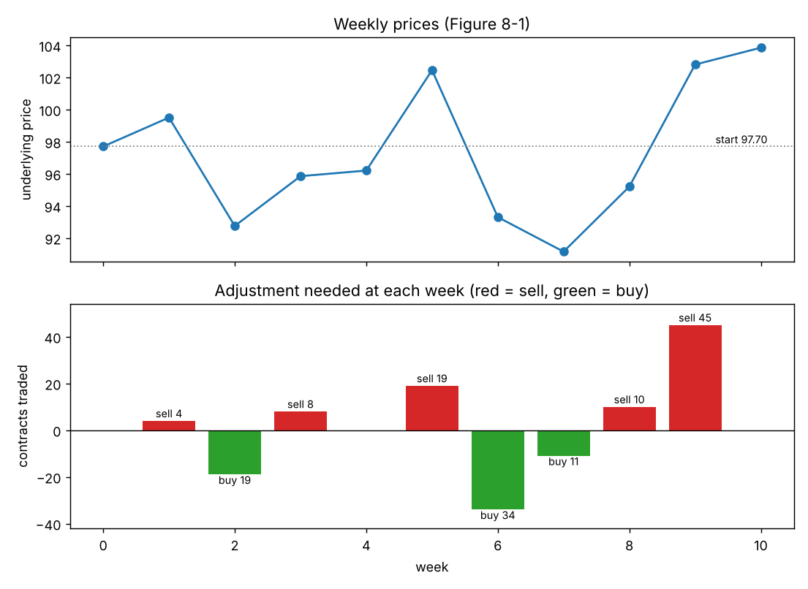
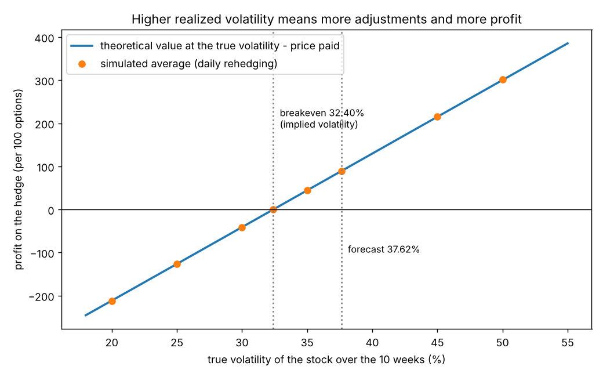

# Chapter 8: Dynamic Hedging

## Summary
A pricing model tells us what an option is worth, but one trade can still lose money even when every input is right, because the model is built on probability. The model also offers a way to cut down the luck: treat the option's life as a **series of small bets** instead of one big bet. Buy an underpriced option (or sell an overpriced one), hedge it to be **delta neutral**, and then **adjust** the hedge every so often to stay neutral. The adjustments force you to sell after the price rises and buy after it falls, and the cash from them, plus interest, adds up to about the theoretical edge. The book shows this on two examples (a call bought at 5.00 worth 5.89, a put sold at 1.70 worth 1.46) where the hedge earns 89.21 and 23.96 against predictions of 89.00 and 24.00. The rest of the chapter covers the real-world limits (costs, rehedging frequency, what happens if volatility is different from the forecast) and ends with a key principle: **a dynamic hedge replicates an option, and the present value of its cash flows equals the option's theoretical value.**

## Key concepts
- **Models are probability based** - one trade can lose; only over many trades do results approach the model. The hedge turns one bet into many. [[concepts/08-dynamic-hedging/series-of-bets-and-dynamic-hedging]]
- **Delta-neutral hedge and adjustments** - hold the opposite delta in the underlying, and trade the underlying again whenever the total delta drifts from zero. [[concepts/08-dynamic-hedging/delta-neutral-adjustments]]
- **Static vs dynamic hedge** - a static hedge is set up once and held to maturity (Chapter 17); a dynamic hedge is re-balanced over the whole life of the option. [[concepts/08-dynamic-hedging/delta-neutral-adjustments]]
- **Buy low, sell high** - when the price rises the call's delta rises, so we sell the underlying; when it falls we buy. [[concepts/08-dynamic-hedging/delta-neutral-adjustments]]
- **The full walkthrough** - Figure 8-1 week by week: original hedge loses 422.50, adjustments gain 467.55. [[concepts/08-dynamic-hedging/stock-option-hedge-walkthrough]]
- **Five P&L components and discounting** - original hedge, adjustments, option carry, interest on stock, interest on adjustments; then discount to today. [[concepts/08-dynamic-hedging/hedge-pnl-components-and-discounting]]
- **The unhedged amount** - because the option's value curve bends (gamma), the hedge is slightly off for any move; rehedging collects that gap again and again. [[concepts/08-dynamic-hedging/gamma-and-the-unhedged-amount]]
- **How often to rehedge, and frictions** - regular intervals or a delta band; costs, retail vs professional; more adjustments do not change the average, only the luck. [[concepts/08-dynamic-hedging/rehedging-frequency-and-costs]]
- **Realized volatility and the race** - profit depends on how much the underlying actually moves; the breakeven volatility is the option's implied volatility at the price paid. [[concepts/08-dynamic-hedging/realized-volatility-and-the-race]]
- **Implied volatility moves** - if implied volatility rises to our forecast we can close early; if it falls first we show a temporary loss but the plan is unchanged. [[concepts/08-dynamic-hedging/implied-volatility-moves-and-holding-the-hedge]]
- **Futures options and variation** - the same idea for a sold put on a futures contract, with variation cash flows instead of stock proceeds. [[concepts/08-dynamic-hedging/futures-option-hedge-and-variation]]
- **Replication principle** - a dynamic hedge replicates an option; the present value of its cash flows is the theoretical value. [[concepts/08-dynamic-hedging/option-replication-and-the-hedging-principle]]

## Formulas
**Delta-neutral hedge and adjustment** (delta in whole numbers; $+$ for bought, $-$ for sold or short)

$$\text{total delta position} = \sum (\text{quantity} \times \Delta) \qquad \text{adjustment (contracts)} = \frac{\text{total delta position}}{100}$$

If the total is positive, **sell** that many contracts; if negative, **buy**.

**Interest on a cash flow** (simple interest, $r$ per year, remaining days)

$$\text{interest} = \text{cash flow} \times r \times \frac{\text{days left}}{365}$$

**Discounting the total to today**

$$\text{P\&L today} = \frac{\text{total cash flow at expiration}}{1 + r \times \dfrac{70}{365}}$$

**Predicted P&L of the hedge** (options bought; reverse the sign if sold)

$$\text{predicted P\&L} = \text{number of options} \times (\text{theoretical value} - \text{price paid})$$

**Variation on futures** (price change times futures held; a short position gains when the price falls)

$$\text{variation} = \text{number short} \times (\text{old price} - \text{new price})$$

**Replication principle** (the chapter's closing statement)

$$\text{theoretical value} = \text{present value of the sum of all cash flows of the dynamic hedge}$$

**Our link to Chapter 7: what one interval of a hedged option earns** (not printed in this chapter; ignores interest)

$$\text{hedged P\&L over one interval} \approx \tfrac12\,\Gamma\,(\Delta S)^2 + \Theta \times (\text{days})$$

Symbols and intuition for each are in [[formulas]].

## Worked example
**Stock example (Figures 8-1 and 8-2).** Stock 97.70, June 100 call, 10 weeks (70 days), interest 6%, forecast volatility 37.62%. Theoretical value 5.89, price 5.00, delta 50. Buy 100 calls, sell 50 underlying contracts: $100 \times 50 - 50 \times 100 = 0$ deltas.

| Component | Calculation | Result |
|---|---|---|
| Original hedge, option | $100 \times (3.85 - 5.00)$ | $-115.00$ |
| Original hedge, stock | $50 \times (97.70 - 103.85)$ | $-307.50$ |
| **Adjustments** | sum of the weekly trades and the final buy-back | $+467.55$ |
| Carry on the options | $-500 \times 6\% \times 70/365$ | $-5.75$ |
| Interest on the stock proceeds | $4{,}885 \times 6\% \times 70/365$ | $+56.21$ |
| Interest on the adjustments | each week's cash $\times\, 6\% \times$ days left$/365$ | $-5.27$ |
| **Total cash flow** | | $+90.24$ |
| **Discounted to today** | $90.24 / (1 + 0.06 \times 70/365)$ | $+89.21$ |
| Predicted by the model | $100 \times (5.89 - 5.00)$ | $+89.00$ |

Week 1, for instance: the stock rose to 99.50, the call delta went from 50 to 54, so the total is $100 \times 54 - 50 \times 100 = +400$ deltas. Sell 4 underlying contracts at 99.50 (cash $+398.00$), and we are neutral again with 54 short.

**Futures example (Figures 8-4 and 8-5).** Futures 61.85, March 60 put, 10 weeks, interest 8%, true volatility 21.48%. Theoretical value 1.46, price 1.70 (implied volatility 23.92%), delta $-35$. Sell 100 puts and 35 futures. Total: original hedge $+144.40$, adjustments $-122.01$, interest on options $+2.61$, interest on variation $-0.67$, so $+24.33$; discounted $+23.96$ against a prediction of $100 \times (1.70 - 1.46) = +24.00$.

**Breakeven volatility.** At a true volatility of 37.62% the hedge makes about 89; at 32.40% (the implied volatility of the 5.00 price) it makes nothing; below that it loses. Our simulation (10,000 random paths, daily rehedging) gives averages of $-212$ at 20%, $-41$ at 30%, $0$ at 32.4%, $+89$ at 37.62% and $+302$ at 50%.

**Rehedging more often narrows the spread, not the average.** Simulation of the same hedge: just the original hedge gives an average near 86 but a standard deviation of about 487 and a loss half the time; 10 rehedges give about 171 and 29%; 70 give about 67 and 8%; 280 give about 34 and 1%.

## Concepts explained in detail
- [[concepts/08-dynamic-hedging/series-of-bets-and-dynamic-hedging]]
- [[concepts/08-dynamic-hedging/delta-neutral-adjustments]]
- [[concepts/08-dynamic-hedging/stock-option-hedge-walkthrough]]
- [[concepts/08-dynamic-hedging/hedge-pnl-components-and-discounting]]
- [[concepts/08-dynamic-hedging/gamma-and-the-unhedged-amount]]
- [[concepts/08-dynamic-hedging/rehedging-frequency-and-costs]]
- [[concepts/08-dynamic-hedging/realized-volatility-and-the-race]]
- [[concepts/08-dynamic-hedging/implied-volatility-moves-and-holding-the-hedge]]
- [[concepts/08-dynamic-hedging/futures-option-hedge-and-variation]]
- [[concepts/08-dynamic-hedging/option-replication-and-the-hedging-principle]]

## Maths I needed to recall
- [[00-maths-refresher/signs-and-running-totals]] - plus and minus for buy/sell and long/short, total delta position, running totals of contracts
- [[00-maths-refresher/simple-interest-and-time-fractions]] - interest for 70 days, 63 days, 56 days...
- [[00-maths-refresher/present-value-and-discounting]] - dividing the final total by $1 + rt$
- [[00-maths-refresher/derivatives-and-rates-of-change]] - delta as a slope, gamma as the bend, estimating changes
- [[00-maths-refresher/standard-deviation-and-variance]] - the "spread" of the simulated results
- [[00-maths-refresher/summation-notation]] - adding up the weekly cash flows

## Code
- [[code/dynamic_hedging.ipynb]] - rechecks the model value, delta and implied volatility; rebuilds Figures 8-1, 8-2, 8-4 and 8-5 from the book's prices and deltas; simulates 20,000 random price paths to compare rehedging frequencies and true volatilities; draws all five figures in the notes

## Notes on the book's text
We found a few slips while recomputing. None affects the ideas.
- **Interest on the adjustments:** the text (page 124) says a total of $-5.28$; Figure 8-2 prints $-5.27$, which is what the weekly column sums to. The total cash flow is printed 90.24 (the rounded components add to 90.24; unrounded we get 90.23).
- **Volatility 37.62% vs 37.65%:** the text twice says 37.65% (pages 121 and 131) but everywhere else, including the figure and the 89.00 prediction, uses 37.62%. We treat 37.65% as a typo.
- **Figure 8-4, week 7 variation:** printed 29.98; the correct figure is $21 \times (62.88 - 61.50) = 28.98$. Only 28.98 gives the printed adjustment total of $-122.01$. [[concepts/08-dynamic-hedging/futures-option-hedge-and-variation]]
- **Figure 8-4, week 9 total delta position:** printed $-3{,}000$ but the trade is "Sell 30", and in every other row a sell goes with a *positive* total. It should read $+3{,}000$.
- **"Carefully constructed":** the book says outright that the near-perfect match between 89.21 and 89.00 was engineered. Our simulation shows the *average* really is near the prediction, but a single run is typically off by tens (standard deviation about 67 with daily rehedging).
- **Delta-band illustration (page 129-130):** the book looks only at which weekly adjustments in Figure 8-1 are small enough to skip. If you actually skip one, later deltas and trades change, so it is only a rough guide. [[concepts/08-dynamic-hedging/rehedging-frequency-and-costs]]

## Open questions
- [ ] Why does the sum of the "unhedged amounts" equal the option's value in the limit of continuous rehedging? (Chapter 8 states it; the proof is the Black-Scholes argument, Chapters 18 and 19.)
- [ ] Which volatility should the hedge deltas use: my forecast, or the market's implied volatility? (The book uses the forecast throughout; our simulation also did. Chapters 20 and 23.)
- [ ] How do real traders choose a rehedging interval or delta band given costs and risk limits? (The book only says it depends on cost structure and risk tolerance.)
- [ ] What goes wrong when volatility is not constant or the price jumps (so the hedge cannot be adjusted in time)? (Chapter 23: "Trading Is Continuous", "Volatility Is Constant".)
- [ ] How does the same hedge work in practice with dividends and hard-to-borrow stock for the short-stock leg? (We only noted the dividend rule in this chapter; Chapters 2 and 7 for borrowing.)
