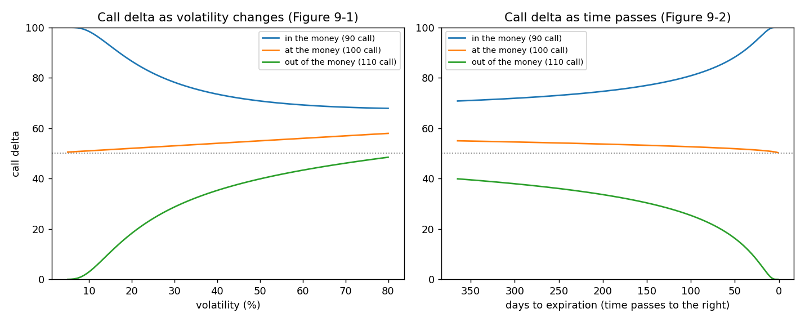
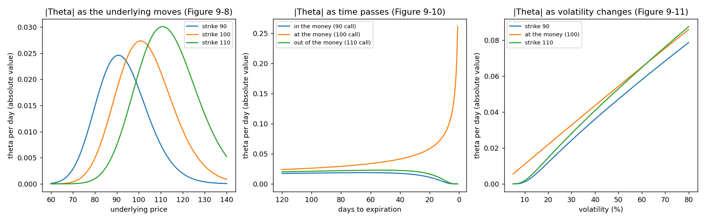
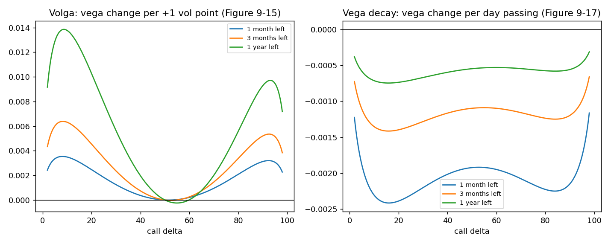
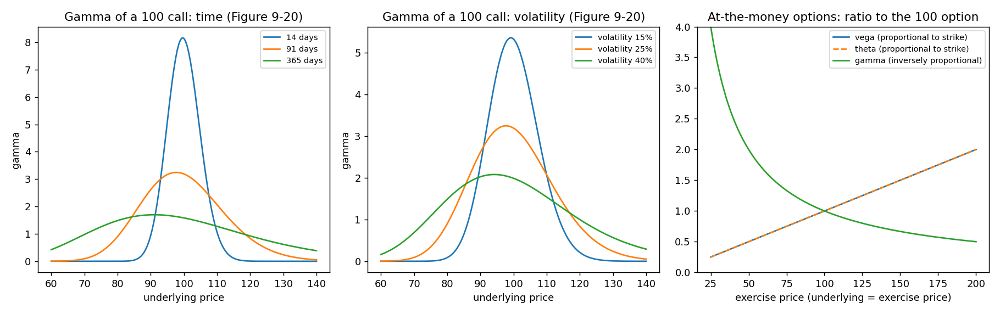
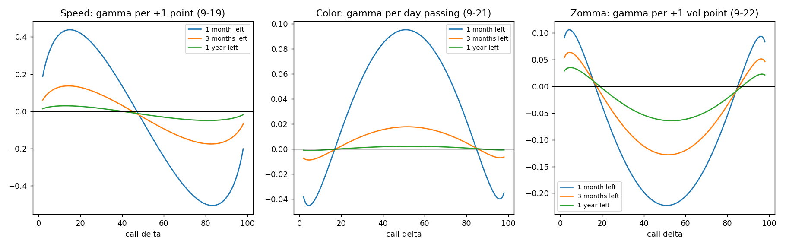
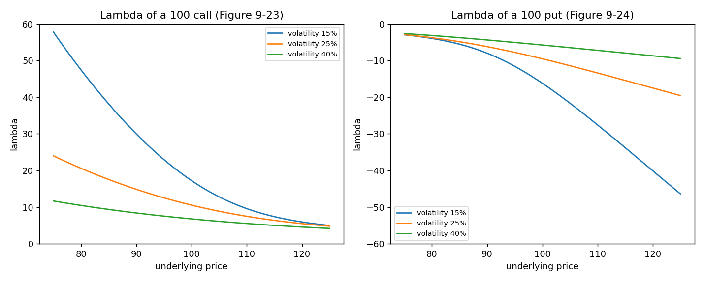

# Chapter 9: Risk Measurement II

## Summary
The numbers from Chapter 7 (delta, gamma, theta, vega) describe an option **today, in today's market**. This chapter asks what happens to those numbers when the market changes: the underlying moves, volatility moves, or simply a day goes by. The answer is that every one of them changes, and the changes have their own names (vanna, charm, volga, vega decay, speed, color, zomma), all of them "the sensitivity of a sensitivity". A small set of patterns explains almost everything: **gamma, theta and vega are greatest at the money**; **time and volatility usually have similar effects** (more of either pushes deltas toward 50 and flattens at-the-money gamma); and **at-the-money options close to expiration in a quiet market are the riskiest**, because their gamma is huge and their deltas can swing from near 0 to near 100 on a small move. The chapter also gives a way to estimate the theta of an at-the-money option, introduces **lambda** (the percentage version of delta, or leverage), and ends with two summary tables of where each measure is largest. The lesson is the one in the first paragraph: "nothing remains constant."

## Key concepts
- **Everything changes** - the traditional measures shift with price, volatility and time; the names for those shifts are the second- and third-order sensitivities. [[concepts/09-risk-measurement-ii/higher-order-sensitivities-and-their-names]]
- **Time and volatility act alike** - more time is like higher volatility. In the model they enter only through $\sigma\sqrt{t}$. [[concepts/09-risk-measurement-ii/time-and-volatility-have-similar-effects]]
- **Delta moves toward 50 as volatility or time rises** - out-of-the-money call deltas rise, in-the-money ones fall; the reverse as either falls. So a hedge can become unbalanced without the underlying moving, and the **implied delta** changes with implied volatility. [[concepts/09-risk-measurement-ii/delta-changes-with-volatility-and-time]]
- **Vanna and charm** - how fast delta changes with volatility and with the passing of days; largest at call deltas near 15-20 and 80-85, about zero near 50. [[concepts/09-risk-measurement-ii/vanna-and-charm]]
- **Theta** - largest at the money; at the money it accelerates toward expiration, elsewhere it fades; proportional to volatility at the money. [[concepts/09-risk-measurement-ii/theta-in-different-conditions]]
- **Estimating at-the-money theta** - value is proportional to $\sqrt{t}$, so tomorrow's value is $TV_t\sqrt{(t-1)/t}$. [[concepts/09-risk-measurement-ii/estimating-atm-theta-with-the-square-root-of-time]]
- **At-the-money scaling** - theta and vega are proportional to the exercise price, gamma is inversely proportional. [[concepts/09-risk-measurement-ii/at-the-money-scaling-with-the-exercise-price]]
- **Vega** - largest at the money; flat against volatility at the money, rising with volatility in and out of the money; falls as expiration nears. [[concepts/09-risk-measurement-ii/vega-in-different-conditions]]
- **Volga (vomma) and vega decay** - the curvature of value against volatility, and the shrinking of vega as days pass. [[concepts/09-risk-measurement-ii/volga-and-vega-decay]]
- **Gamma** - largest at the money; at the money it rises as time passes or volatility falls. [[concepts/09-risk-measurement-ii/gamma-in-different-conditions]]
- **Speed, color and zomma** - how gamma changes with the underlying, with time and with volatility. [[concepts/09-risk-measurement-ii/speed-color-and-zomma]]
- **The riskiest options** - at the money, close to expiration, low volatility. [[concepts/09-risk-measurement-ii/short-dated-at-the-money-options-the-riskiest]]
- **Lambda** - percentage change in the option per 1% change in the underlying: $\Lambda = \Delta \times S/TV$. [[concepts/09-risk-measurement-ii/lambda-leverage]]
- **The summary tables** - Figures 9-25 and 9-26: where each measure is maximised. [[concepts/09-risk-measurement-ii/summary-tables-where-each-measure-is-largest]]

## Formulas
**Theta of an at-the-money option** ($TV_t$ is the value with $t$ days left)

$$TV_{t-1} = TV_t \times \sqrt{\frac{t-1}{t}} \qquad \Theta = TV_t \times \left(1 - \sqrt{\frac{t-1}{t}}\right)$$

**Approximate gamma from two deltas** (price moves from $S_1$ to $S_2$)

$$\Gamma \approx \frac{\Delta_2 - \Delta_1}{S_2 - S_1}$$

**Lambda (elasticity or leverage)** (delta as a decimal)

$$\Lambda = \Delta \times \frac{S}{TV}$$

**Position delta after an implied-volatility move** (the book's example)

$$\text{position delta} = (\text{number of options} \times \Delta_{\text{new}}) - (\text{underlying contracts short} \times 100)$$

**At-the-money scaling with the exercise price $K$**

$$\Theta \propto K \qquad \text{vega} \propto K \qquad \Gamma \propto \frac{1}{K}$$

**Our link: first-order updates of the measures** (not printed in the book; small moves only)

$$\Delta_{\text{new}} \approx \Delta + \Delta S\,\Gamma + \Delta\sigma\,\text{vanna} + d\,\text{charm}$$

$$\Gamma_{\text{new}} \approx \Gamma + \Delta S\,\text{speed} + \Delta\sigma\,\text{zomma} + d\,\text{color}$$

Symbols and intuition for each are in [[formulas]].

## Worked example
**1. The theta of an at-the-money option (page 145).** Value 2.50, 30 days left: $\Theta = 2.50 \times (1 - \sqrt{29/30}) = 2.50 \times 0.01681 \approx 0.042$. A day later (value 2.458, 29 days left): $2.458 \times (1 - \sqrt{28/29}) = 2.458 \times 0.01737 \approx 0.0427$ (the book rounds to 0.043). The model's true one-day decays are 0.0420 and 0.0427. [[concepts/09-risk-measurement-ii/estimating-atm-theta-with-the-square-root-of-time]]

**2. An implied delta moves with implied volatility (page 137).** 40 calls with implied volatility 32%, implied delta 25, hedged by selling 10 underlying contracts: $40 \times 25 - 10 \times 100 = 0$. Implied volatility rises to 36%, the delta rises toward 50. The book takes 30: $40 \times 30 - 10 \times 100 = +200$ (bullish). Our model gives about 28 for a 91-day call, so about $+123$. [[concepts/09-risk-measurement-ii/delta-changes-with-volatility-and-time]]

**3. At-the-money gamma and the passage of time (page 151).** A 100 call with the underlying at 97.50 moving to 102.50. Little time or low volatility: delta $25 \to 75$, gamma $\approx 50/5 = 10$. Lots of time or high volatility: delta $45 \to 55$, gamma $\approx 10/5 = 2$. [[concepts/09-risk-measurement-ii/gamma-in-different-conditions]]

**4. Lambda (page 154).** Call 4.00, delta 20, underlying 100: $\Lambda = 0.20 \times 100/4.00 = 5$. A 1% rise in the underlying lifts the option about 5%. [[concepts/09-risk-measurement-ii/lambda-leverage]]

**5. How jumpy is an at-the-money call? (our numbers).** Delta of the 100 call with the underlying at 98, 99, 100, 101, 102:

| Case | 98 | 99 | 100 | 101 | 102 | Gamma |
|---|---|---|---|---|---|---|
| 91 days, volatility 25% | 46.0 | 49.3 | 52.5 | 55.7 | 58.7 | 3.2 |
| 30 days, volatility 25% | 40.3 | 45.8 | 51.4 | 56.9 | 62.3 | 5.6 |
| 3 days, volatility 15% | 7.0 | 23.2 | 50.3 | 77.0 | 92.8 | 29.3 |
| 1 day, volatility 15% | 0.5 | 10.1 | 50.2 | 89.8 | 99.4 | 50.8 |

[[concepts/09-risk-measurement-ii/short-dated-at-the-money-options-the-riskiest]]

## What the graphs show
The book's Figures 9-1 to 9-24 are sketches without numbers; ours are drawn from a model (no interest, underlying 100) so the shapes can be checked. Every figure is made in [[code/risk_measures_ii.ipynb]].

**Delta against volatility and time** (Figures 9-1 to 9-5): out- and in-the-money calls move toward 50; at the money stays near 50.

**Vanna and charm** (Figures 9-6 and 9-7): zero near the middle, largest around deltas 15-20 and 80-85.

**Theta** (Figures 9-8 to 9-11): a hump at the money; accelerates near expiration at the money only; linear in volatility at the money.

**Vega** (Figures 9-12 to 9-14 and 9-16): a hump at the money; flat against volatility at the money; falls with time.

**Volga and vega decay** (Figures 9-15 and 9-17):

**Gamma** (Figures 9-18 and 9-20) and **at-the-money scaling** (right panel):

**Speed, color and zomma** (Figures 9-19, 9-21 and 9-22):

**Lambda** (Figures 9-23 and 9-24): largest for out-of-the-money options; falls with volatility.

## Concepts explained in detail
- [[concepts/09-risk-measurement-ii/higher-order-sensitivities-and-their-names]]
- [[concepts/09-risk-measurement-ii/time-and-volatility-have-similar-effects]]
- [[concepts/09-risk-measurement-ii/delta-changes-with-volatility-and-time]]
- [[concepts/09-risk-measurement-ii/vanna-and-charm]]
- [[concepts/09-risk-measurement-ii/theta-in-different-conditions]]
- [[concepts/09-risk-measurement-ii/estimating-atm-theta-with-the-square-root-of-time]]
- [[concepts/09-risk-measurement-ii/at-the-money-scaling-with-the-exercise-price]]
- [[concepts/09-risk-measurement-ii/vega-in-different-conditions]]
- [[concepts/09-risk-measurement-ii/volga-and-vega-decay]]
- [[concepts/09-risk-measurement-ii/gamma-in-different-conditions]]
- [[concepts/09-risk-measurement-ii/speed-color-and-zomma]]
- [[concepts/09-risk-measurement-ii/short-dated-at-the-money-options-the-riskiest]]
- [[concepts/09-risk-measurement-ii/lambda-leverage]]
- [[concepts/09-risk-measurement-ii/summary-tables-where-each-measure-is-largest]]

## Maths I needed to recall
- [[00-maths-refresher/sensitivity-of-a-sensitivity]] - orders of sensitivity, mixed derivatives, why vanna has two readings
- [[00-maths-refresher/proportionality-and-percentage-change]] - proportional vs inversely proportional, percent vs points, elasticity (lambda)
- [[00-maths-refresher/derivatives-and-rates-of-change]] - slope and slope of the slope, partial derivatives
- [[00-maths-refresher/standard-deviation-and-variance]] - why time scales with a square root
- [[00-maths-refresher/signs-and-running-totals]] - total delta position of a hedged book

## Code
- [[code/risk_measures_ii.ipynb]] - rechecks the chapter's four numeric examples; builds the delta, gamma, vega, theta, vanna, charm, volga, vega decay, speed, color, zomma and lambda functions from the Black-Scholes model (no interest); redraws the chapter's graphs from numbers; checks the book's statements about where each measure peaks. Draws all eight figures in these notes.

## Notes on the book's text
We found a few slips and sign-convention points while recomputing. None changes the ideas.
- **Figure 9-3 labels:** in the text we have, the put-delta figure has curves labelled "at-the-money call" and "in-the-money call"; given the figure is about puts (and Figure 9-4's labels say put) these look like label slips.
- **Page 145:** after the at-the-money theta estimate the text says the theta "will also become increasingly large (Figure 9-7)". Figure 9-7 is the charm; the figure about theta over time is 9-10. [[concepts/09-risk-measurement-ii/estimating-atm-theta-with-the-square-root-of-time]]
- **Page 154, lambda example:** "the new delta of the option ... should be approximately 4.20". It means the new *value*: the delta is 0.20 and the value rises from 4.00 to about 4.20. [[concepts/09-risk-measurement-ii/lambda-leverage]]
- **Page 147, volga:** "either volatility gamma or volatility gamma" repeats the same phrase; the meaning is "volatility gamma" (the curvature with respect to volatility). [[concepts/09-risk-measurement-ii/volga-and-vega-decay]]
- **Sign of time-based measures:** the formulas in Figure 9-26 differentiate with respect to time *to* expiration (so, for example, at-the-money color is negative: gamma is smaller with more time). We report charm, vega decay and color as the change **per day passing**, which is the opposite sign. [[concepts/09-risk-measurement-ii/speed-color-and-zomma]]
- **Implied delta example:** the jump from 25 to 30 is a round number. A model gives about 28, a smaller (but same-direction) change. [[concepts/09-risk-measurement-ii/delta-changes-with-volatility-and-time]]
- **Where peaks sit:** the text says vanna and charm peak near deltas 20 and 80 and speed near 15 and 85; Figure 9-26 says "15-20, 80-85" for all three; and the vega-decay table entry (20 and 80) is narrower than the text ("between 10 and 90"). Our model: about 17/86, 17/86, 14/83 and 16/84, consistent with all.
- **Lambda and volatility:** "lambda values for both calls and puts fall" when volatility rises. For puts the values are negative, so "fall" has to mean shrink in size (our figure).
- **Rounding:** the second at-the-money theta is $2.458 \times 0.01737 = 0.0427$; the book prints 0.043.

**Our additions (not in the book):** the shortcut $\Theta \approx TV/(2t)$; the first-order update formulas for delta, vega and gamma; the "$\tfrac12\,\text{volga}\,(\Delta\sigma)^2$" refinement of the vega estimate; the observation that the gamma hump peaks slightly below the strike; and the 3-day short-gamma "one wiggle" example.

## Open questions
- [ ] Why do volatility and time enter an option's value only through $\sigma\sqrt{t}$ in the model, and where does that stop being true (interest rates, dividends, skew)? (Chapters 18 and 19, Black-Scholes.)
- [ ] Where do the formulas for vanna, charm, volga, speed, color and zomma come from? (They are derivatives of the Black-Scholes value; the book's footnote 6 points to Espen Haug, *The Complete Guide to Option Pricing Formulas*, and his "Know Your Weapon" articles.)
- [ ] How do traders limit the risk of short-dated, at-the-money, short-gamma positions in practice (limits, hedging bands)? (Chapter 21, position analysis, uses speed and volga on a real position.)
- [ ] How are vanna and volga used when a volatility skew is traded? (Later chapters on volatility spreads and skews.)
