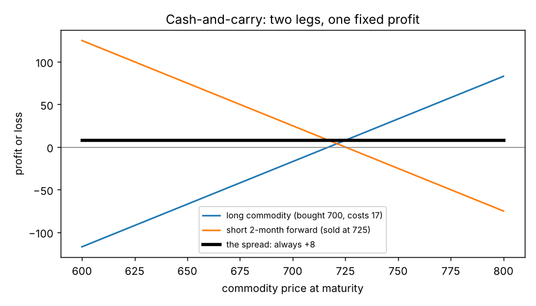
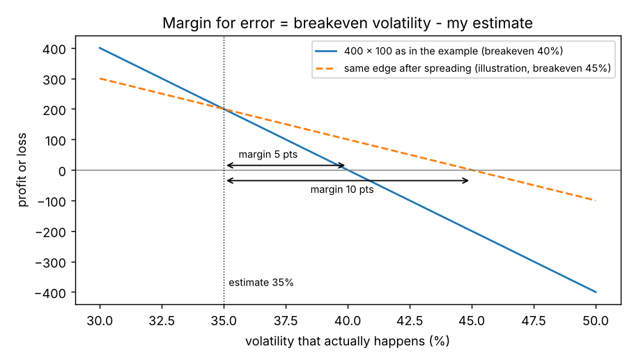
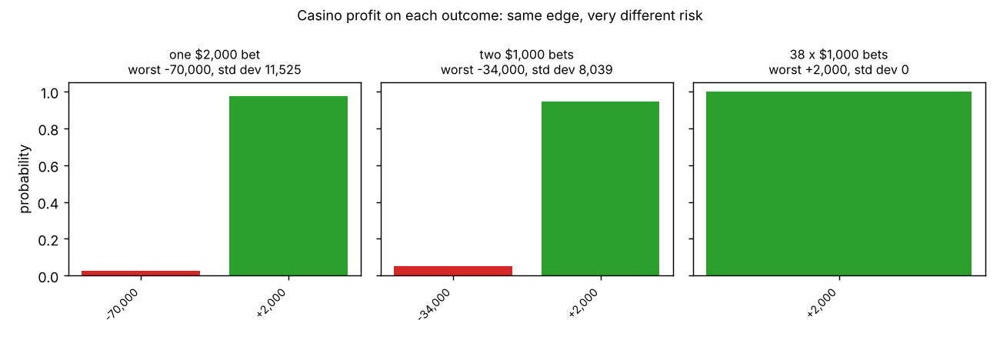

# Chapter 10: Introduction to Spreading

## Summary
A **spread** is a strategy made of opposite positions in different but related instruments, built so that when the market moves one leg gains and the other loses. The chapter starts outside options (cash-and-carry, futures calendar spreads, note-over-bond, a 3:1 commodity ratio, the crack spread) to show the general idea: *you can profit from the relationship between two prices without knowing where either price is going.* It then moves to options, where "position" can mean exposure to direction (delta), to the volatility that actually happens (gamma), to implied volatility (vega) or to interest rates (rho). Most successful option traders are spread traders for three reasons: they can bet on a **relative mispricing** (best measured in volatility points), they can build a position that matches a **view**, and above all spreading **controls risk**. Because theoretical edge is only reliable over the long run, the trader's job is to stay in the game, and a spread gives a larger **margin for error** in the inputs without giving up the edge. The casino at the roulette table is the book's picture of this: the same 5% edge, but spreading the bets around the table removes the chance of one lucky bettor wiping out the house.

## Key concepts
- **Spread and legs** - opposing positions in related instruments; each position is a *leg*; you *buy* or *sell* the whole spread. [[concepts/10-introduction-to-spreading/what-is-a-spread]]
- **Cash-and-carry and calendar spreads** - spreads built on an arbitrage relationship (cash vs forward, near forward vs far forward) whose profit is fixed once the cash flows are set. [[concepts/10-introduction-to-spreading/cash-and-carry-and-calendar-spreads]]
- **Intermarket and ratio spreads** - spreads between different markets, sometimes in unequal numbers (3:1) or with three legs (crack spread). Less reliable, so riskier. [[concepts/10-introduction-to-spreading/intermarket-and-ratio-spreads]]
- **Executing a spread** - leg risk (do the hard leg first), the bid-ask of a spread, and why only the total price matters. [[concepts/10-introduction-to-spreading/executing-a-spread]]
- **Option spreads** - spreads in delta, gamma, vega or rho; dynamic vs static. The Chapter 8 hedge is a gamma spread. [[concepts/10-introduction-to-spreading/option-spreads-delta-gamma-vega-rho]]
- **Relative mispricing in volatility terms** - the question "which option is more overpriced?" is answered in volatility points, not in price. [[concepts/10-introduction-to-spreading/mispricing-in-volatility-terms]]
- **Margin for error** - breakeven volatility minus your volatility estimate; spreading widens it so you can trade larger. [[concepts/10-introduction-to-spreading/margin-for-error-and-trade-size]]
- **The casino and short-term bad luck** - same edge, much smaller worst case when bets are spread around. [[concepts/10-introduction-to-spreading/casino-spreading-and-short-term-bad-luck]]

## Formulas
**Price of a spread** (buy $A$, sell $B$ and $C$; use $+$ for legs bought and $-$ for legs sold)

$$\text{spread price} = A - B - C$$

**Spread market from the leg quotes** (the example on page 164)

$$\text{spread bid} = A_{\text{bid}} - B_{\text{ask}} - C_{\text{ask}} \qquad \text{spread ask} = A_{\text{ask}} - B_{\text{bid}} - C_{\text{bid}}$$

**3:2:1 crack spread**

$$\text{crack} = 2 \times \text{gasoline} + 1 \times \text{heating oil} - 3 \times \text{crude oil}$$

**Theoretical edge adds up across size**

$$\text{total edge} = \text{number of options} \times (\text{theoretical value} - \text{price paid})$$

**Margin for error** (in volatility points)

$$\text{margin for error} = \text{breakeven volatility} - \text{my volatility estimate}$$

**Casino edge on a roulette bet** (38 numbers, pays 35 to 1)

$$\text{expected return per 1 bet} = \frac{36}{38} = 0.947 \qquad \text{edge} = 1 - \frac{36}{38} = \frac{2}{38} \approx 5.26\%$$

Symbols and intuition for each are in [[formulas]].

## Worked example
**1. Cash-and-carry (page 159).** Cash 700, interest 6% a year, storage and insurance 5 a month. Fair two-month forward: $700 + 700 \times 0.06 \times \tfrac{2}{12} + 2 \times 5 = 700 + 7 + 10 = 717$. If the forward trades at 725, buy the commodity, sell the forward, carry: $-7 - 700 - 10 + 725 = +8$, whatever the commodity is worth at maturity. [[concepts/10-introduction-to-spreading/cash-and-carry-and-calendar-spreads]]

**2. A futures calendar spread (page 160-161).** Four-month forward $= 700 + 14.17 + 20 = 734.17$ (the second two months' interest is charged on 717). Fair spread $734.17 - 717 = 17.17$. At a spread of 20 it is 2.83 too expensive: buy the two-month at 717, sell the four-month at 737, carry to maturity for $+2.83$.

**3. Note over bond (page 161-162).** Sell the spread at $118\tfrac{27}{32} - 116\tfrac{14}{32} = 2\tfrac{13}{32}$; buy it back at $115\tfrac{10}{32} - 113\tfrac{7}{32} = 2\tfrac{3}{32}$; profit $\tfrac{10}{32}$.

**4. A 3:1 ratio spread (page 162).** B is expected to trade at $3 \times$ A. At A = 120, B = 390 (ratio 3.25), buy 3 A and sell 1 B: $-360 + 390 = +30$. When the ratio returns to 3, closing costs nothing, so the profit is 30 at any price level. [[concepts/10-introduction-to-spreading/intermarket-and-ratio-spreads]]

**5. The market for a three-leg spread (page 164).** Quotes: A 128/131, B 47/49, C 68/70. Spread bid: $128 - 49 - 70 = 9$; ask: $131 - 47 - 68 = 16$. A market maker may quote the whole thing 11/14. [[concepts/10-introduction-to-spreading/executing-a-spread]]

**6. Which option is more overpriced? (page 166).** At 23% volatility: option 1 is worth 7.00, trades at 8.00 (implied 26%); option 2 is worth 6.00, trades at 6.75 (implied 28%). Option 1 is over by 1.00 in price (3 volatility points); option 2 by only 0.75 (5 points). In volatility terms option 2 is the greater mispricing. [[concepts/10-introduction-to-spreading/mispricing-in-volatility-terms]]

**7. Margin for error (page 166-167).** Estimate 35%; sell calls at 4.00 worth 3.50 (delta 25). Edge $= 4 \times 0.50 = 2.00$ for a 4 x 1 spread, 20.00 for 40 x 10, 200.00 for 400 x 100. If volatility is 45% the calls are worth 4.50 and the 400 x 100 position loses $400 \times 0.50 = 200$. [[concepts/10-introduction-to-spreading/margin-for-error-and-trade-size]]

**8. The casino (page 167-168).** One 2,000 bet on a number: casino wins 2,000 with probability $\tfrac{37}{38}$ or loses 70,000 with probability $\tfrac{1}{38}$. Two 1,000 bets on different numbers: wins 2,000 with probability $\tfrac{36}{38}$ or loses 34,000 with probability $\tfrac{2}{38}$. Both have expected profit $105.26$ (5.26% of the money bet), but with a 50,000 bankroll only the first can bankrupt the casino. 38 bets of 1,000 on every number: a sure 2,000. [[concepts/10-introduction-to-spreading/casino-spreading-and-short-term-bad-luck]]

## Concepts explained in detail
- [[concepts/10-introduction-to-spreading/what-is-a-spread]]
- [[concepts/10-introduction-to-spreading/cash-and-carry-and-calendar-spreads]]
- [[concepts/10-introduction-to-spreading/intermarket-and-ratio-spreads]]
- [[concepts/10-introduction-to-spreading/executing-a-spread]]
- [[concepts/10-introduction-to-spreading/option-spreads-delta-gamma-vega-rho]]
- [[concepts/10-introduction-to-spreading/mispricing-in-volatility-terms]]
- [[concepts/10-introduction-to-spreading/margin-for-error-and-trade-size]]
- [[concepts/10-introduction-to-spreading/casino-spreading-and-short-term-bad-luck]]

## Maths I needed to recall
- [[00-maths-refresher/ratios-and-32nds]] - ratios like 3:1, quotes in 32nds, a spread price as a signed sum
- [[00-maths-refresher/probability-and-expected-value]] - expected value and the casino's edge
- [[00-maths-refresher/standard-deviation-and-variance]] - how the roulette risk is compared (standard deviation)
- [[00-maths-refresher/signs-and-running-totals]] - plus for bought, minus for sold, across several legs
- [[00-maths-refresher/simple-interest-and-time-fractions]] - the interest in the cash-and-carry examples

## Code
- [[code/spreading_intro.ipynb]] - rechecks every example in the chapter (cash-and-carry, calendar spread, NOB spread in 32nds, 3:1 ratio, three-leg spread market, volatility-terms mispricing, the 35% example, three roulette cases with exact standard deviations) and draws the three figures above.

## Notes on the book's text
We found a few slips while recomputing. None changes the ideas.
- **Page 162, closing spread:** "$115\,10/32 - 113\,7/32 = 23/32$" has lost its whole-number part; it means $2\tfrac{3}{32}$ (and the profit $2\tfrac{13}{32} - 2\tfrac{3}{32} = \tfrac{10}{32}$ only works that way).
- **Page 162, the 3:1 example:** "Commodity A ought to be trading at 360 (3 x 120) or Commodity B ought to be trading at 130 (390/3)" has the two commodities swapped. For the ratio $B = 3A$ to hold with B at 390, **A** ought to be $390/3 = 130$; with A at 120, **B** ought to be $3 \times 120 = 360$. The trade (buy 3 A, sell 1 B for a credit of 30) is unaffected. [[concepts/10-introduction-to-spreading/intermarket-and-ratio-spreads]]
- **Page 164:** "200 - 86 100 = 14" is missing a minus sign; it should read $200 - 86 - 100 = 14$.
- **Page 167, the casino's edge:** the text says 5%. A wheel with 38 numbers paying 35 to 1 gives $2/38 = 5.26\%$ (the earlier "95 cents on the dollar" is rounded from $36/38 = 94.7$ cents). We use 5.26% in our figures.
- **Page 166-167, the 40% survival limit:** the book states the trader "can survive" up to 40% but does not say the position breaks even there. With a straight line through the book's two points (3.50 at 35%, 4.50 at 45%) the call is worth exactly 4.00 at 40%, so 40% *is* the breakeven. That straight line is our assumption.
- **Page 167, "400 x 100":** 400 calls with delta 25 give 10,000 deltas, which is 100 underlying contracts of 100 deltas. The loss of 200 ignores the hedge's own P&L, as in Chapter 8's breakeven argument.

**Our additions (not in the book):** the straight-line volatility assumption in the margin-for-error figure; the dashed "after spreading" line (an illustration of a breakeven pushed to 45%); the standard deviations of the three casino cases; the reading of the 7.00/8.00 and 6.00/6.75 options as implied vegas of about 0.33 and 0.15 per volatility point.

## Open questions
- [ ] How do you actually find a spread whose breakeven volatility is far from your estimate? (Chapters 11 and 13: volatility spreads and risk considerations.)
- [ ] How should a trader decide how much margin for error is enough, and how big to trade? (Chapter 13, "How much margin for error?")
- [ ] How does a calendar spread in *options* compare with the futures calendar spread here? (Chapter 11.)
- [ ] When the market quotes a spread as one price, how does the market maker price the hedge of the individual legs? (Chapter 11, "Submitting a spread order.")
- [ ] Is the 3:1 ratio relationship ever tested statistically before trading it, or is it judgement? (Not covered in the book.)
