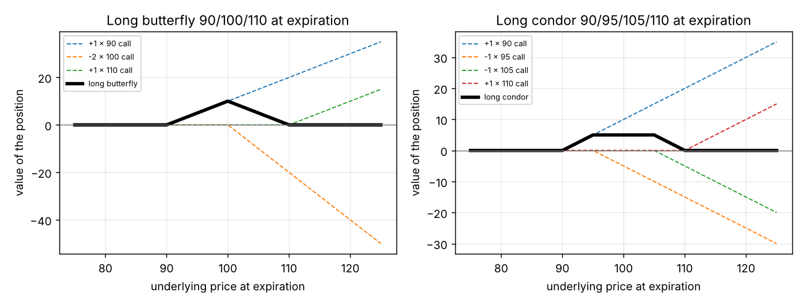
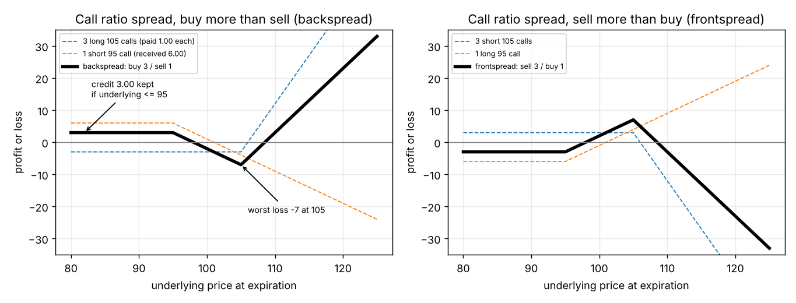
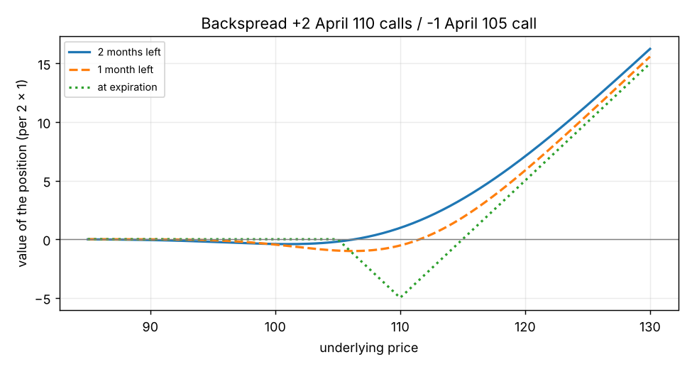
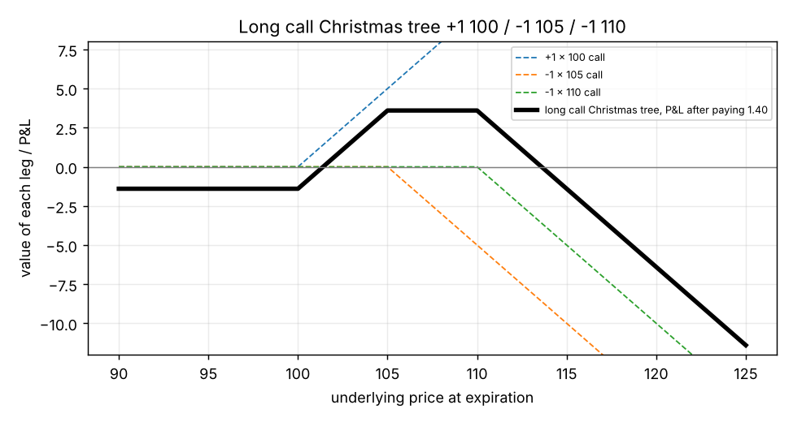
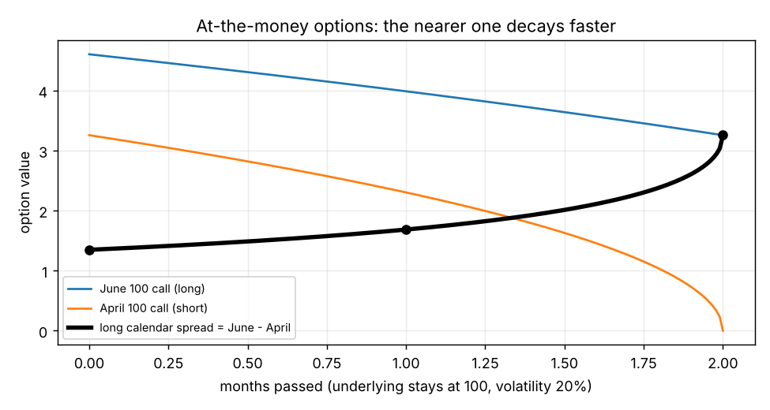
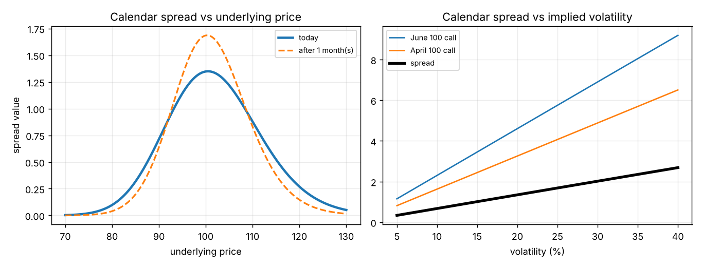
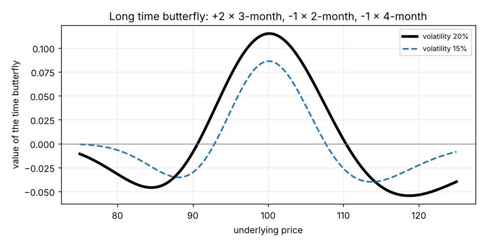
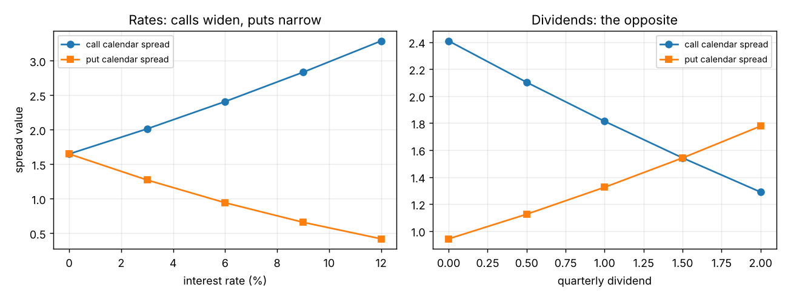

# Chapter 11: Volatility Spreads

## Summary
In Chapter 8 an option's delta was cancelled with the underlying. Chapter 11 shows that the delta can be cancelled with **other options** instead. Every such position is roughly delta neutral, yet it still reacts to how far the underlying moves (gamma), to time (theta) and to implied volatility (vega); these are **volatility spreads**. The chapter goes through the common ones: **straddles and strangles** (buy or sell a call and a put), **butterflies and condors** (the same, with limited risk or reward), **ratio spreads and Christmas trees** (the same, tilted so that one side is limited), **calendar spreads, time butterflies and diagonals** (options with different expirations, which have a very different character because the near option decays faster and the far option has more vega). Almost every spread falls into one of four categories according to the signs of its gamma and vega, and a simple rule tells you which to choose: **if implied volatility is low, prefer positive vega; if high, prefer negative vega.** The chapter ends with practical points: how to adjust the delta, and how a whole spread is traded as one order at one price.

**If the second half (from ratio spreads on) felt hard,** read in this order: [[concepts/11-volatility-spreads/ratio-spreads-building-and-payoff]], then [[concepts/11-volatility-spreads/ratio-spreads-gamma-theta-vega-and-risk]], [[concepts/11-volatility-spreads/christmas-trees-and-ladders]], [[concepts/11-volatility-spreads/calendar-spreads-time-decay]], [[concepts/11-volatility-spreads/calendar-spreads-volatility-and-opposite-wishes]]. Each starts from a picture and a small example.

## The big picture on one page
| Family | What it is | Gamma / theta / vega | Risk and reward |
|---|---|---|---|
| **Straddle, strangle** (long) | buy a call and a put | $+/-/+$ | unlimited reward both ways, premium at risk |
| **Straddle, strangle** (short) | sell a call and a put | $-/+/-$ | unlimited risk both ways |
| **Butterfly, condor** (long) | buy wings, sell body | $-/+/-$ | limited risk, limited reward |
| **Butterfly, condor** (short) | sell wings, buy body | $+/-/+$ | limited reward and risk |
| **Ratio spread, buy more** | more options **bought** at the outer (farther out of the money) strike, fewer sold at the nearer strike | $+/-/+$ | unlimited one side, limited other |
| **Ratio spread, sell more** | more options **sold** at the outer strike, fewer bought at the nearer strike | $-/+/-$ | limited one side, unlimited other |
| **Christmas tree** (long / short) | 1 vs 2 options at three strikes | $-/+/-$ / $+/-/+$ | like a strangle, one side limited |
| **Calendar** (long) | buy far, sell near, same strike | $-/+/+$ | limited risk, limited reward |
| **Calendar** (short) | buy near, sell far | $+/-/-$ | limited both |
| **Time butterfly** (long) | buy 2 middle expiries, sell near and far | like long calendar | debit |
| **Diagonal** | calendar with different strikes | depends | analyse each one |

("Long" = executed for a debit, "short" = for a credit.)

## Key concepts
- **Volatility spread** - delta cancelled with other options; sensitive to movement, implied volatility and time. [[concepts/11-volatility-spreads/hedging-with-other-options]]
- **Straddle, strangle, ratio straddle, guts** - a call and a put at the same strike (straddle) or different strikes (strangle); the 95 straddle needs 3 puts per call to be delta neutral. [[concepts/11-volatility-spreads/straddles-and-strangles]]
- **Butterfly and condor (wingspreads)** - the long versions have limited risk; value at expiration is between 0 and the strike gap. [[concepts/11-volatility-spreads/butterflies-and-condors]]
- **Ratio spread (backspread / frontspread)** - unequal numbers of same-type options at two strikes, ratio set by the delta ratio. [[concepts/11-volatility-spreads/ratio-spreads-building-and-payoff]], [[concepts/11-volatility-spreads/ratio-spreads-gamma-theta-vega-and-risk]]
- **Christmas tree (ladder)** - one option against one each at two other strikes; like a strangle with one side limited. [[concepts/11-volatility-spreads/christmas-trees-and-ladders]]
- **Calendar spread (time / horizontal)** - same strike, different expiries; long = far bought, near sold. Time helps it (near option decays faster). [[concepts/11-volatility-spreads/calendar-spreads-time-decay]]
- **Calendar vs implied volatility** - $-$gamma and $+$vega: wants calm underlying and rising implied volatility. [[concepts/11-volatility-spreads/calendar-spreads-volatility-and-opposite-wishes]]
- **Futures-market calendars** - the two options may sit on different futures; hedge with a futures spread. [[concepts/11-volatility-spreads/calendar-spreads-in-futures-markets]]
- **Time butterfly** - same strike, three expiries; buying the body is a debit (long). [[concepts/11-volatility-spreads/time-butterflies]]
- **Interest rates and dividends** - move the far forward price more; call calendars have positive rho and negative dividend risk, puts the opposite. [[concepts/11-volatility-spreads/calendar-spreads-interest-rates-and-dividends]]
- **Diagonal spread** - calendar with different strikes; behaves like a calendar if 1:1, same type, same delta. [[concepts/11-volatility-spreads/diagonal-spreads]]
- **Long / short premium; the four categories** - gamma sign gives long or short premium; (gamma, vega) signs give four categories. [[concepts/11-volatility-spreads/long-short-premium-and-the-four-categories]]
- **Choosing a spread** - low implied volatility: $+$vega; high: $-$vega. [[concepts/11-volatility-spreads/choosing-a-spread-by-implied-volatility]]
- **Reading the evaluation tables** - quantity times Greek, added up. [[concepts/11-volatility-spreads/reading-the-spread-tables]]
- **Adjustments** - four ways to keep delta under control. [[concepts/11-volatility-spreads/adjusting-a-volatility-spread]]
- **Spread orders** - one bid and ask for the whole package. [[concepts/11-volatility-spreads/submitting-a-spread-order]]

## Formulas
**Delta-neutral quantities** (ratio spread: sell $\Delta_1$, buy $\Delta_2$ of a farther-out-of-the-money option)

$$\text{ratio} = \frac{\Delta_{\text{sold}}}{\Delta_{\text{bought}}}$$

**Payoff of a call ratio spread, buy $n$ calls at $K_2$, sell 1 call at $K_1$** ($K_1 < K_2$, credit $c$ received)

$$\text{P\&L}(S) = c - \max(S - K_1, 0) + n \max(S - K_2, 0)$$

$$\text{max loss} = (K_2 - K_1) - c \qquad \text{upper breakeven} = \frac{nK_2 - K_1 - c}{n - 1}$$

**Butterfly and condor maximum value**

$$\text{butterfly max value} = K_2 - K_1 \;(\text{gap between strikes}) \qquad \text{condor max value} = \text{gap between the two lower strikes}$$

**At-the-money scaling (why a calendar behaves as it does)**

$$\gamma \propto \frac{1}{\sqrt{T}} \qquad \theta \propto -\frac{1}{\sqrt{T}} \qquad \text{vega} \propto \sqrt{T} \qquad V_{\text{ATM}} \approx 0.4 \, S \, \sigma \sqrt{T}$$

**Forward price for a stock** (simple interest, dividend $D$)

$$F = S(1 + rt) - D$$

**Position Greeks and cash flow**

$$\text{Greek}_{\text{total}} = \sum_i q_i \times \text{Greek}_i \qquad \text{cash flow} = -\sum_i q_i \times V_i$$

**Change of delta when the market moves**

$$\Delta\text{delta} \approx \gamma \times \text{move}$$

**Theoretical edge of a whole spread** (prices at implied volatility, values at your volatility)

$$\text{edge} = \sum_i q_i \times (V_i^{\text{theo}} - \text{price}_i)$$

Symbols and intuition for each are in [[formulas]].

## Worked example
**1. Delta-neutral ratio straddle (page 171).** September 95 call delta 75, 95 put delta $-25$. One of each gives $+50$. Three puts per call gives $75 - 75 = 0$. [[concepts/11-volatility-spreads/straddles-and-strangles]]

**2. Long butterfly (page 175).** $+1$ 90 call, $-2$ 100 calls, $+1$ 110 call: value at 80, 100, 120 is 0, 10, 0. Maximum = the gap between strikes. [[concepts/11-volatility-spreads/butterflies-and-condors]]

**3. The 3 x 1 call ratio spread (page 179).** Buy 3 October 105 calls at 1.00 (delta 25), sell 1 October 95 call at 6.00 (delta 75): delta $3 \times 25 - 75 = 0$, credit $6.00 - 3.00 = 3.00$. P&L: $+3.00$ at 80, $-2.00$ at 100, $+23.00$ at 120; breakevens 98 and 108.5; worst loss $-7.00$ at 105. [[concepts/11-volatility-spreads/ratio-spreads-building-and-payoff]]

**4. A 2 x 1 call backspread from Figure 11-31 (page 200).** $+20$ April 110 calls, $-10$ April 105 calls: credit 4.10, delta $-10$, gamma $+16.0$, theta $-0.080$, vega $+0.50$. [[concepts/11-volatility-spreads/ratio-spreads-gamma-theta-vega-and-risk]]

**5. Long call Christmas tree (page 209).** Buy 100 call 3.76, sell 105 call 1.71, sell 110 call 0.65: debit 1.40. Max profit $+3.60$ between 105 and 110, breakevens 101.4 and 113.6. [[concepts/11-volatility-spreads/christmas-trees-and-ladders]]

**6. Calendar spread, time passes (Figure 11-19).** June 100 call minus April 100 call: 4.60 $-$ 3.26 $=$ 1.34; a month later 3.99 $-$ 2.30 $=$ 1.69; at April expiration $3.26 - 0 = 3.26$. [[concepts/11-volatility-spreads/calendar-spreads-time-decay]]

**7. Calendar spread, volatility changes (Figure 11-21).** Spread value at 10, 15, 20, 25, 30% volatility: 0.67, 1.01, 1.34, 1.68, 2.02. [[concepts/11-volatility-spreads/calendar-spreads-volatility-and-opposite-wishes]]

**8. Futures-market calendar hedge (page 191).** 10 March/June call calendar spreads: June $+500$, March $-500$ deltas; buy 5 March futures and sell 5 June futures. [[concepts/11-volatility-spreads/calendar-spreads-in-futures-markets]]

**9. Time butterfly (page 191).** Buy 2 mid-month options, sell the near and far: debit $2 \times 3.99 - 3.26 - 4.60 = 0.12$ in our 2/3/4-month example. [[concepts/11-volatility-spreads/time-butterflies]]

**10. Interest rates and dividends on calendars (Figure 11-28).** Call calendar spread at rates 0, 3, 6, 9, 12%: 1.65, 2.01, 2.41, 2.83, 3.29; put calendar: 1.65, 1.27, 0.94, 0.66, 0.42. [[concepts/11-volatility-spreads/calendar-spreads-interest-rates-and-dividends]]

**11. Choosing by implied volatility (Figures 11-32 and 11-33).** At 17% implied volatility, positive-vega spreads have a positive edge (long straddle $+9.63$, backspread $+1.01$, long calendar $+1.90$); at 23% the negative-vega ones do. [[concepts/11-volatility-spreads/choosing-a-spread-by-implied-volatility]]

**12. Adjusting by feel (page 202).** Underlying 50.00, gamma $-200$: a 2-point fall adds $(-200) \times (-2) = +400$ deltas. [[concepts/11-volatility-spreads/adjusting-a-volatility-spread]]

**13. Spread order (page 203).** Straddle quoted 6.25 / 6.75: sell at 6.25, buy at 6.75, regardless of the call/put split. [[concepts/11-volatility-spreads/submitting-a-spread-order]]

## Concepts explained in detail
- [[concepts/11-volatility-spreads/hedging-with-other-options]]
- [[concepts/11-volatility-spreads/straddles-and-strangles]]
- [[concepts/11-volatility-spreads/butterflies-and-condors]]
- [[concepts/11-volatility-spreads/ratio-spreads-building-and-payoff]]
- [[concepts/11-volatility-spreads/ratio-spreads-gamma-theta-vega-and-risk]]
- [[concepts/11-volatility-spreads/christmas-trees-and-ladders]]
- [[concepts/11-volatility-spreads/calendar-spreads-time-decay]]
- [[concepts/11-volatility-spreads/calendar-spreads-volatility-and-opposite-wishes]]
- [[concepts/11-volatility-spreads/calendar-spreads-in-futures-markets]]
- [[concepts/11-volatility-spreads/time-butterflies]]
- [[concepts/11-volatility-spreads/calendar-spreads-interest-rates-and-dividends]]
- [[concepts/11-volatility-spreads/diagonal-spreads]]
- [[concepts/11-volatility-spreads/long-short-premium-and-the-four-categories]]
- [[concepts/11-volatility-spreads/reading-the-spread-tables]]
- [[concepts/11-volatility-spreads/choosing-a-spread-by-implied-volatility]]
- [[concepts/11-volatility-spreads/adjusting-a-volatility-spread]]
- [[concepts/11-volatility-spreads/submitting-a-spread-order]]

## Maths I needed to recall
- [[00-maths-refresher/slope-and-straight-lines]] - walking along a payoff line, finding where it crosses zero (ratio-spread breakevens)
- [[00-maths-refresher/signs-and-running-totals]] - plus for bought, minus for sold; totals across several legs
- [[00-maths-refresher/max-function]] - $\max(S - K, 0)$ for the payoff of each leg
- [[00-maths-refresher/ratios-and-32nds]] - ratios such as 3:1 and 2:1
- [[00-maths-refresher/proportionality-and-percentage-change]] - "proportional to $\sqrt{T}$" and ratios of square roots
- [[00-maths-refresher/simple-interest-and-time-fractions]] - the forward prices in the interest-rate example
- [[00-maths-refresher/derivatives-and-rates-of-change]] - gamma as "delta per point"

## Code
- [[code/volatility_spreads.ipynb]] - rechecks every example (butterfly and condor values, the 3 x 1 ratio spread with its breakevens, whether a delta-neutral backspread is always a credit, the Christmas tree, the three calendar tables, the at-the-money scaling, the time butterfly, the rate and dividend tables, the Greek totals of 36 example spreads against the book, the edge at 17% and 23% implied volatility) and draws the eight figures above.

## Notes on the book's text
We found a few slips while recomputing. None changes the ideas.
- **Page 172, short strangle:** the text lists the short strangle as "+gamma / -theta / +vega", the same as the long strangle. It should be $-$gamma / $+$theta / $-$vega, as in Figure 11-9 and in the totals of Figure 11-33.
- **Figure 11-18:** the labels "Call ratio spread (sell more than sell)" and "Put ratio spread (sell more than sell)" should read "sell more than buy".
- **Figure 11-33, totals:** four numbers disagree with the option table: short straddle (April) rho prints $-0.170$ (should be $+0.170$); long strangle (June) delta prints $-20$ (should be $+20$); put ratio spread, sell more (June) theta prints $+0.020$ (should be $+0.200$); long put Christmas tree (April) gamma prints $-30.0$ (the book uses 3.8 for the April 100 put's gamma instead of 4.8; the correct total is $-40.0$). [[concepts/11-volatility-spreads/reading-the-spread-tables]]
- **Figure 11-33, short condor:** the April 105 put is printed as 5.66 (the table has 5.67); in our copy the June short condor lists the signs of a long call condor although its totals are those of a short condor.
- **Rounding:** Figure 11-19 prints the spread as 1.34 and 1.69 (our exact values are 1.35 and 1.68); the dividend table (11-28) differs from our reconstruction by 0.01 in a few cells. These are rounding of printed values.

**Our additions (not in the book):**
- Figures 11-19 to 11-21 use **no interest** (our inference: with 6% the June call would be 5.62, not 4.60).
- The dividend dates for Figure 11-28 (one dividend before March, two before June, at 1.5 and 4.5 months) are our reconstruction; they reproduce the table.
- The fit $V \approx 2.30 \sqrt{\text{months}}$, the at-the-money scaling derivation of the calendar's gamma and vega, and the time-butterfly check.
- The numerical test that a delta-neutral spread buying more than it sells is a credit for every pair of strikes from 80 to 130 (stock 100, 2 months, 20%, 6%).
- The theoretical-edge table at 17% and 23% implied volatility.
- The eight diagrams.

## Open questions
- [ ] Why is a delta-neutral backspread always a credit under a traditional model? We tested it numerically (every strike pair) but did not prove it. ([[concepts/11-volatility-spreads/ratio-spreads-building-and-payoff]])
- [ ] How does a volatility skew (a different implied volatility at each strike) change which ratio spread is cheapest? (Later chapters on skew.)
- [ ] How do different implied volatilities for different expirations (the term structure) change a calendar spread or time butterfly? ([[concepts/11-volatility-spreads/calendar-spreads-volatility-and-opposite-wishes]])
- [ ] What should a trader do with a calendar spread when the near option expires: close, roll or hold the long option? (Not covered in this chapter.)
- [ ] How big should the delta limit be for a given spread and account size? ([[concepts/11-volatility-spreads/adjusting-a-volatility-spread]]; Chapter 13)
- [ ] How do bull and bear ratio spreads (Chapter 12) differ from the volatility versions here?
- [ ] How does a market maker work out a price for a very complex spread? ([[concepts/11-volatility-spreads/submitting-a-spread-order]])
