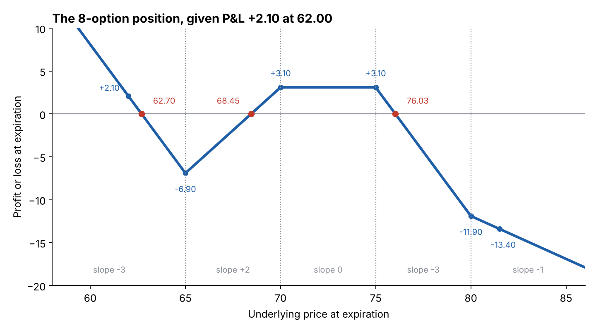

# P&L of complex positions: the slope walk-through

**One-line definition:** for a position with many legs, find the slope in every stretch, compute the P&L at **one** convenient price, then use the slopes to walk to every other price and to find the breakevens.

## Intuition
A complicated position is still a chain of straight segments that bend at the exercise prices. If you know where the chain *starts* (one P&L value) and how steep each segment is (the slopes), you know the whole chain. No need to value every option at every price.

## The recipe
1. **List the exercise prices** (the only places the graph can bend).
2. **Slopes** in each stretch: add up the contracts ([[concepts/04-expiration-profit-and-loss/slope-method-for-combined-positions]]).
3. **P&L at one price.** The easiest place is usually *at an exercise price* (there the options at that strike are worth zero). For each leg: P&L = value at expiration minus price paid (long) or price received minus value (short), times the number of contracts. Underlying legs: gain or loss versus the entry price.
4. **Walk:** $\text{P\&L at the next point} = \text{P\&L now} + \text{slope} \times \text{distance}$ ([[00-maths-refresher/slope-and-straight-lines]]).
5. **Breakevens:** in any stretch where P&L changes sign, breakeven $= x_0 - y_0 / m$.

## Example A: a four-leg position (the book's)
Underlying at 98.00. Position:

| Quantity | Contract | Price |
|---|---|---|
| +1 | 95 call | 6.25 |
| -1 | 105 call | 1.75 |
| -2 | 105 puts | 7.75 |
| -2 | underlying contracts | 98.00 |

**Slopes**

| Contract | Below 95 | 95-105 | Above 105 |
|---|---|---|---|
| +1 95 call | 0 | +1 | +1 |
| -1 105 call | 0 | 0 | -1 |
| -2 105 puts | +2 | +2 | 0 |
| -2 underlying | -2 | -2 | -2 |
| **Total** | **0** | **+1** | **-2** |

**P&L at 95**

| Contract | Price | Value at 95 | P&L per contract | Total P&L |
|---|---|---|---|---|
| +1 95 call | 6.25 | 0 | -6.25 | -6.25 |
| -1 105 call | 1.75 | 0 | +1.75 | +1.75 |
| -2 105 puts | 7.75 | 10.00 | $7.75 - 10.00 = -2.25$ | -4.50 |
| -2 underlying | 98.00 | 95.00 | $98.00 - 95.00 = +3.00$ | +6.00 |
| **Total** | | | | **-3.00** |

**Walk:**
- Below 95 the slope is 0, so P&L is **-3.00** everywhere below 95 (the maximum loss).
- 95 to 105, slope $+1$: P&L at 105 $= -3.00 + 1 \times 10 = +7.00$.
- Above 105, slope $-2$: loses 2 points per point of rise.

**Breakevens:**
- First (between 95 and 105): $95 + 3.00 / 1 = 98.00$.
- Second (above 105): $105 + 7.00 / 2 = 108.50$.

**Independent check at 110** (valuing each leg directly): 95 call $15 - 6.25 = +8.75$; short 105 call $-(5) + 1.75 = -3.25$; two short 105 puts (worthless) $+15.50$; two short underlying $-2 \times (110 - 98) = -24$. Total $8.75 - 3.25 + 15.50 - 24 = -3.00$. The slope walk gives $7.00 - 2 \times 5 = -3.00$. They agree.

## Example B: the 8-option position, given one P&L value (the book's)
Using the slopes from the earlier table (below 65: $-3$; 65-70: $+2$; 70-75: 0; 75-80: $-3$; above 80: $-1$). We are told the P&L at an underlying price of **62.00 is +2.10**. What is it at 81.50?

| Interval | Starting P&L | Slope | Ending P&L |
|---|---|---|---|
| 62.00 to 65.00 | +2.10 | -3 | $2.10 - 3 \times 3 = -6.90$ |
| 65.00 to 70.00 | -6.90 | +2 | $-6.90 + 2 \times 5 = +3.10$ |
| 70.00 to 75.00 | +3.10 | 0 | +3.10 |
| 75.00 to 80.00 | +3.10 | -3 | $3.10 - 3 \times 5 = -11.90$ |
| 80.00 to 81.50 | -11.90 | -1 | $-11.90 - 1 \times 1.50 = -13.40$ |

So at 81.50 the position **loses 13.40**.

**Breakevens** (a stretch where the sign changes):

| Stretch | Calculation | Breakeven |
|---|---|---|
| 62.00 to 65.00 | $62.00 + 2.10 / 3$ | 62.70 |
| 65.00 to 70.00 | $65.00 + 6.90 / 2$ | 68.45 |
| 75.00 to 80.00 | $75.00 + 3.10 / 3$ | 76.03 (76.033...) |

Three breakevens, so the position makes money in some zones and loses in others.

**Typos in the book:** in the walk-through table the PDF prints "+3.50" as the ending P&L of both the 65-70 row and the 70-75 row. The correct value is **+3.10** ($-6.90 + 10 = 3.10$), which is also what the later breakeven calculation (76.03) and the 75-80 row use. Also, the legend of Figure 4-15 lists slightly different contract counts (-5 75 calls, +3 80 calls) from the position in the text (-6 and +4), so the figure's legend should not be used to recompute slopes. All of this is recomputed in [[code/expiration_pnl.ipynb]].

## Common confusions
- **Pick one anchor and trust the slopes.** You do not need option prices if someone gives you the P&L at one price (Example B).
- **Check where the slope applies.** A breakeven formula only counts if the answer lies inside the stretch you used.
- **The anchor can be anywhere**, but at an exercise price most legs are worth zero or easy numbers.

## Related
- Chapter: [[chapters/04-expiration-profit-and-loss]]
- Before: [[concepts/04-expiration-profit-and-loss/expiration-pnl-and-breakeven]]
- Maths needed: [[00-maths-refresher/slope-and-straight-lines]]
- See also: [[glossary]]
