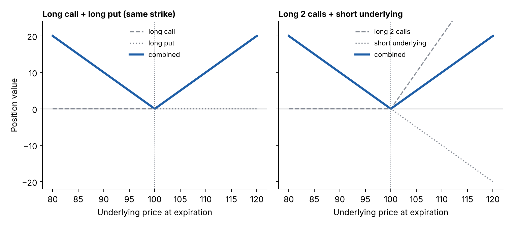

# Equivalent positions (the same graph built in different ways)

**One-line definition:** different combinations of options and underlying can have exactly the same parity graph, which means the same strategy can be constructed in more than one way.

## Intuition
If two positions have the same slope in every stretch, they behave identically as the underlying moves at expiration. Only the "ingredients" differ. This is an important idea; Natenberg develops it in Chapter 14.

## Three examples (all at exercise price $X$)

**1. Long call + long put = a V shape.** Slopes: below $X$, $0 + (-1) = -1$; above $X$, $+1 + 0 = +1$.

**2. Long 2 calls + short 1 underlying = the same V shape.** Slopes: below $X$, the calls are out of the money and the short underlying is $-1$, giving $-1$. Above $X$, the 2 calls give $+2$ and the short underlying gives $-1$, giving $+1$. Same slopes as example 1, so the same graph.

**3. Long call + short put = a long underlying position.** Slopes: below $X$, $0 + (+1) = +1$; above $X$, $+1 + 0 = +1$. Always $+1$, exactly like owning the underlying.

## The maths behind example 3 (our own derivation)
Call value minus put value at expiration, for exercise price $X$:

$$\max(0, S - X) - \max(0, X - S) = S - X$$

Check both cases:
- If $S > X$: the call is worth $S - X$ and the put is worth 0, so the difference is $S - X$.
- If $S < X$: the call is worth 0 and the put is worth $X - S$, so the difference is $0 - (X - S) = S - X$.

Either way it equals $S - X$, which is just "long the underlying, valued relative to $X$". Numbers with $X = 100$:

| $S$ | Long call | Short put | Sum | $S - X$ |
|---|---|---|---|---|
| 90 | 0 | -10 | -10 | -10 |
| 100 | 0 | 0 | 0 | 0 |
| 110 | 10 | 0 | 10 | 10 |

(This is the starting point of the relationship between calls, puts and the underlying that the book explores later.)

## What "same graph" does and does not mean
The graphs match in **shape**: the same slopes everywhere. The *profit and loss* graphs are then the same shape too, shifted up or down by whatever each version costs to put on. (Our reading; the book simply says the parity graphs are identical.)

Also remember that the location of the *underlying* position is irrelevant for the parity graph: only whether you are long (+1) or short (-1).

## Common confusions
- Equivalent parity graphs do not mean equal *prices* for the ingredients. They are linked by pricing relationships met in later chapters.
- "Long call + long put" and "long 2 calls + short underlying" are different trades with different risks until expiration. At expiration, they have the same sensitivity.

## Related
- Chapter: [[chapters/04-expiration-profit-and-loss]]
- Before: [[concepts/04-expiration-profit-and-loss/slope-method-for-combined-positions]]
- See also: [[glossary]]
