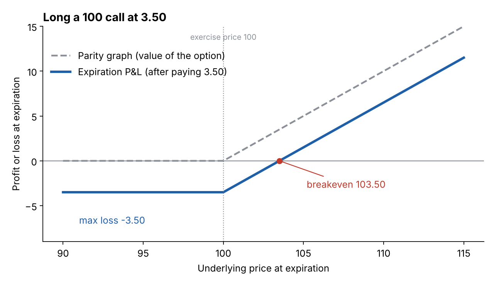

# Expiration profit and loss, and breakeven prices

**One-line definition:** the *expiration P&L graph* shows profit or loss at expiration for each underlying price. It is the parity graph shifted **down** by what you paid (a debit) or **up** by what you received (a credit). The **breakeven price** is where the P&L is zero.

## Intuition
The parity graph says what the position is *worth*. But whether you *made money* depends on what you paid. Buying an option creates a **debit** (cash out); selling creates a **credit** (cash in). So:

$$\text{P\&L at expiration} = \text{value at expiration} - \text{price paid} \quad(\text{long})$$

$$\text{P\&L at expiration} = \text{price received} - \text{value at expiration} \quad(\text{short})$$

Visually you just slide the hockey stick down (long) or up (short) by the premium.

## The maths: breakevens for a single option
Set P&L to zero and solve (see [[00-maths-refresher/rearranging-formulas]]).

**Long (or short) a call** with exercise price $X$ and premium $p$. In the money, value $= S - X$.

| Step | Result |
|---|---|
| Long call P&L above $X$ | $S - X - p$ |
| Set it to zero | $S - X - p = 0$ |
| Add $X + p$ to both sides | $S = X + p$ |

**Long (or short) a put.** In the money, value $= X - S$, so P&L (long) $= X - S - p$. Setting to zero gives $S = X - p$.

| Position | Breakeven | Max loss / max profit |
|---|---|---|
| Long call | $X + p$ | lose at most $p$; gain unlimited |
| Short call | $X + p$ | gain at most $p$; lose unlimited |
| Long put | $X - p$ | lose at most $p$; gain up to $X - p$ (the underlying cannot go below 0) |
| Short put | $X - p$ | gain at most $p$; lose up to $X - p$ |

Note the breakeven is *beyond* the exercise price, because the option must first earn back its cost: above $X$ for a call, below $X$ for a put.

## Worked examples (the book's)
Option prices with the underlying at 98.00:

| Exercise price | 85 | 90 | 95 | 100 | 105 | 110 | 115 |
|---|---|---|---|---|---|---|---|
| Calls | 14.25 | 9.75 | 6.25 | 3.50 | 1.75 | 0.75 | 0.25 |
| Puts | 0.25 | 1.00 | 2.25 | 4.50 | 7.75 | 11.75 | 16.25 |

**Long a 100 call at 3.50.**
- Below 100: option worthless, lose 3.50 (the maximum loss).
- Above 100: slope $+1$.
- Breakeven $= 100 + 3.50 = 103.50$.
- Check at 102: value 2, P&L $= 2 - 3.50 = -1.50$. The option is in the money yet the position still loses.
- Check at 103.50: value 3.50, P&L $= 0$.

**Short a 95 put at 2.25.**
- Above 95: put worthless, keep the 2.25 credit (the maximum profit).
- Below 95: slope $+1$ (you lose a point for each point the underlying falls).
- Breakeven $= 95 - 2.25 = 92.75$. Check: at 92.75 the put is worth $95 - 92.75 = 2.25$, which cancels the credit.

**Comparing strikes** (long positions):

| | 95 | 100 | 105 |
|---|---|---|---|
| Call price | 6.25 | 3.50 | 1.75 |
| Call breakeven $X + p$ | 101.25 | 103.50 | 106.75 |
| Put price | 2.25 | 4.50 | 7.75 |
| Put breakeven $X - p$ | 92.75 | 95.50 | 97.25 |

Calls with **lower** exercise prices are worth more (you buy cheaper) and puts with **higher** exercise prices are worth more (you sell dearer).

## Common confusions
- **Breakeven is not the exercise price.** It is the exercise price plus (call) or minus (put) the premium.
- **In the money does not mean profitable.** Between the exercise price and the breakeven a long option is in the money and still losing.
- The P&L graph has the same *slopes* as the parity graph. Only the height changes. So the slope method still applies: [[concepts/04-expiration-profit-and-loss/slope-method-for-combined-positions]].

## Related
- Chapter: [[chapters/04-expiration-profit-and-loss]]
- Before: [[concepts/04-expiration-profit-and-loss/parity-graphs]]
- Next: [[concepts/04-expiration-profit-and-loss/complex-position-pnl-walkthrough]]
- Maths needed: [[00-maths-refresher/rearranging-formulas]], [[00-maths-refresher/slope-and-straight-lines]]
- See also: [[glossary]], [[formulas]]
