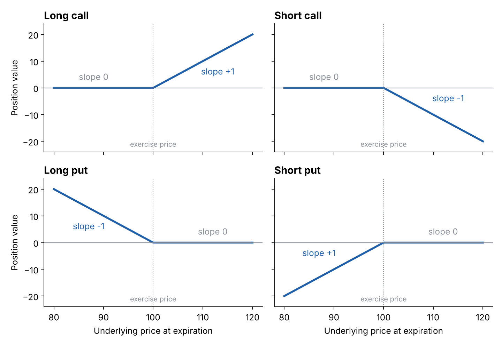

# Parity graphs (hockey-stick diagrams)

**One-line definition:** a *parity graph* shows the **value** of an option position at expiration for every possible underlying price. "Parity" is another name for intrinsic value, and the four basic shapes are nicknamed *hockey sticks*.

## Intuition
At expiration an option is worth exactly its intrinsic value ([[concepts/03-contract-specifications-and-option-terminology/intrinsic-value-and-time-value]]). So we can draw "what is my position worth, for each final underlying price?" without any guessing about volatility or time.

- A **bought** option can only help you: the value is zero or positive. For the call that means 0 up to the exercise price, then rising one point for every point the underlying rises.
- A **sold** option can only hurt you: the value is zero or negative. It is the bought option's graph flipped upside down.

A parity graph shows the **value** of the position only. It does not include what you paid or received for the option. That adds the next layer, see [[concepts/04-expiration-profit-and-loss/expiration-pnl-and-breakeven]].

## The four basic graphs (exercise price $X = 100$)

| Position | Value at expiration | Below $X$ | Above $X$ |
|---|---|---|---|
| Long call | $\max(0, S - X)$ | 0 | rises 1 per point |
| Short call | $-\max(0, S - X)$ | 0 | falls 1 per point |
| Long put | $\max(0, X - S)$ | rises 1 per point as $S$ falls | 0 |
| Short put | $-\max(0, X - S)$ | falls 1 per point as $S$ falls | 0 |

**Slope** is the change in position value per 1 change in the underlying (see [[00-maths-refresher/slope-and-straight-lines]]):

$$\text{slope} = \frac{\text{change in position value}}{\text{change in underlying price}}$$

| Position | Slope |
|---|---|
| Long or short any **out-of-the-money** option | 0 |
| Long an in-the-money call | +1 |
| Short an in-the-money call | -1 |
| Long an in-the-money put | -1 |
| Short an in-the-money put | +1 |

An out-of-the-money option has slope 0, so at expiration its value does not depend on where the underlying finishes (it is worthless anyway).

## Worked example
Values at expiration for an option with exercise price 100:

| Underlying $S$ | Long call | Short call | Long put | Short put |
|---|---|---|---|---|
| 90 | 0 | 0 | 10 | -10 |
| 100 | 0 | 0 | 0 | 0 |
| 110 | 10 | -10 | 0 | 0 |
| 120 | 20 | -20 | 0 | 0 |

## Limited and unlimited risk
The graphs show the most important feature of option trading:

- **Buyers** have **limited risk** (never more than the price paid) and **unlimited profit potential**.
- **Sellers** have **limited profit** (never more than the price received) and **unlimited risk**.

(Footnote in the book: for a put, the underlying cannot fall below zero, so strictly a put's profit or loss is capped at $X$ per unit. In practice traders treat both calls and puts as having unlimited potential.)

**So why would anyone sell options?** New traders always ask this. The answer is *probability*: it is not just the best and worst outcomes that matter but how **likely** each is. A seller who collects a large enough premium for a risk that seems small enough may well accept the unlimited downside. Later chapters make this precise.

## Common confusions
- **Value vs profit.** The parity graph does not include the premium. A long call can sit in the "positive" part of its parity graph and still lose money overall.
- **Flipped, not mirrored left-right.** A short call is the long call turned upside down, not reversed in direction.
- The graph *bends at the exercise price*. That kink is the signature of an option (the "insurance" feature), unlike an underlying position, which is a straight line.

## Related
- Chapter: [[chapters/04-expiration-profit-and-loss]]
- Next: [[concepts/04-expiration-profit-and-loss/slope-method-for-combined-positions]]
- Maths needed: [[00-maths-refresher/max-function]], [[00-maths-refresher/slope-and-straight-lines]]
- See also: [[glossary]]
