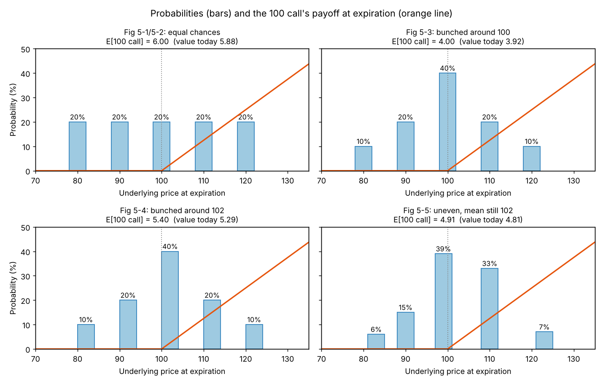
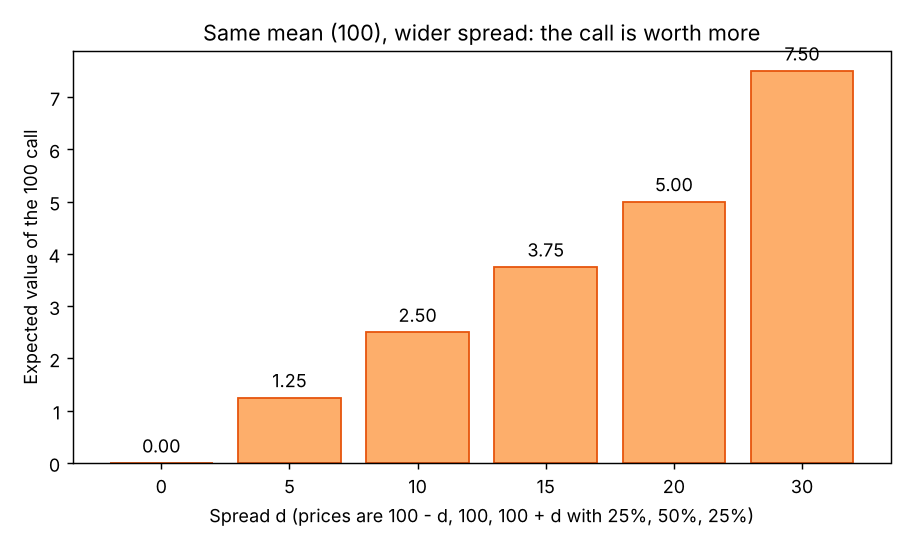

# Pricing an option from probabilities (the simple approach)

**One-line definition:** list the prices the underlying could have at expiration, give each a probability, work out the option's payoff at each price, take the probability-weighted average, then discount it to today.

## Intuition
At expiration an option is worth only its intrinsic value ([[concepts/04-expiration-profit-and-loss/parity-graphs]]). We do not know the underlying price then, but we can describe our *beliefs* as a list of possible prices with chances attached. The option's value today is the average of its payoffs over that list, brought back to today's money.

Two refinements make the list sensible:
1. Prices far from today's price should be **less likely** than prices close to it, so the probabilities should bunch around the middle.
2. The *centre* of the list should be the **forward price** (explained below), not the current price.

## The four steps (the book's summary)
1. Propose a series of possible prices at expiration.
2. Assign each a probability, so that the underlying's expected value equals the **forward price**.
3. For the chosen exercise price, compute the option's expected value.
4. Depending on settlement, take the present value of that expected value.

## The maths
With possible prices $S_1, \dots, S_n$, probabilities $p_1, \dots, p_n$ and exercise price $X$:

$$E_{\text{call}} = \sum_{i=1}^{n} p_i \max(S_i - X,\, 0) \qquad E_{\text{put}} = \sum_{i=1}^{n} p_i \max(X - S_i,\, 0)$$

- $\max(S_i - X, 0)$ is the call's value at price $S_i$ (zero if $S_i \le X$). See [[00-maths-refresher/max-function]].
- Each term is "chance of this price" times "option value at this price"; the sum is the average.

Then, for stock-type settlement (you pay the full premium today), discount:

$$\text{theoretical value} = \frac{E}{1 + r\,t}$$

### Why the centre must be the forward price
If the average of our list were different from the forward price, someone could make a risk-free profit trading the forward against the cash market ([[concepts/02-forward-pricing/arbitrage-and-cash-and-carry]]). So the market is effectively saying the forward price is the most likely average value. In symbols:

$$\sum_{i=1}^{n} p_i\, S_i = F \qquad\text{with}\qquad F = S_{\text{today}} \times (1 + r\,t)\ \text{for a stock paying no dividend}$$

For European options the *current* price only matters because it can be turned into a forward price. That is why traders talk about **at the forward** options (exercise price = forward price) alongside **at the money** options (exercise price = current price). In many markets at-the-forward options trade most and serve as the benchmark for the others.

## Worked example, step by step (the book's)
Stock at 100, interest 12% a year, 2 months, no dividend. Price the **100 call**.

Growth factor: $1 + 0.12 \times 2/12 = 1.02$. Forward: $100 \times 1.02 = 102$.

**A. Five equally likely prices, 20% each, at 80, 90, 100, 110, 120 (Fig 5-1, 5-2).**

| Price $S_i$ | Probability $p_i$ | Call value $\max(S_i - 100, 0)$ | $p_i \times$ value |
|---|---|---|---|
| 80 | 20% | 0 | 0 |
| 90 | 20% | 0 | 0 |
| 100 | 20% | 0 | 0 |
| 110 | 20% | 10 | 2.00 |
| 120 | 20% | 20 | 4.00 |
| | | **Expected value** | **6.00** |

- Mean of the underlying: $0.2(80 + 90 + 100 + 110 + 120) = 100$.
- Theoretical value: $6.00 / 1.02 = 5.88$.

**B. Bunch the probabilities around 100: 10%, 20%, 40%, 20%, 10% (Fig 5-3).**
- Call expected value: $0.2 \times 10 + 0.1 \times 20 = 4.00$; theoretical value $4.00/1.02 = 3.92$.
- The mean is still 100 (the distribution is symmetric about 100), but the call is worth less. Why? The upside prices (110, 120), which are the only ones that pay, now carry less total probability (30% instead of 40%).

**C. Centre the bunch on the forward, 102: prices 82, 92, 102, 112, 122 (Fig 5-4).**
- Call values: 0, 0, 2, 12, 22. Expected value: $0.4 \times 2 + 0.2 \times 12 + 0.1 \times 22 = 0.8 + 2.4 + 2.2 = 5.40$.
- Theoretical value: $5.40/1.02 = 5.29$.

**D. A lopsided distribution that still averages 102 (Fig 5-5).**
- Prices and probabilities: 83 (6%), 90 (15%), 99 (39%), 110 (33%), 123 (7%).
- Mean: $4.98 + 13.50 + 38.61 + 36.30 + 8.61 = 102.00$. Good: it equals the forward.
- Call: $0.33 \times 10 + 0.07 \times 23 = 3.30 + 1.61 = 4.91$; theoretical value $4.91/1.02 = 4.81$.
- Lesson: the distribution does not have to be symmetric, as long as it averages to the forward price.

## What the examples teach
- **Higher forward, higher call value.** B to C moves the whole distribution up by 2 and the call goes from 4.00 to 5.40.
- **More spread, higher call value (same mean).** A to B squeezed the probabilities and the call fell from 6.00 to 4.00. This is the hint that **volatility**, the spread of outcomes, drives option prices. The figure below is our own illustration (not in the book).

- **The real world has infinitely many prices.** Our list has five. A realistic model needs a probability for every possible price; the book says later chapters show how to approximate that (Chapter 6, the normal distribution).

## A side check (our own)
For Fig 5-4, the put's expected value is $0.1 \times 18 + 0.2 \times 8 = 3.40$ and the call's is $5.40$. Then

$$E_{\text{call}} - E_{\text{put}} = 5.40 - 3.40 = 2.00 = F - X = 102 - 100.$$

It works because $\max(S - X, 0) - \max(X - S, 0) = S - X$ at every price ([[concepts/04-expiration-profit-and-loss/equivalent-positions]]), so averaging both sides gives $F - X$. This is the first hint of the call-put link the book promises for European options.

## Common confusions
- **The probabilities are our assumptions**, not facts. Change them and the value changes (that is the "garbage in, garbage out" warning).
- **Centre on the forward, not the current price.** Centring on 100 (examples A and B) was a teaching step. Centring on 102 (C and D) is the arbitrage-free version.
- **The discount step uses interest, not probability.** Dividing by 1.02 does not change how likely anything is.
- This applies to **stock-type settlement** (you pay the premium now). The book says step 4 depends on the settlement procedure. With futures-type settlement ([[concepts/01-financial-contracts/settlement-margin-and-variation]]) the premium is not paid up front, so (our reading) there is no interest to discount for.

## Related
- Chapter: [[chapters/05-theoretical-pricing-models]]
- Maths needed: [[00-maths-refresher/probability-and-expected-value]], [[00-maths-refresher/present-value-and-discounting]], [[00-maths-refresher/summation-notation]], [[00-maths-refresher/max-function]]
- Previous: [[concepts/05-theoretical-pricing-models/expected-value-and-theoretical-value]]
- Next: [[concepts/05-theoretical-pricing-models/black-scholes-model-and-inputs]]
- Forward price: [[concepts/02-forward-pricing/forward-price-cost-and-benefit]]
- Code: [[code/pricing_models.ipynb]]
- See also: [[glossary]], [[formulas]]
