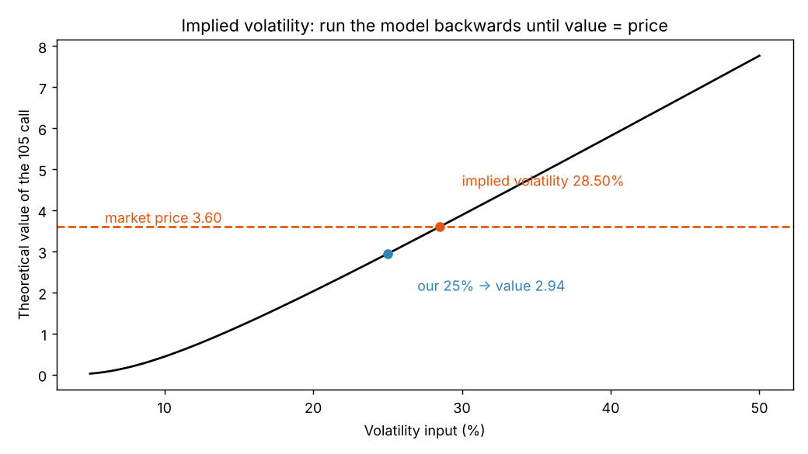

# Implied volatility

**One-line definition:** the implied volatility of an option is the volatility you must feed into the pricing model, holding every other input fixed, so that the model's value equals the option's market price. It is the market's consensus guess of future realized volatility over the option's life.

## Intuition
Normally we use the model *forwards*: inputs in, value out. With an implied volatility we run it *backwards*: we know the price, and ask which volatility would have produced it.

**Forwards:** exercise price, time, stock price, interest rate and volatility go in; a theoretical value comes out. **Backwards:** exercise price, time, stock price, interest rate and the option's *price* go in; a volatility comes out.

Why volatility, and not another input? Time and exercise price are fixed by the contract. The stock price is known to within the bid-ask spread. Interest rate is the least important input. Volatility is the only input that is a real unknown, so it is the one that "absorbs" any disagreement between our value and the market's price.

It is as if the market continuously polls every participant for the volatility they believe in. Nobody votes; prices settle where supply and demand balance, and that equilibrium can be written as a volatility.

## Worked example (the book's): the 105 call
Stock 98.50, exercise 105, three months, interest 6.00%, no dividend, European, Black-Scholes. Our volatility estimate is 25%.

1. **Our value.** Feed in 25%: theoretical value **2.94**.
2. **Market price.** The call trades actively at **3.60**. That is 0.66 more than our value.
3. **Which input explains the gap?** Test each in turn, others held constant:

| Input changed | Value needed to reach 3.60 | Plausible? |
|---|---|---|
| Time or exercise price | n/a, fixed by the contract | no |
| Stock price (98.50) | 100.16 | no: well outside the bid-ask spread |
| Interest rate (6.00%) | 13.30% | no: a huge change |
| **Volatility (25%)** | **28.50%** | **yes** |

4. **Solve for volatility.** Start at 25% and raise it until the model gives 3.60. At 28.50% it does. The implied volatility is **28.50%**.

The book notes that most models do not run in reverse directly, but simple algorithms find the answer quickly. Our notebook halves a range repeatedly (bisection): try the middle volatility, see whether the model value is too low or too high, keep the half that brackets the price, and repeat.

## Price vs volatility terms
- In **points**: the call is $3.60 - 2.94 = 0.66$ overpriced.
- In **volatility points**: $28.50 - 25.00 = 3.50$ overpriced.

Traders often prefer volatility terms because the same price difference means different things for different options.

**Comparing options.** The 100 call under the same conditions is at 5.40, which is clearly more in points. But its implied volatility is 27.51% versus 28.50% for the 105 call, so in theoretical terms the **100 call is almost a full volatility point cheaper**. Traders talk about volatility as the price: "I bought the call at 27.51 percent." (Our notebook gets 27.53%; small rounding difference.)

If the future realized volatility were 25%, selling either call would be profitable in theory. But if it turned out to be 32%, selling either would lose. So being wrong about volatility is a risk to weigh; other things equal the lower implied volatility (the 100 call) is the better value to **buy**, or the less overpriced to sell.

## Things that can go wrong
- **Model dependence.** Implied volatility depends on the model used; different models can give noticeably different values for some options.
- **Stale or mismatched inputs.** Suppose 3.60 was the *last trade*, two hours ago, when the stock was 99.25. With the stock at 99.25 the implied volatility is 26.95%, not 28.50%. Inputs must be contemporaneous. (Ours: 26.93%.)
- **A single number for many options.** Data vendors may give one representative implied volatility per underlying, usually weighted towards at-the-money options (or by volume or open interest).
- **Calls and puts at the same exercise price** and expiry have very similar implied volatilities (put-call parity, Chapter 15).

## Premium is a synonym for price, and sometimes for implied volatility
Strictly, *premium* is an option's price. Because implied volatility comes from the price, traders say "premium levels are high" when implied volatility is high relative to history or recent realized volatility, and "low" when it is unusually low.

## Which volatility matters: value vs price
The book's summary:

| | What it is | Role |
|---|---|---|
| **Future realized volatility** | what the underlying will do | determines an option's **value** |
| **Implied volatility** | what the market price implies | a reflection of the option's **price** |

Every trader compares value and price: cheap value-for-price means buy; expensive means sell. For an option trader this becomes:
- implied volatility **low** compared with expected future realized volatility: prefer to **buy** options;
- implied volatility **high**: prefer to **sell** options.

Future volatility is unknown, so look at historical and (if available) forecast volatility to make an intelligent guess.

## The weather analogy
A Chicago trader must pick clothes on a July morning.
- **History:** it is never cold enough in July for a winter coat.
- **Forecast:** a forecaster promises clear skies and 90 degrees F.
- **Market:** he looks out of the window and everyone is wearing coats and carrying umbrellas, which *implies* very different weather.

Whom to believe depends on local knowledge, and on the cost of being wrong (a few blocks in the rain vs a short trip). Likewise, volatility traders weigh history, forecasts and the market's implied view, and choose strategies that survive being wrong.

## Common confusions
- **Implied volatility is not a forecast you can trust blindly.** It is the market's opinion, and it can be wrong.
- **A higher price in points does not mean higher implied volatility.** Compare in volatility terms.
- **It is solved for, not observed.** There is a different implied volatility for each option; they often differ across exercise prices.

## Related
- Chapter: [[chapters/06-volatility]]
- Previous: [[concepts/06-volatility/realized-volatility]]
- Next: [[concepts/06-volatility/volatility-and-option-values]]
- Earlier: [[concepts/05-theoretical-pricing-models/black-scholes-model-and-inputs]], [[concepts/05-theoretical-pricing-models/choosing-the-inputs]]
- Maths needed: [[00-maths-refresher/rearranging-formulas]] (solving for an unknown by trial is the alternative when algebra cannot isolate it)
- Code: [[code/volatility.ipynb]]
- See also: [[glossary]], [[formulas]]
