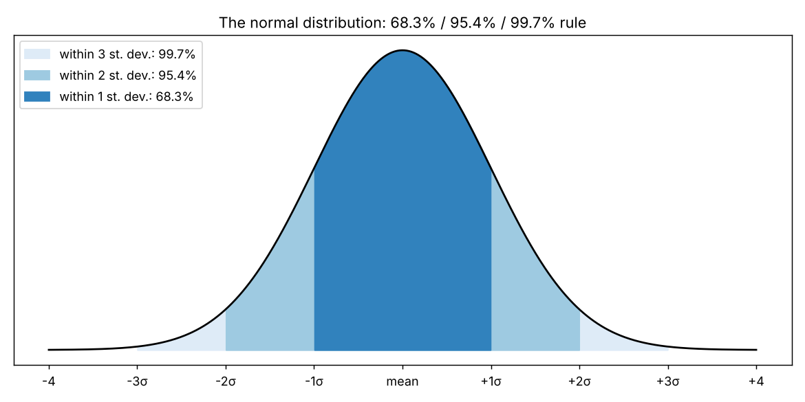

# Mean and standard deviation

**One-line definition:** the *mean* is the average outcome (the centre of the bell); the *standard deviation* measures how spread out the outcomes are and tells you how likely any given distance from the mean is.

## Intuition
A normal distribution is fully described by two numbers:
- **Mean:** where the peak sits.
- **Standard deviation:** how quickly the bell spreads out. A fast-spreading bell has a high standard deviation (Figure 6-4); a slow-spreading one has a low standard deviation (Figure 6-3).

Think of the standard deviation as a typical-distance ruler. "One standard deviation" is a ruler length; you can count how many of those rulers a value sits from the mean.

## The 68-95-99.7 rule
For a normal distribution:

| Distance from the mean | Share of outcomes inside | Approximate fraction |
|---|---|---|
| $\pm 1$ standard deviation | 68.3% | about $\tfrac{2}{3}$ |
| $\pm 2$ standard deviations | 95.4% | about $\tfrac{19}{20}$ |
| $\pm 3$ standard deviations | 99.7% | about $\tfrac{369}{370}$ |

Because the bell is symmetrical, up moves and down moves are equally likely, and the percentages split evenly: 95.4% inside $\pm 2$ means 4.6% outside, and half of that, 2.3%, lies beyond $+2$ standard deviations.

## Worked example 1: the pinball maze (the book's)
Troughs numbered 0 to 15. The mean is 7.50 and the standard deviation is 3.00.

**Q: how likely is a ball to land in a trough lower than 5 or higher than 10?**

1. One standard deviation from the mean: $7.5 \pm 3$, which is $4.5$ to $10.5$.
2. The half-numbers are dividers between troughs, so troughs 5 to 10 are inside.
3. About $\tfrac{2}{3}$ of balls land in troughs 5 to 10 (68.3%).
4. The rest, about $\tfrac{1}{3}$, land in troughs 0 to 4 and 11 to 15. Exactly $100\% - 68.3\% = 31.7\%$.

**Q: someone offers 30 to 1 that a ball lands in trough 14 or 15. Good bet?**

1. Two standard deviations: $7.5 \pm 6$, so $1.5$ to $13.5$. Troughs 14 and 15 are outside.
2. Chance of being outside two standard deviations: $100\% - 95.4\% = 4.6\%$, roughly 1 in 20.
3. That 4.6% covers **both** tails: troughs 0, 1 as well as 14, 15. Only the upper half counts: about 2.3%, roughly 1 in 40 (the book says "about 1 chance in 40"; exactly 1 in 44).
4. At 30 to 1 you would break even only if the chance were 1 in 31 (3.2%). The chance is less than that, so it is a **bad bet**. The trap is forgetting that the 1-in-20 figure includes both tails.

## Standard deviations add (in distance)
"One standard deviation is 3, so two standard deviations are 6." Distances in standard deviations are just multiples: $k$ standard deviations $= k \times \sigma$. (Careful: the *variance*, not the standard deviation, adds when you combine independent random steps; that is why time scales with a square root. See [[concepts/06-volatility/scaling-volatility-for-time]].)

## How the numbers are found
- **Mean:** add up all results and divide by how many there are.
- **Standard deviation:** the book postpones the calculation; the steps are in [[00-maths-refresher/standard-deviation-and-variance]]. What matters now is how to *interpret* it.
- The exact probability for any number of standard deviations is in statistics tables or a spreadsheet function (in Excel, `NORM.S.DIST(z, TRUE)`); the notebook uses Python's `math.erf`.

## Common confusions
- **The standard deviation is not the maximum move.** About 1 outcome in 3 falls *outside* one standard deviation.
- **The 4.6% beyond two standard deviations is two-sided.** Only half is in each tail.
- **The mean need not be a possible outcome.** The maze mean 7.5 is between troughs 7 and 8; no ball lands there (compare the die in [[concepts/05-theoretical-pricing-models/expected-value-and-theoretical-value]]).

## Related
- Chapter: [[chapters/06-volatility]]
- Maths needed: [[00-maths-refresher/standard-deviation-and-variance]], [[00-maths-refresher/normal-distribution-and-z-scores]]
- Previous: [[concepts/06-volatility/random-walks-and-normal-distributions]]
- Next: [[concepts/06-volatility/volatility-as-a-standard-deviation]]
- Code: [[code/volatility.ipynb]]
- See also: [[glossary]], [[formulas]]
