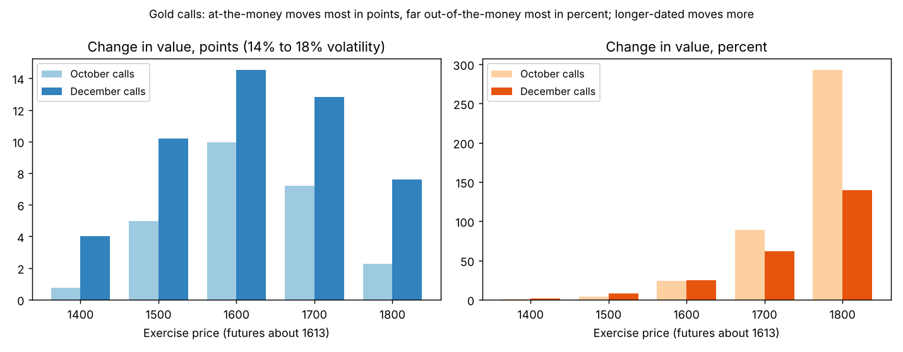

# Volatility and option values: three principles

**One-line definition:** changing the volatility input changes option values dramatically, and the effect is not the same for every option. Three rules tell you which options react most.

## Intuition
Higher volatility means a wider bell of possible prices ([[concepts/06-volatility/random-walks-and-normal-distributions]]), which raises every option's value. But an option that is already deep in the money behaves like the underlying and barely notices; an option that is far out of the money starts tiny, so any increase looks huge in percent.

## The data (the book's gold options, July 31, 2012)
October gold futures 1612.4, eight weeks (56 days) to expiry, interest 0.50%. Theoretical values when volatility is 14% and 18%:

| Exercise | Call at 14% | Call at 18% | Change (points) | Change (%) | Put at 14% | Put at 18% | Change (points) | Change (%) |
|---|---|---|---|---|---|---|---|---|
| 1400 | 212.37 | 213.13 | 0.76 | under 1% | 0.13 | 0.89 | 0.76 | 585% |
| 1500 | 116.05 | 121.01 | 4.96 | 4% | 3.74 | 8.70 | 4.96 | 133% |
| 1600 | 41.65 | 51.60 | **9.95** | 24% | 29.26 | 39.21 | **9.95** | 34% |
| 1700 | 8.08 | 15.28 | 7.20 | 89% | 95.61 | 102.82 | 7.21 | 8% |
| 1800 | 0.78 | 3.05 | 2.27 | **291%** | 188.23 | 190.51 | 2.28 | 1% |

The 1600 option is the **at-the-money** one (futures are about 1612). It gains the most **in points**. The far out-of-the-money 1800 call and 1400 put gain the most **in percent**.

## The three principles
1. **In points, volatility changes the at-the-money option most.** Compare 9.95 (1600) with 0.76 (1400) and 2.27 (1800).
2. **In percent, volatility changes the out-of-the-money option most.** The 1800 call more than triples (0.78 to 3.05, +291%), the 1400 put rises 585%.
3. **Longer-dated options react more than shorter-dated ones** (same exercise price, in total points).

Principle 3 from the December options (17 weeks, 119 days, futures 1614.6):

| Exercise | October change (points) | December change (points) |
|---|---|---|
| 1500 call | 4.96 | 10.18 |
| 1600 call | 9.95 | 14.53 |
| 1700 call | 7.20 | 12.81 |
| 1800 call | 2.27 | 7.59 |

For each exercise price the December change is bigger. The same principles hold for puts, and for the percent change the at-the-money and out-of-the-money pattern repeats (December 1800 call +140%, December 1400 put +226%).

## Why deep in-the-money options barely react
As an option moves deep into the money it becomes more sensitive to the *underlying price* and less to volatility (it behaves like the underlying). Whether you measure in points or percent, in-the-money options are the least sensitive. This explains where trading volume is: traders who go to an options market for its volatility characteristics concentrate on at-the-money and out-of-the-money options, the ones most sensitive to volatility.

## More observations from the tables
- **Calls and puts with the same exercise price and expiry change by almost exactly the same amount** when volatility moves (9.95 and 9.95 at 1600). The book links this to put-call parity (Chapter 15), and the implied volatilities of such a call and put are nearly identical (17.68% for both the 1600s).
- **Implied volatility varies across exercise prices**: 22.36% (1400), 19.01%, 17.68% (1600), 18.42%, 20.46% (1800) in the October calls. The lowest is at the money.
- **Volatility itself moves.** The book's Figure 6-14 (gold, eight-week historical volatility, 2009 to 2012) shows swings of 4 percentage points over eight weeks are common. A 2-point margin for error "may be no margin for error at all": never build a strategy that works at 20% volatility but loses heavily at 18% or 22%.

## Common confusions
- **"Most sensitive" depends on the measure.** At the money wins in points; out of the money wins in percent.
- **A bigger percent change on a tiny option is a small dollar change.** The 1800 call rose 291% but only 2.27 points.
- **Longer-dated options are more sensitive in points, not necessarily in percent** (look at the December percentages: they are smaller than October for the same far-out strikes).

## Related
- Chapter: [[chapters/06-volatility]]
- Previous: [[concepts/06-volatility/implied-volatility]]
- Later chapters: Chapter 7 puts numbers on these sensitivities (the vega), Chapter 13 covers margin for error.
- Code: [[code/volatility.ipynb]] (the notebook recomputes every table value with the Black formula)
- See also: [[glossary]], [[formulas]]
