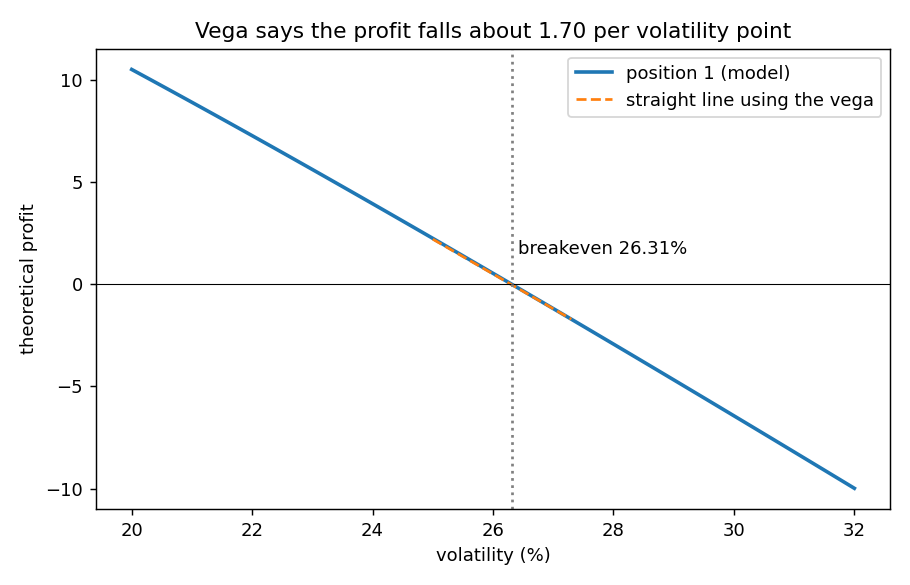

# Breakeven volatility: the implied volatility of a position

**One-line definition:** the implied volatility of a position is the volatility at which its theoretical profit is exactly zero; a rough estimate is the volatility used plus the sign-adjusted ratio of edge to vega.

## Intuition
Every option has an implied volatility: the volatility that makes the model value equal its market price ([[concepts/06-volatility/implied-volatility]]). A *position* has one too. Your theoretical profit depends on the volatility you assume; at some volatility the profit shrinks to zero, and that is the position's breakeven. For a trader with a volatility view it answers: how wrong can my estimate be before this trade stops being profitable?

## The maths
The position's theoretical profit at a volatility $\sigma$, using the total position vega and the profit $E$ at the original volatility $\sigma_0$:

$$\text{profit}(\sigma) \approx E + \text{vega} \times (\sigma - \sigma_0)$$

Set the profit to zero and solve ([[00-maths-refresher/rearranging-formulas]]):

| Step | Result |
|---|---|
| Set profit to zero | $0 = E + \text{vega} \times (\sigma - \sigma_0)$ |
| Subtract $E$ | $-E = \text{vega} \times (\sigma - \sigma_0)$ |
| Divide by $\text{vega}$ | $-E / \text{vega} = \sigma - \sigma_0$ |
| Add $\sigma_0$ | $\sigma = \sigma_0 - \dfrac{E}{\text{vega}}$ |

The book describes this as "divide the edge by the vega and add it", which is right only once you track signs: **subtract edge divided by vega**.

## Worked example: Position 1
Edge $+2.20$, vega $-1.70$ per volatility point, volatility used 25%.

1. At 26%: $2.20 + (-1.70) = +0.50$.
2. At 27%: $0.50 + (-1.70) = -1.20$. The profit has turned negative.
3. Breakeven: $25 - \dfrac{2.20}{-1.70} = 25 + 1.29 = 26.29\%$.

The book prints **27.29%**, which is a slip (between 26 and 27 the profit crosses zero, so the answer cannot be above 27). The exact model answer, solving the real (curved) relationship, is **26.31%**. Because Position 1 is only 10 short 95 calls at 8.55, this is also the implied volatility of the 95 call at that price.

**Position 2 (long straddle).** Edge $-2.10$, vega $+3.92$: $25 - \dfrac{-2.10}{3.92} = 25 + 0.54 = 25.54\%$. The straddle needs volatility above about 25.5% to be profitable at the traded prices. That fits a long vega position bought above theoretical value.

## Gamma versus vega
Position 1's negative gamma says "I want the underlying to be quiet". Its negative vega says "I want *implied* volatility to fall". These sound the same but are different:

| | Gamma | Vega |
|---|---|---|
| Measures your exposure to... | realized volatility (does the underlying actually move?) | implied volatility (what do option prices imply?) |
| Short-gamma / short-vega wants... | the underlying to be quiet | option prices to fall |

Realized and implied volatility are often correlated but not always. The underlying can become more volatile while implied volatility falls, or less volatile while implied rises. The book returns to this in Chapter 11.

## Common confusions
- **Linear estimate versus exact answer.** The vega is a slope at one point, so the breakeven from the straight line (26.29%) is only approximately the true one (26.31%). Over a wide change in volatility the relationship curves.
- **Breakeven is not a forecast.** It tells you the margin for error in your volatility estimate ([[concepts/06-volatility/volatility-and-option-values]], margin for error).
- **Edge is measured at your volatility.** Change the assumed volatility and the edge changes by $\text{vega} \times (\text{change})$.

## Related
- Chapter: [[chapters/07-risk-measurement-i]]
- Previous: [[concepts/07-risk-measurement-i/gamma-and-theta-trade-off]]
- Maths needed: [[00-maths-refresher/rearranging-formulas]]
- Code: [[code/risk_measures.ipynb]]
- See also: [[glossary]], [[formulas]]
