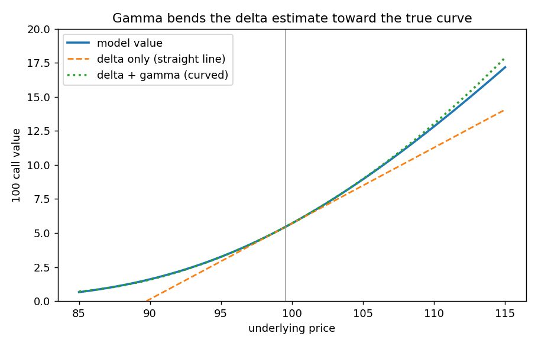

# Estimating a new option value with delta and gamma

**One-line definition:** to estimate an option's new value after the stock moves, use the *average* delta over the move: $C_{\text{new}} \approx C + \Delta S \times \Delta + \tfrac12 (\Delta S)^2 \times \Gamma$.

## Intuition
Delta is the slope *at your starting price*. If the stock moves a long way, the slope has changed, so "change in price times delta" is only right for tiny moves. Gamma tells you how fast the slope changes. A good compromise is to use the **average** slope between the start and end prices.

## Errata first
The book prints the price change as $S_1 - S_2$ in these formulas. With $S_2$ the **new** price, the change is $S_2 - S_1$. As printed, a rising stock would make a long call *lose* value. The book's prose (the change is $S_2 - S_1$) and its worked example (delta goes $40 \to 50$ when the price goes up 4) both use $S_2 - S_1$. We use the corrected version below. ($\Delta S$ below stands for $S_2 - S_1$. The squared term is not affected by the sign.)

## The maths
Let the price move from $S_1$ to $S_2$, with change $\Delta S = S_2 - S_1$ (positive for a rise, negative for a fall). The option starts with value $C$, delta $\Delta$ and gamma $\Gamma$.

| Step | Result |
|---|---|
| New delta at $S_2$ (add gamma per point of change) | $\Delta_{\text{new}} = \Delta + \Delta S \times \Gamma$ |
| Average of old and new delta | $\dfrac{\Delta + \Delta_{\text{new}}}{2} = \dfrac{2\Delta + \Delta S \times \Gamma}{2} = \Delta + \dfrac{\Delta S \times \Gamma}{2}$ |
| Change in value = price change times average delta | $\Delta S \times \left(\Delta + \dfrac{\Delta S \times \Gamma}{2}\right)$ |
| Multiply out | $\Delta S \times \Delta + \dfrac{(\Delta S)^2 \times \Gamma}{2}$ |

$$C_{\text{new}} \approx C + \underbrace{\Delta S \times \Delta}_{\text{delta term}} + \underbrace{\tfrac12 (\Delta S)^2 \times \Gamma}_{\text{gamma term}}$$

- Use decimals for delta and gamma here (delta 40 is 0.40, gamma 2.5 per point is 0.025). The book's footnote 8 reminds us of this.
- The gamma term is always positive for a long option, because $(\Delta S)^2 \ge 0$. A long option gains from curvature whichever way the price moves.
- It is not exact because gamma itself changes along the way, but it is better than delta alone. It works for puts too, as long as the put's delta is negative.

## Worked example 1 (the book's)
At 97.50 a call is worth 3.65 with delta 40 and gamma 2.5. The underlying rises to 101.50, so $\Delta S = +4$.

1. New delta: $40 + 4 \times 2.5 = 50$.
2. Average delta: $(40 + 50)/2 = 45$, i.e. 0.45.
3. New value: $3.65 + 4.00 \times 0.45 = 5.45$.

Same result with the two terms: delta term $4 \times 0.40 = 1.60$, gamma term $\tfrac12 \times 16 \times 0.025 = 0.20$, total $3.65 + 1.80 = 5.45$.

Falling by 4 instead ($\Delta S = -4$): delta term $-1.60$, gamma term $+0.20$, new value $3.65 - 1.40 = 2.25$. The call loses *less* than delta alone suggests (a fall of 1.60), because delta shrinks as the price falls.

With the book's printed sign ($S_1 - S_2 = -4$ for a rise): $3.65 - 1.60 + 0.20 = 2.25$ for a *rise*. That is the contradiction a careful reader spots.

## Worked example 2 (checked against the model)
June 100 call from Figure 7-13: stock 99.50, value 5.435, delta 0.5565, gamma 0.0318 per point. Stock rises to 103.50 ($\Delta S = +4$).

| Estimate | Value |
|---|---|
| Delta only: $5.435 + 4 \times 0.5565$ | 7.661 |
| Delta plus gamma: $7.661 + \tfrac12 \times 16 \times 0.0318$ | 7.916 |
| Actual (model) | **7.907** |

Delta alone is off by 0.25; adding gamma cuts the error to 0.01. Code: [[code/risk_measures.ipynb]].

## Common confusions
- **"Why not just use the new delta?"** It overstates the gain (it assumes the price had the *final* slope the whole way). The old delta understates it. The average is in between.
- **Units.** Gamma is quoted in deltas per point. Write it as a decimal before multiplying by price changes.
- **Not a pricing formula.** It is an approximation for small to moderate moves, with volatility, time and rates unchanged.

## Related
- Chapter: [[chapters/07-risk-measurement-i]]
- Previous: [[concepts/07-risk-measurement-i/gamma]]
- Maths needed: [[00-maths-refresher/derivatives-and-rates-of-change]]
- See also: [[glossary]], [[formulas]]
