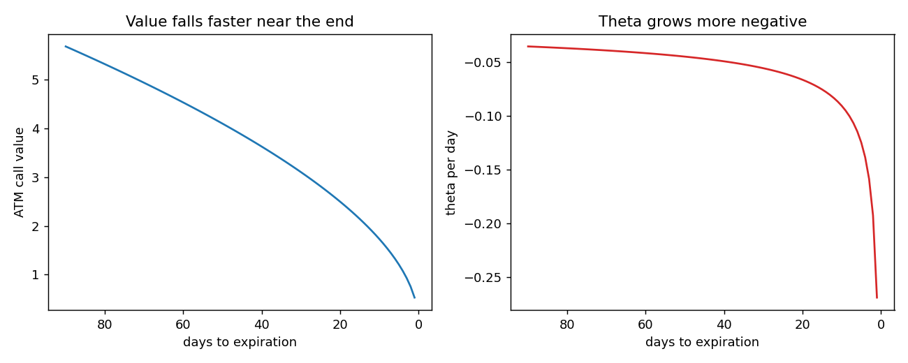

# Theta

**One-line definition:** the theta ($\Theta$) is the rate at which an option loses value as time passes with everything else unchanged, usually quoted as value lost per calendar day.

## Intuition
An option's value is intrinsic value plus time value. At expiration only intrinsic value is left. The time value is a melting ice cube: every day there is a little less chance of a big move, so a little less to pay for.

## The maths
Convention (used in the book and these notes): theta is written as a **negative** number for an option that loses value.

$$\text{value tomorrow} \approx \text{value today} + \Theta$$

Example: an option worth 4.00 with $\Theta = -0.05$ is worth 3.95 tomorrow and 3.90 the day after, if the underlying does not move and nothing else changes.

**Theta grows as expiration approaches** for an option that stays at the money. Book example (illustrative numbers): $-0.03$ at three months, $-0.06$ at three weeks, $-0.16$ at three days. Our model check (stock = strike = 100, volatility 25%, interest 6%): $-0.035$ at 91 days, $-0.065$ at 21 days, $-0.159$ at 3 days.

Why? The time value of an at-the-money option is roughly proportional to $\sqrt{t}$ (the square-root rule, [[concepts/06-volatility/scaling-volatility-for-time]]). A square-root curve is steep near zero: the last few days remove a bigger slice of value per day than the early days do. (Check: from 91 days to 3 days, $\sqrt{91/3} \approx 5.5$, and theta grew about 4.5 times.)

## Worked example (Figure 7-13)
June 100 call: theta $-0.035$. Ten calls lose about $10 \times 0.035 = 0.35$ per day; that is position 2's call half (+10 calls: $10 \times -0.035$). The puts lose $10 \times 0.019 = 0.19$. Position 2 total theta: $-0.35 - 0.19 = -0.54$ per day. See [[concepts/07-risk-measurement-i/reading-a-position-risk-table]].

## Can theta be positive?
Yes, rarely: **negative time value**. Take a deep in-the-money call, strike 60, underlying at 100, which will be worth its intrinsic value 40 at expiration. With stock-type settlement the buyer pays *today*, so today's value is only the present value of 40 (perhaps 39). If the underlying stays at 100, the value must climb from 39 to 40 as time passes: a positive theta.

Conditions: stock-type settlement, deeply in the money, and **European** (American holders would exercise today to start earning interest on the intrinsic value).

**Our check.** This example works cleanly for an option on a *futures* contract, where the quoted price is also the forward price. Using the Black (1976) formula, the 60 call on futures at 100 is worth 38.83 with 182 days left, 39.22 at 120, 39.61 at 60, 39.99 at 1: rising toward 40. For a no-dividend *stock* call the forward price is above the stock price (it grows at the interest rate), so the call stays worth more than intrinsic value (41.77 at 182 days) and theta is negative. A deep in-the-money European *put* on a stock shows negative time value (a 140 put with the stock at 100: 36.22 at 182 days, rising toward 40). The book returns to this when discussing early exercise (Chapter 16).

## Common confusions
- **"Theta is per day" means calendar days** (as the book quotes). Traders sometimes talk per trading day.
- **Theta is not profit.** A long option "loses" theta every day only if the underlying sits still. Movement can more than make up for it (gamma, [[concepts/07-risk-measurement-i/gamma-and-theta-trade-off]]).
- **Positive theta is rare.** Assume negative for long options and positive for short options.

## Related
- Chapter: [[chapters/07-risk-measurement-i]]
- Previous: [[concepts/07-risk-measurement-i/estimating-option-value-with-delta-and-gamma]]
- Next: [[concepts/07-risk-measurement-i/vega]]
- Later: Chapter 9 (theta in more detail), Chapter 16 (early exercise)
- See also: [[concepts/03-contract-specifications-and-option-terminology/intrinsic-value-and-time-value]], [[glossary]], [[formulas]]
