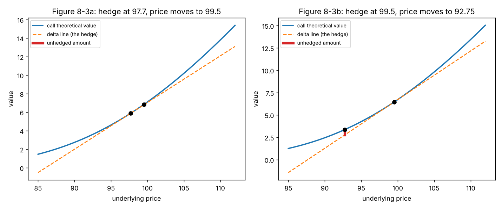

# Gamma and the unhedged amount (Figure 8-3)

**One-line definition:** the **unhedged amount** is the gap between a call's true value and the straight-line value predicted by its delta; it exists because the value curve bends (gamma), and rehedging collects that gap on every move.

## Intuition
A delta hedge uses a straight line (the slope at one point) to stand in for a curve. For tiny moves the line and the curve are the same. For bigger moves they separate, and because a long option's curve bends **upward**, the true value is always *above* the line, whichever way the price moved. The option holder who is hedged therefore gains a little on every sizeable move, up or down.

That is why the book says that "most of the option's value was determined by the amount earned on the rehedging process".

## What the book's figure shows
- Start at the initial price 97.70. Draw the call's value as a curve and its initial delta as a line (dotted) and the opposite stock position (dashed). For small moves they cancel.
- With the price at 99.50 (week 1) the option has gained *more* than the short stock has lost: a mismatch, the unhedged amount. Rising price: the option's gain rate increases.
- At the new price we adjust to delta neutral again, **capturing** the mismatch. Falling price (92.75, week 2): the option's loss rate shrinks; again a mismatch in our favour.

In theory, ignoring interest, the sum of all these small gaps is the option's value:

$$\text{option theoretical value} \approx \text{gap}_1 + \text{gap}_2 + \dots + \text{gap}_n$$

With a finite number of rehedges we take a finite number of bets. To replicate the value exactly we would need an infinite number of them: continuous rehedging.

## The maths
This uses the estimate from Chapter 7 ([[concepts/07-risk-measurement-i/estimating-option-value-with-delta-and-gamma]]):

$$C_{\text{new}} \approx C + \Delta S \times \Delta + \tfrac12 (\Delta S)^2 \times \Gamma$$

where $\Delta S$ is the price change, $\Delta$ the delta and $\Gamma$ the gamma, with delta and gamma as decimals.

**Step 1.** The short stock position loses (or gains) $-\Delta \times \Delta S$. The option's first term $\Delta S \times \Delta$ exactly cancels it. What is left over is the last term.

$$\text{unhedged amount} \approx \tfrac12\,\Gamma\,(\Delta S)^2$$

**Step 2.** Because $(\Delta S)^2$ is a square, it is positive whether $\Delta S$ is $+1.80$ or $-1.80$. That is why the gap is on the *same side* for rising and falling prices (positive gamma, long option).

**Step 3 (our extension, not in the book).** Time also passes. A long option loses theta each day. So over one rehedging interval the hedged position earns, roughly (ignoring interest):

$$\text{hedged P\&L over one interval} \approx \tfrac12\,\Gamma\,(\Delta S)^2 + \Theta \times (\text{days})$$

with $\Theta$ negative for a long option. Gamma gain from movement against theta loss from waiting: this is the gamma-theta trade-off of [[concepts/07-risk-measurement-i/gamma-and-theta-trade-off]] in action, and it is the "race" of [[concepts/08-dynamic-hedging/realized-volatility-and-the-race]].

## Worked example (our numbers, volatility 37.62%)
We recreate the two steps of Figure 8-3. To isolate the curvature we freeze time during each step (in real life a week passes and theta takes a bite as well).

**(a) Hedge set at 97.70** (70 days left): call value $V_0 = 5.890$, delta $0.5044$, gamma $0.0248$ per point (2.48 in the book's units). The price moves to 99.50, so $\Delta S = +1.80$.

$$\text{delta-only estimate} = 5.890 + 0.5044 \times 1.80 = 6.798, \qquad \text{true value} = 6.838$$

$$\text{unhedged amount} = 6.838 - 6.798 = 0.040, \qquad \tfrac12 \times 0.0248 \times 1.80^2 = 0.040$$

**(b) Hedge reset at 99.50** (63 days left): value $6.450$, delta $0.5447$ (the book's 54), gamma $0.0255$. The price now falls to 92.75, so $\Delta S = -6.75$.

$$\text{delta-only estimate} = 6.450 + 0.5447 \times (-6.75) = 2.773, \qquad \text{true value} = 3.367$$

$$\text{unhedged amount} = 3.367 - 2.773 = 0.594, \qquad \tfrac12 \times 0.0255 \times 6.75^2 = 0.581$$

In both steps the true value is *above* the line, once after a rise and once after a fall. The second move is 3.75 times the first, and its gap is about 15 times bigger (the square of 3.75 is 14.1).

The gap on a single option is small, but we hold 100 options and collect a gap at every rehedge until expiration.

## Common confusions
- **The unhedged amount is a profit only for a long option.** For a short option (negative gamma) the same gap is a *loss* each rehedge; the seller earns theta instead.
- **Larger moves, bigger gap.** Doubling the move quadruples the gap. So a few big moves are worth more than many tiny ones: the hedge cares about the size of moves (volatility), not their direction.
- **It is not additional to the option's price.** Recall we paid 5.00 for the option. The gaps collected must "pay back" its theoretical value; if the stock is quiet the gaps are small and we lose to time value.
- **Why does the exact total match?** The proof that infinitely many gaps add to exactly the Black-Scholes value is mathematics we have not reached; the book only states it ([[chapters/08-dynamic-hedging]], open questions).

## Related
- Chapter: [[chapters/08-dynamic-hedging]]
- Previous: [[concepts/08-dynamic-hedging/hedge-pnl-components-and-discounting]]
- Next: [[concepts/08-dynamic-hedging/rehedging-frequency-and-costs]]
- Earlier: [[concepts/07-risk-measurement-i/gamma]], [[concepts/07-risk-measurement-i/delta]]
- Maths needed: [[00-maths-refresher/derivatives-and-rates-of-change]]
- Code: [[code/dynamic_hedging.ipynb]]
- See also: [[glossary]], [[formulas]]
