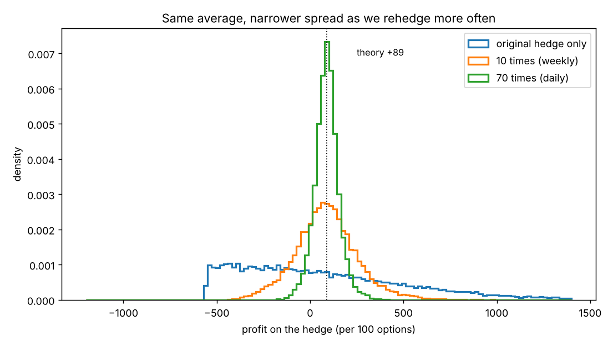

# Rehedging frequency, costs and the frictionless market

**One-line definition:** how often you rebalance a hedge changes how *lucky or unlucky* a single result can be, not the average result; real costs and restrictions decide how often rebalancing is worth it.

## Intuition
Rehedging is like taking more shots at a basket. Each shot has the same chance of going in; more shots do not make any one shot better, but your total is closer to the "true" scoring rate. The cost of each shot (brokerage and exchange fees) eats into the score. A professional who pays almost nothing per shot takes many. A retail trader who pays a lot per shot takes fewer, and accepts more variation in the final total.

## Two ways to decide when to rehedge
If we ignore costs, there are two common approaches:

1. **Regular intervals.** Rehedge every hour, day or week (Figure 8-1 used weeks "for no other reason than 10 lines seemed to fit nicely on the page"). The more often, the closer the result to the model's prediction.
2. **Delta bands.** Rehedge only when the total delta drifts beyond a set limit. Most traders do not insist on exact neutrality; within limits they accept some directional risk.

The book illustrates bands using the weekly delta positions in Figure 8-1 (+400, $-1{,}900$, +800, 0, +1,900, $-3{,}400$, $-1{,}100$, +1,000, +4,500):

| Limit | Adjustments that would have been skipped | 
|---|---|
| 500 deltas | week 1 (+400) |
| 1,000 deltas | weeks 1 (+400), 3 (+800), 8 (+1,000) |
| 1,500 deltas | weeks 1 (+400), 3 (+800), 7 ($-1{,}100$), 8 (+1,000) |

The more directional risk you accept, the fewer the trades, and the more likely the actual result differs from the predicted one. (The book's illustration is only a first pass: once you skip a week, later deltas and trades would change. Even 500 deltas, it notes, may be more directional risk than many traders accept.)

## What simulation shows (our extension)
The book gives one path. We ran the same hedge (buy 100 calls at 5.00, theoretical 5.89, true volatility 37.62%) on **20,000 random paths** and varied the number of rehedges over the 70 days. Results are profit today per 100 options:

| Rehedges | Average | Standard deviation | Chance of a loss |
|---|---|---|---|
| 1 (original hedge only) | 86 | 487 | 51% |
| 10 (weekly) | 88 | 171 | 29% |
| 70 (daily) | 88 | 67 | 8% |
| 280 | 89 | 34 | 1% |

The model predicts 89. The averages are all close to it, while the spread shrinks, roughly with the square root of the number of rehedges (10 times more rehedges: spread about 3 times smaller; 4 times more: about 2 times smaller). This is exactly the book's claim: "adjustments do not in themselves alter the expected return; they simply reduce the short-term effects of good and bad luck."

Note the blue curve: with no rehedging, the result depends on where the stock ends up, so you lose half the time even with a 0.89 edge on each option. The pro's daily rehedging gives a loss only 8% of the time.

## Retail vs professional
A professional (especially an exchange member) has low transaction costs, so adjustments cost little against the expected profit and he rehedges often. A retail customer with the same hedge has the same favourable odds, but each adjustment costs more, so he rehedges less often and is "more sensitive to the effects of short-term good and bad luck". Larger occasional losses, larger occasional profits, about the same average. The book adds in a footnote that this ignores the professional's real advantage of buying at the bid and selling at the ask: a retail customer "can never hope to match" it.

## The frictionless market
Our example assumed a **frictionless market**:

| Assumption | Reality |
|---|---|
| Traders can freely buy or sell the underlying | Short sales may be restricted by regulators or exchanges; futures can be limit-locked, so no trading until the price comes off the limit |
| One constant interest rate for borrowing and lending | Different traders pay different rates; there is a spread between borrowing and lending; a short seller usually does not get full interest on the proceeds. Fortunately the interest rate is usually the *least important* input |
| Zero transaction costs | A real consideration: with high costs "all the profits could be eaten up by brokerage and exchange fees", and more adjustments mean more cost |
| No taxes | Different instruments and holding periods may be taxed differently; the book simply assumes each trader maximizes pretax profit |

## Common confusions
- **More rehedging is not free profit.** It reduces variance but costs money. The right frequency depends on "each trader's cost structure and risk tolerance".
- **Not rehedging is not wrong.** A theoretically profitable hedge still has the odds on its side; a trader who skips adjustments just has a larger chance of not realizing the profit on any one hedge.
- **The exact numbers above are ours.** The book describes the effect in words; the table comes from our notebook ([[code/dynamic_hedging.ipynb]]), using risk-neutral drift and continuously compounded interest, so treat them as an illustration.

## Related
- Chapter: [[chapters/08-dynamic-hedging]]
- Previous: [[concepts/08-dynamic-hedging/gamma-and-the-unhedged-amount]]
- Next: [[concepts/08-dynamic-hedging/realized-volatility-and-the-race]]
- Earlier: [[concepts/02-forward-pricing/short-selling-and-borrowing-costs]], [[concepts/05-theoretical-pricing-models/models-and-their-limits]]
- Later: Chapter 23, "Models and the Real World"
- Maths needed: [[00-maths-refresher/standard-deviation-and-variance]]
- See also: [[glossary]], [[formulas]]
