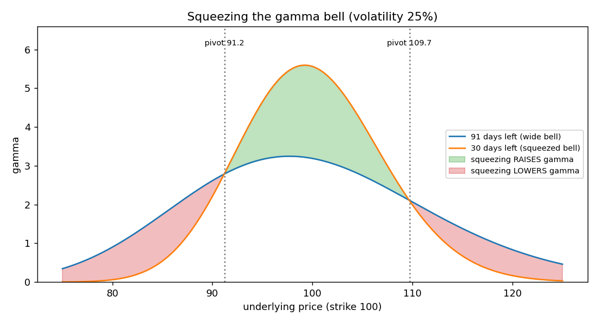
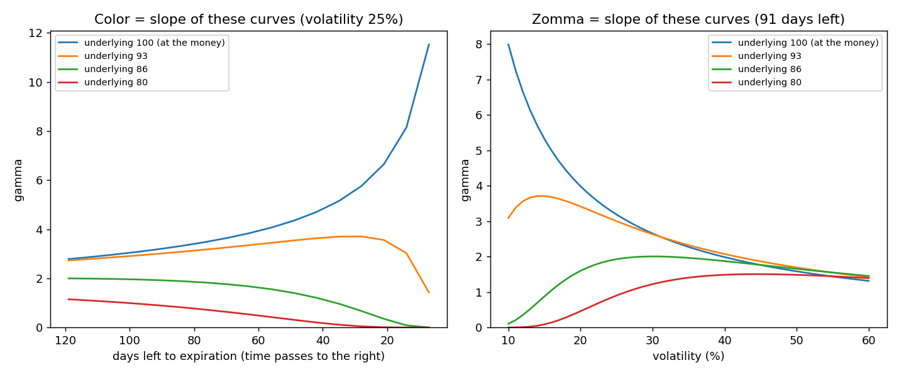
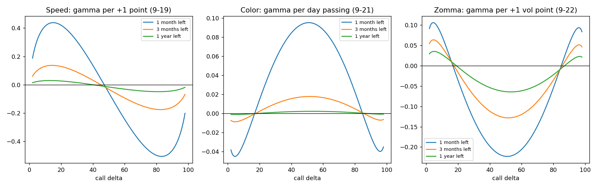

# Color and zomma in detail (how gamma changes with time and volatility)

**One-line definition:** **color** (gamma decay) is how much an option's gamma changes as a day passes, and **zomma** is how much it changes when volatility rises one point; at the money, gamma grows as time passes (color positive in our per-day convention) and shrinks as volatility rises (zomma negative), the signs flip near call deltas of 5 and 95, and both are about zero near 15 and 85.

## Intuition: squeeze the bell and look at where you are standing
Start from [[concepts/09-risk-measurement-ii/gamma-as-a-bell-curve]]: gamma against the underlying price is a bell with a fixed area. You are standing at one underlying price. Then:
- **Time passes** (or volatility falls): the bell is **squeezed**.
- **Volatility rises:** the bell is **stretched**.

Color and zomma ask one thing: *what happens to the height of the bell at the spot where I am standing?*

The picture shows a squeeze (91 days to 30 days). There are three zones:

| Where you stand | What a squeeze does to your gamma | Color (per day passing) | Zomma (volatility up is a stretch) |
|---|---|---|---|
| Near the strike (green) | gamma **rises** | positive | negative |
| At the pivots, where the curves cross (about one standard deviation out; call deltas about 15-20 and 80-85) | **no change** | about 0 | about 0 |
| Out in the tails (red; call deltas below about 15 or above about 85, most clearly near 5 and 95) | gamma **falls** | negative | positive |

Why the pivots exist: a squeezed bell is taller in the middle but falls away faster, so the two bells must cross somewhere, and for a bell curve that is about one standard deviation from the centre.

## Graph 1: gamma as time passes (color is the slope)
Fix the underlying and watch its gamma day by day. Four prices, strike 100, volatility 25%:

*Left panel.* Call deltas with 91 days left: 52.5 (price 100), 30.2 (93), 12.6 (86), 4.2 (80).
- **Price 100 (at the money):** gamma rises the whole way, and ever faster: 3.19 with 91 days left, 5.56 with 30, 8.15 with 14, 11.52 with 7. A rising slope means positive color, growing as expiration nears.
- **Price 93:** gamma rises at first, peaks at about 28 days left (3.71), then collapses to 1.43 at 7 days. It starts in the green zone and, as the bell squeezes and the option drifts out of the money, ends up in the red zone. **Color changes sign along the way.**
- **Prices 86 and 80:** they start in the red zone and gamma falls towards zero. Negative color.

## Graph 2: gamma against volatility (zomma is the slope)
*Right panel* (91 days left): the same four prices, with volatility along the bottom.
- **Price 100:** gamma falls steadily as volatility rises (7.99 at 10%, 3.19 at 25%, 1.32 at 60%): negative zomma. Higher volatility stretches the bell, so the peak gets lower.
- **Prices 93, 86 and 80:** each curve is a **hump**: gamma rises with volatility up to a peak, then falls. The peak moves right the further out of the money the price is: about 15% volatility for 93, 30% for 86 and 45% for 80. The bell needs enough volatility to reach you; once it has, extra volatility just spreads it thinner. So zomma is positive on the left of each hump and negative on the right.

## Putting it all on one graph: the book's Figures 9-21 and 9-22
The book plots color and zomma against call delta, so that every option is on one scale. These are the slopes of the curves above, collected for every delta. Ours are the two right-hand panels (the left one is speed):

Values for a call (volatility 25%), in units of 0.001:

| Call delta | 5 | 15 | 50 | 85 | 95 |
|---|---|---|---|---|---|
| Color, 91 days left (per day passing) | −8.7 | −2.2 | **+17.7** | +0.5 | −6.9 |
| Color, 30 days left | −44.9 | −9.3 | **+95.2** | −0.9 | −39.3 |
| Zomma, 91 days left (per volatility point) | +63.1 | +15.3 | **−127.9** | −4.1 | +49.6 |
| Zomma, 30 days left | +104.9 | +19.4 | **−222.7** | +0.1 | +91.4 |

- **Biggest at the money**, with the **opposite sign near deltas 5 and 95**, and about **zero near 15 and 85** (the model's zero crossings with 91 days left are at call deltas of about 17 and 85).
- **Bigger with less time:** at the money, color is $+0.0022$ per day with 365 days left, $+0.0177$ with 91 and $+0.0952$ with 30. This is the book's "reducing time or volatility will increase" color and zomma: a narrower bell changes faster.

## The book's sign statements, decoded
The book describes color from the point of view of time *to* expiration, so its sign is the opposite of our per-day-passing convention. Zomma needs no translation.

| The book says | In our convention |
|---|---|
| At the money, gamma is smaller with more time and larger with less time, "hence a negative color value" | color is **positive** per day passing |
| Near deltas 5 and 95, "an increase in time causes gamma values to rise... (a positive color)" | color is **negative** per day passing |
| Zomma at the money: gamma smaller as volatility rises, "a negative zomma" | same: **negative** |
| Zomma near deltas 5 and 95: "an increase in volatility causes gamma values to rise (a positive zomma)" | same: **positive** |
| Near deltas 15 and 85 both are "close to 0" | same |

## Why color and zomma look like twins
In the model (no interest), gamma depends on time and volatility only through $\sigma\sqrt{t}$ (apart from a fixed $1/S$), so time passing is like volatility falling ([[concepts/09-risk-measurement-ii/time-and-volatility-have-similar-effects]]). That is why at the money color is positive while zomma is negative: time passing acts like volatility falling, and falling volatility raises gamma. It also gives an exact link between the two:

$$\text{color (per day passing)} \approx -\frac{\sigma}{7.3\,t} \times \text{zomma (per volatility point)}$$

- Symbols: $\sigma$ volatility as a decimal (0.25), $t$ years left; $7.3 = 2 \times 365 \div 100$.
- Why: one day passing shortens $t$ by $1/365$ of a year, which changes $\sigma\sqrt{t}$ by about $\sigma/(2\sqrt{t} \times 365)$. One volatility point changes it by $0.01\sqrt{t}$. Both act on gamma through the same $\sigma\sqrt{t}$, so the ratio of the two effects is $-\dfrac{\sigma}{2\sqrt{t} \times 365} \div \left(0.01\sqrt{t}\right) = -\dfrac{\sigma}{7.3\,t}$ (the minus sign is because a day *passing* reduces $t$).
- Check at the money: 91 days gives $-0.25/(7.3 \times 0.249) = -0.137$, against the model's $0.0177 / -0.1281 = -0.138$. For 30 days: $-0.417$ against $-0.427$. For 365 days: $-0.034$ against $-0.034$.

You do not need the formula to use the idea; it just shows that the two are the same effect.

## Worked example: a position of 100 at-the-money options
Underlying 100, 30 days left, volatility 25%: gamma 5.56 per option, so a 1-point move changes the position's delta by about $100 \times 5.56 = 556$ delta points.

- **Color:** $+0.095$ per day. Tomorrow, with nothing else changed, gamma is about 5.66 (the model: 5.658), so the position's delta now moves by about 566 per point. The delta risk grows a little every day, faster as expiration nears.
- **Zomma:** $-0.223$ per volatility point. If implied volatility falls 3 points, gamma rises by about $3 \times 0.223 = 0.67$, to about 6.2 (the model: 6.32; the straight-line guess is a little low because gamma curves upward as volatility falls). The position's delta now moves by about 630 per point, **even though the price has not moved**.

## Common confusions
- **Color is not constant over an option's life.** An option that starts near the money can drift across the zones (the price 93 example), so color and zomma describe *today's* position, not the rest of the journey.
- **"About zero" is not "no gamma".** At the pivots the gamma itself can be sizeable; it just does not change for a small squeeze or stretch.
- **The numbers look tiny** (color 0.0177 per day). They matter because gamma itself builds up near expiration (at 7 days left an at-the-money option's gamma is already 11.5) and because positions hold many options.

## Related
- Chapter: [[chapters/09-risk-measurement-ii]]
- Built on: [[concepts/09-risk-measurement-ii/gamma-as-a-bell-curve]]
- Maths needed: [[00-maths-refresher/sensitivity-of-a-sensitivity]]
- Previous: [[concepts/09-risk-measurement-ii/speed-color-and-zomma]]
- Code: [[code/risk_measures_ii.ipynb]]
- See also: [[concepts/09-risk-measurement-ii/short-dated-at-the-money-options-the-riskiest]], [[glossary]], [[formulas]]
