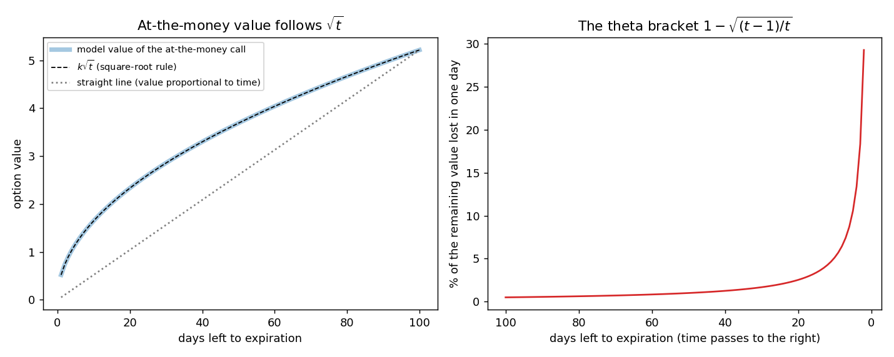

# Estimating the theta of an at-the-money option (the square-root-of-time rule)

**One-line definition:** because an at-the-money option's value is proportional to the square root of the time left, one day later its value is $\sqrt{(t-1)/t}$ times today's, and its theta is the difference.

## Intuition
We have two facts about an at-the-money option:
1. Its value is proportional to volatility (theta, which measures value-melting, is proportional to volatility, [[concepts/09-risk-measurement-ii/theta-in-different-conditions]]).
2. Volatility over a period is proportional to the **square root of time** ([[concepts/06-volatility/scaling-volatility-for-time]]).

Put them together: the value of an at-the-money option is proportional to $\sqrt{\text{days left}}$. Then "tomorrow's value" is easy to predict from "today's value" and the decay is the gap between them.

The book says plainly that this works **only for at-the-money options**: "There is no convenient method for estimating the theta of in-the-money and out-of-the-money options."

## Why is the value proportional to $\sqrt{t}$?
This is the step the book takes from Chapter 6, so it is worth making it feel obvious.

**1. Random steps partly cancel.** Flip a coin 100 times, moving the price up one for heads and down one for tails. You do not end up 100 steps from the start; you typically end up about 10 away, because heads and tails undo each other. In general the typical distance after $n$ random steps is $\sqrt{n}$:

| Number of steps | 1 | 4 | 9 | 100 | 400 |
|---|---|---|---|---|---|
| Typical distance from the start | 1 | 2 | 3 | 10 | 20 |

Four times the steps gives only twice the distance. (If the price *trended*, the distance would grow in step with time; it is the randomness that makes it a square root. See [[concepts/06-volatility/scaling-volatility-for-time]] and [[concepts/06-volatility/random-walks-and-normal-distributions]].)

**2. An at-the-money option is worth about "how far the price typically travels".** It pays off only if the price ends up on the right side of the strike, and the further the price can wander, the more it can finish there. (The book states this precisely in Chapter 18 as the "40% rule": an at-the-forward option is worth about 40% of one standard deviation of the price.)

**3. So its value follows the square-root curve.** Four times the time left means about twice the value, not four times. Half the time left means about 71% of the value ($\sqrt{0.5} = 0.707$), not 50%.

*Left:* the model's at-the-money value (thick line) sits on the square-root curve (dashed) and well above the straight line "proportional to time" (dotted). An option with 10 days left is worth about 32% of the same option with 100 days left ($\sqrt{0.1} = 0.32$); a straight line would say 10%. *Right:* a square-root curve is steep near zero, so each day removes a bigger share of what is left as expiration approaches. That share is the bracket $1-\sqrt{(t-1)/t}$ in the formula below.

## The maths
Let $TV_t$ be the theoretical value with $t$ days to expiration.

**Step 1.** Value proportional to $\sqrt{t}$ means the ratio of two values equals the ratio of the square roots of their times:

$$\frac{TV_{t-1}}{TV_t} = \frac{\sqrt{t-1}}{\sqrt{t}} = \sqrt{\frac{t-1}{t}}$$

**Step 2.** Multiply both sides by $TV_t$:

$$TV_{t-1} = TV_t \times \sqrt{\frac{t-1}{t}}$$

**Step 3.** Theta is the value lost in one day, today's value minus tomorrow's:

$$\Theta = TV_t - TV_{t-1} = TV_t \times \left(1 - \sqrt{\frac{t-1}{t}}\right)$$

**Why theta keeps growing.** The bracket $1 - \sqrt{(t-1)/t}$ gets larger as $t$ gets smaller. Try it:

| Days left $t$ | $\sqrt{(t-1)/t}$ | Bracket $1 - \sqrt{(t-1)/t}$ | As a share of today's value | Shortcut $1/(2t)$ |
|---|---|---|---|---|
| 90 | 0.99443 | 0.00557 | 0.6% | 0.00556 |
| 30 | 0.98319 | 0.01681 | 1.7% | 0.01667 |
| 10 | 0.94868 | 0.05132 | 5.1% | 0.05000 |
| 5 | 0.89443 | 0.10557 | 10.6% | 0.10000 |
| 2 | 0.70711 | 0.29289 | 29.3% | 0.25000 |
| 1 | 0.00000 | 1.00000 | 100.0% | 0.50000 |

**A shortcut (ours, not the book's).** For large $t$, $\sqrt{1 - x} \approx 1 - x/2$ when $x$ is small. With $x = 1/t$ the bracket becomes about $1/(2t)$, so

$$\Theta \approx \frac{TV_t}{2t}$$

(today's value divided by twice the number of days left). With 30 days: $2.50/(2 \times 30) = 0.0417$, against the exact 0.0420. The shortcut is good while many days remain (the table: 30 days, 0.0167 against 0.0168) and poor in the last few (2 days: 0.25 against 0.29; 1 day: 0.5 against 1, because the whole remaining value goes).

## Worked example (the book's)
An at-the-money option worth 2.50 with 30 days left.

1. Today: $\Theta = 2.50 \times \left(1 - \sqrt{29/30}\right) = 2.50 \times (1 - 0.98319) = 2.50 \times 0.01681 \approx 0.042$.
2. Tomorrow the value is $2.50 - 0.042 = 2.458$ with 29 days left.
3. Tomorrow's theta: $2.458 \times \left(1 - \sqrt{28/29}\right) = 2.458 \times (1 - 0.98263) = 2.458 \times 0.01737 \approx 0.0427$. The book rounds to 0.043.

Theta rose from 0.042 to 0.043 in one day, with the time still a month away. ([[code/risk_measures_ii.ipynb]] checks both steps against a model: for a 30-day at-the-money option worth 2.50 at volatility 21.9%, the model's true one-day decays are 0.0420 and 0.0427.)

## Common confusions
- **"Proportional to the square root" is not "halves when time halves".** Halve the time and the value falls to about 71%, not 50%. That is exactly why the value is lost faster near expiration: the curve is steep near zero.
- **The estimate assumes the underlying stays at the strike and volatility does not change.** It describes decay with nothing else moving.
- **This is the decay over a whole day**, from $t$ days to $t-1$ days, not the instantaneous slope the pricing model reports. They differ slightly (the model's theta at 30 days is $-0.0417$, the one-day decay is $-0.0420$) because theta is itself rising.
- **At the money only, and when the strike equals the forward price.** With interest, dividends or a skew the "at the money" option is not exactly proportional to $\sqrt{t}$.
- **The book cites Figure 9-7** after this passage; it means Figure 9-10 (theta over time). Figure 9-7 is the charm.

## Related
- Chapter: [[chapters/09-risk-measurement-ii]]
- Maths needed: [[00-maths-refresher/proportionality-and-percentage-change]], [[00-maths-refresher/standard-deviation-and-variance]]
- Previous: [[concepts/09-risk-measurement-ii/theta-in-different-conditions]]
- Next: [[concepts/09-risk-measurement-ii/at-the-money-scaling-with-the-exercise-price]]
- See also: [[concepts/07-risk-measurement-i/theta]], [[glossary]], [[formulas]]
