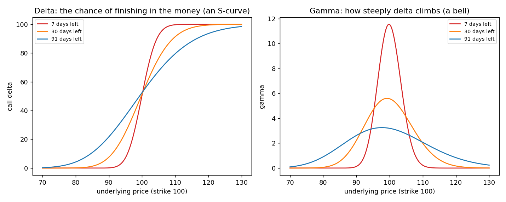

# Gamma as a bell curve (squeezing and stretching)

**One-line definition:** delta (roughly the chance of finishing in the money) climbs from 0 to 100 as the underlying rises, and gamma is how steeply it climbs, so gamma is a hump shaped like a bell curve whose area is always 100; less time or lower volatility **squeezes** the bell (narrow and tall), more time or higher volatility **stretches** it (wide and low).

## Intuition
Draw delta against the underlying price: an S-curve that starts at 0 far below the strike and ends at 100 far above it. Gamma is the *steepness* of that S-curve at each price, so it is small in the flat ends and largest in the steep middle: a hump.

Two facts make the picture work.
1. **The area under the bell is always 100.** Delta climbs by exactly 100 in total, from 0 to 100, and the area under a "steepness" curve is the total climb. We checked: 7, 30 and 91 days left all give an area of 100.0 (strike 100, volatility 25%).
2. **Time and volatility only squeeze or stretch the bell.** Because the area is fixed, a narrow bell must be tall and a wide bell must be low. Think of a fixed amount of sand (100 units) spread along the price axis: pile it narrow and it is a tall heap; spread it wide and it is a thin layer.

| Days left (strike 100, volatility 25%) | 7 | 30 | 91 |
|---|---|---|---|
| Gamma at the strike (height of the bell) | 11.52 | 5.56 | 3.19 |
| Area under the bell | 100 | 100 | 100 |

The bell has roughly the shape of "where might the price end up", the distribution of final prices from Chapters 5 and 6 ([[concepts/06-volatility/lognormal-distributions]]). It is slightly lopsided and peaks a little below the strike.

## What this explains
**1. Gamma is greatest at the money (Figure 9-18).** The steepest part of the S-curve is in the middle, so the tallest part of the bell is at the strike.

**2. Why at-the-money gamma is smaller at higher exercise prices.** Gamma is measured per **point** of the underlying, and the bell's width in points grows with the price (a one-standard-deviation yearly move of 25% is 25 points on a stock at 100 but 250 points on a stock at 1,000). A wider bell with the same area is lower: at-the-money gamma is 6.38, 3.19 and 0.32 for strikes of 50, 100 and 1,000 (91 days, volatility 25%), inversely proportional to the strike ([[concepts/09-risk-measurement-ii/at-the-money-scaling-with-the-exercise-price]]).

**3. Why at-the-money gamma rises as time passes or volatility falls, but the reverse happens away from the money (Figure 9-20).** The book's example (page 151): a 100 call with the underlying at 97.50.
- *Squeezed bell (little time or low volatility):* you stand near the top of a narrow, steep bell. The 5-point move to 102.50 carries delta from about 25 to 75, so gamma is about $50/5 = 10$.
- *Wide bell (lots of time or high volatility):* the same 5 points is a gentle slice of a flat bell. Delta goes from about 45 to 55, so gamma is about $10/5 = 2$. (The model gives deltas of 25.7 and 75.0 for 13 days at volatility 20%, and a gamma of 2.0 for 91 days at 40%.)

Away from the strike the narrow bell has fallen to almost nothing while the wide bell is still there, so the order flips:

| Underlying price | 90 | 94 | 100 | 106 | 110 |
|---|---|---|---|---|---|
| 7 days left | 0.13 | 2.56 | **11.52** | 2.56 | 0.23 |
| 30 days left | 2.21 | 4.20 | 5.56 | 3.66 | 1.99 |
| 91 days left | 2.62 | 3.10 | 3.19 | 2.62 | 2.07 |

The 30-day and 91-day curves cross at two "pivot" prices, about 91 and 110 here (call deltas of about 20 and 83). Near the strike the squeezed bell wins; beyond the pivots the wide bell wins. ([[concepts/09-risk-measurement-ii/color-and-zomma-in-detail]] builds on this.)

**4. Speed (Figure 9-19) is the slope of the bell.** On the rising left side (out-of-the-money calls) gamma grows as the price rises toward the strike: positive speed. On the falling right side (in-the-money calls) gamma shrinks as the price rises: negative speed. At the very top and in the flat tails the slope is about zero. The slope is steepest on the flanks, at call deltas of about 15 and 85 (our model: 14 to 15 and about 83). Squeeze the bell and its flanks get steeper, so speed grows with less time or lower volatility ([[concepts/09-risk-measurement-ii/speed-color-and-zomma]]).

## Common confusions
- **"Gamma is a probability."** Not exactly. Delta is roughly the *cumulative* chance of finishing in the money, and gamma is how fast that chance changes, which has the shape of the *distribution* of final prices. It is a picture to think with, not a probability to quote.
- **The area of 100 is in delta points.** It is on the same 0-to-100 scale as delta, not a money value.
- **This note plots against the underlying price.** The speed, color and zomma graphs in the chapter are re-labelled against delta, which stretches the picture but keeps the story.
- **A wider bell does not mean "less gamma risk everywhere".** It means less gamma near the strike and more in the tails. What matters is where the price is standing.

## Related
- Chapter: [[chapters/09-risk-measurement-ii]]
- Built on: [[concepts/07-risk-measurement-i/gamma]], [[concepts/09-risk-measurement-ii/gamma-in-different-conditions]]
- Next: [[concepts/09-risk-measurement-ii/color-and-zomma-in-detail]]
- Code: [[code/risk_measures_ii.ipynb]]
- See also: [[concepts/09-risk-measurement-ii/time-and-volatility-have-similar-effects]], [[glossary]], [[formulas]]
