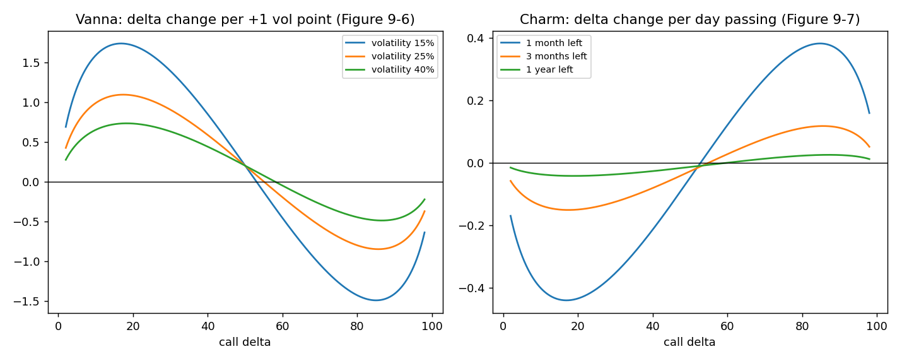

# Vanna and charm: how delta changes with volatility and time

**One-line definition:** **vanna** is the change in an option's delta for a 1-point change in volatility, and **charm** (delta decay) is the change in delta as a day passes; both are zero near delta 50 and largest for options with deltas around 15 to 20 and 80 to 85.

## Intuition
[[concepts/09-risk-measurement-ii/delta-changes-with-volatility-and-time]] said which *direction* delta moves. Vanna and charm measure *how fast*.

Ask: which options can change their delta the most?
- Delta already near **0**, **100** or **50** has nowhere to go (almost certainly out / in the money, or already a coin toss), so little changes.
- Deltas in the **middle of those anchors** (roughly 15 to 20 and 80 to 85) have the most room to move toward 50 if volatility rises (or toward 0 or 100 if volatility falls or time passes).

That gives the hump shapes in the figure.

**Why the sign flips at 50.** More volatility widens the range of outcomes. An out-of-the-money call (delta below 50) gets a better chance of finishing in the money, so its delta **rises**: positive vanna. An in-the-money call (delta above 50) gets a better chance of finishing out of the money, so its delta **falls** toward 50: negative vanna. At 50 it is a coin toss either way, so nothing changes. Less time acts like less volatility, so charm (per day passing) has the opposite pattern: out-of-the-money deltas fall toward 0, in-the-money deltas rise toward 100.

## The maths
We quote each per **one volatility point** (vanna) or **one day passing** (charm), with delta in whole numbers:

$$\text{vanna} = \frac{\text{change in delta}}{\text{change in volatility (points)}} \qquad \text{charm} = \frac{\text{change in delta}}{\text{one day passing}}$$

Reading the figure (calls; puts have the same shapes with deltas $-100$ to 0):
- **Signs.** Out-of-the-money calls (delta below about 50) have **positive vanna** (more volatility lifts the delta) and **negative charm** (time passing lowers it). In-the-money calls (above about 50) are the opposite. Near 50, both are about zero (the vanna crosses zero a little above 50, which the book explains by the lopsided lognormal distribution).
- **Biggest at** call deltas around 15 to 20 and 80 to 85. Our model puts the peaks at about 17 and 86.
- **Size.** Vanna falls as volatility rises (the curves are lower at 40% than at 15%). Charm gets much bigger as expiration nears (the "1 month" curve is about three times the "3 months" curve and ten times the "1 year" curve).
- **What each does not depend on.** Vanna barely changes with time to expiration; charm barely changes with volatility. (Volatility acts on vanna, time acts on charm.)

## Reading the graph: sign and size
For any point on the graph ask two things: which side of the zero line is it (the **sign**), and how far from the line is it (the **size**)?

| Sign | Vanna (per +1 volatility point) | Charm (per day passing) |
|---|---|---|
| Positive | delta rises when volatility rises | delta rises as days pass |
| Negative | delta falls when volatility rises | delta falls as days pass |

The size is the number of delta points that move. Example, the vanna of a 20-delta and an 80-delta call (91 days):

| Volatility | 20-delta call | 80-delta call |
|---|---|---|
| 15% | +1.71 | −1.43 |
| 25% | +1.08 | −0.80 |
| 40% | +0.73 | −0.45 |

The signs do not change, but at higher volatility both numbers are **closer to zero**. So the high-volatility curve is not "less" on one side and "more" on the other: it is flatter, a smaller size on both sides. (In the negative region the low-volatility curve is *lower* on the page, which is a larger effect, not a smaller one.) How to read all four graphs: [[concepts/09-risk-measurement-ii/how-the-higher-order-graphs-are-made]].

## Why the high-volatility curve is flatter, and charm is bigger near expiration
Delta depends on how many standard deviations the strike is from the underlying ([[00-maths-refresher/normal-distribution-and-z-scores]]), and the size of one standard deviation is set by volatility. Now raise volatility by one point:
- At 10% volatility that is 10% more spread (1 out of 10). At 40% it is only 2.5% more (1 out of 40).
- So at low volatility the same one point pushes the strike through many more standard deviations, and the delta moves more.

Think of a splash of milk in a small cup and in a large mug: the small cup changes colour much more. Comparing options with the same delta (as the graph does), the effect is roughly proportional to $1/\text{volatility}$: the 20-delta call has vanna 1.71 at 15%, 1.08 at 25% and 0.73 at 40%. (The Black-Scholes formula for vanna has the volatility in the denominator, which is where this comes from.)

**Time works the same way.** One day is a small slice of a long life and a big slice of a short one. For a 20-delta call (volatility 25%) charm is $-0.43$ per day with 30 days left, $-0.15$ with 91 days and $-0.04$ with 365 days.

## Worked example 1: vanna
A 110 call (underlying 100, 91 days, volatility 25%): delta 24.2, vanna 1.03. Volatility rising 5 points should lift the delta by roughly $5 \times 1.03 \approx 5.2$, to about 29.3. The model says 28.7 (the vanna shrinks as volatility rises, so a linear estimate is a little high; it is good for small moves).

## Worked example 2: charm and a hedge that drifts
You own 50 calls with delta 20 and are hedged delta neutral with 10 short underlying contracts: $50 \times 20 - 10 \times 100 = 0$. One month to expiration, volatility 25%: charm of a 20-delta call is about $-0.43$ per day.

$$\text{position delta after one day} \approx 50 \times (-0.43) = -21$$

The position has become about 21 deltas **short** (0.2 of a contract) after one day with no market move. After a weekend (3 calendar days) the drift is around $-65$ deltas, so you would need to buy about two thirds of an underlying contract to get back to neutral. With three months left charm is only $-0.15$, so the same position drifts about 7.5 deltas a day. **The closer to expiration, the faster the hedge drifts.**

## Common confusions
- **Why our charm graph looks upside down against the book's.** Here charm is "delta change per day that passes", so it is negative for out-of-the-money calls: a 20-delta call loses delta as days go by. The book's Figure 9-7 shows a **positive** hump at call delta 20 because its formulas use time *to* expiration, so its picture is the effect of one day *more* time. Turn ours upside down and they match; the shapes and sizes are the same.
- **"Vanna is smaller at higher volatility and smaller at lower volatility?"** No: the *size* is smaller at higher volatility and larger at lower volatility, on both sides of 50. The confusion comes from the negative region, where the low-volatility curve is lower on the page (more negative). Size is the distance from the zero line. The book's "falling as we raise volatility, rising as we reduce volatility" is about size too.
- **Vanna has two readings** (delta vs volatility; vega vs underlying price). Same number ([[00-maths-refresher/sensitivity-of-a-sensitivity]]).
- **Both are small per unit.** Vanna of about 1 means one delta point per volatility point. It matters for large positions, big volatility moves, and short-dated hedges.

## Related
- Chapter: [[chapters/09-risk-measurement-ii]]
- Maths needed: [[00-maths-refresher/sensitivity-of-a-sensitivity]]
- How the graphs are made and read: [[concepts/09-risk-measurement-ii/how-the-higher-order-graphs-are-made]]
- Previous: [[concepts/09-risk-measurement-ii/delta-changes-with-volatility-and-time]]
- Next: [[concepts/09-risk-measurement-ii/theta-in-different-conditions]]
- See also: [[concepts/09-risk-measurement-ii/summary-tables-where-each-measure-is-largest]], [[glossary]], [[formulas]]
