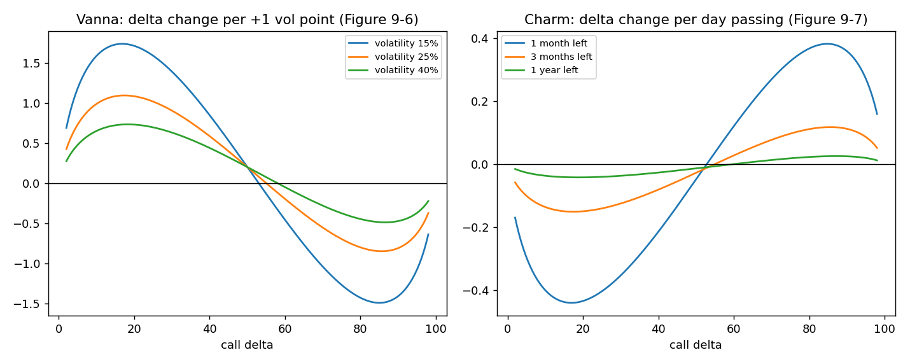

# Vanna and charm: how delta changes with volatility and time

**One-line definition:** **vanna** is the change in an option's delta for a 1-point change in volatility, and **charm** (delta decay) is the change in delta as a day passes; both are zero near delta 50 and largest for options with deltas around 15 to 20 and 80 to 85.

## Intuition
[[concepts/09-risk-measurement-ii/delta-changes-with-volatility-and-time]] said which *direction* delta moves. Vanna and charm measure *how fast*.

Ask: which options can change their delta the most?
- Delta already near **0**, **100** or **50** has nowhere to go (almost certainly out / in the money, or already a coin toss), so little changes.
- Deltas in the **middle of those anchors** (roughly 15 to 20 and 80 to 85) have the most room to move toward 50 if volatility rises (or toward 0 or 100 if volatility falls or time passes).

That gives the hump shapes in the figure.

## The maths
We quote each per **one volatility point** (vanna) or **one day passing** (charm), with delta in whole numbers:

$$\text{vanna} = \frac{\text{change in delta}}{\text{change in volatility (points)}} \qquad \text{charm} = \frac{\text{change in delta}}{\text{one day passing}}$$

Reading the figure (calls; puts have the same shapes with deltas $-100$ to 0):
- **Signs.** Out-of-the-money calls (delta below about 50) have **positive vanna** (more volatility lifts the delta) and **negative charm** (time passing lowers it). In-the-money calls (above about 50) are the opposite. Near 50, both are about zero (the vanna crosses zero a little above 50, which the book explains by the lopsided lognormal distribution).
- **Biggest at** call deltas around 15 to 20 and 80 to 85. Our model puts the peaks at about 17 and 86.
- **Size.** Vanna falls as volatility rises (the curves are lower at 40% than at 15%). Charm gets much bigger as expiration nears (the "1 month" curve is about three times the "3 months" curve and ten times the "1 year" curve).
- **What each does not depend on.** Vanna barely changes with time to expiration; charm barely changes with volatility. (Volatility acts on vanna, time acts on charm.)

## Worked example 1: vanna
A 110 call (underlying 100, 91 days, volatility 25%): delta 24.2, vanna 1.03. Volatility rising 5 points should lift the delta by roughly $5 \times 1.03 \approx 5.2$, to about 29.3. The model says 28.7 (the vanna shrinks as volatility rises, so a linear estimate is a little high; it is good for small moves).

## Worked example 2: charm and a hedge that drifts
You own 50 calls with delta 20 and are hedged delta neutral with 10 short underlying contracts: $50 \times 20 - 10 \times 100 = 0$. One month to expiration, volatility 25%: charm of a 20-delta call is about $-0.43$ per day.

$$\text{position delta after one day} \approx 50 \times (-0.43) = -21$$

The position has become about 21 deltas **short** (0.2 of a contract) after one day with no market move. After a weekend (3 calendar days) the drift is around $-65$ deltas, so you would need to buy about two thirds of an underlying contract to get back to neutral. With three months left charm is only $-0.15$, so the same position drifts about 7.5 deltas a day. **The closer to expiration, the faster the hedge drifts.**

## Common confusions
- **Sign of charm.** Here charm is "delta change per day that passes", so it is negative for out-of-the-money calls. The book's formula uses time *to* expiration; its sign for charm is therefore reversed, but its text only describes the shapes.
- **Vanna has two readings** (delta vs volatility; vega vs underlying price). Same number ([[00-maths-refresher/sensitivity-of-a-sensitivity]]).
- **Both are small per unit.** Vanna of about 1 means one delta point per volatility point. It matters for large positions, big volatility moves, and short-dated hedges.

## Related
- Chapter: [[chapters/09-risk-measurement-ii]]
- Maths needed: [[00-maths-refresher/sensitivity-of-a-sensitivity]]
- Previous: [[concepts/09-risk-measurement-ii/delta-changes-with-volatility-and-time]]
- Next: [[concepts/09-risk-measurement-ii/theta-in-different-conditions]]
- See also: [[concepts/09-risk-measurement-ii/summary-tables-where-each-measure-is-largest]], [[glossary]], [[formulas]]
