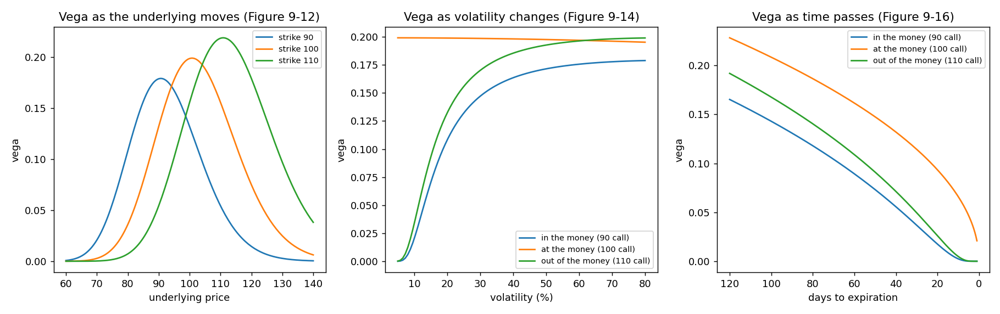

# Vega in different conditions

**One-line definition:** vega is largest at the money, scales with the exercise price at the money, is nearly constant against volatility for an at-the-money option but rises with volatility for in- and out-of-the-money options, and shrinks as expiration approaches.

## Intuition
Vega says "how much is this option worth if implied volatility rises one point?" An option is most affected by volatility when its fate is still undecided, which is at the money.
- **Underlying price:** the same hump as theta. In fact the book says its graph is "almost identical" to the theta graph.
- **Volatility:** an at-the-money option's value is a nearly straight line in volatility, so its slope (vega) is nearly constant. Out- and in-the-money options start nearly worthless and "wake up" as volatility rises, because they begin to act at the money.
- **Time:** more time gives volatility more room to work. Long-term options are always more sensitive to volatility than short-term ones (a Chapter 6 principle).

## The maths and the three patterns

**1. Against the underlying price (Figure 9-12).** A hump centred on the exercise price; the higher the exercise price the bigger the hump. At the money, vega is proportional to the exercise price: a 100 option has twice the vega of a 50 option ([[concepts/09-risk-measurement-ii/at-the-money-scaling-with-the-exercise-price]]). (The slope of this hump, how vega changes as the underlying moves, is the **vanna**: the same number as the delta's sensitivity to volatility, [[concepts/09-risk-measurement-ii/vanna-and-charm]].)

**2. Against volatility (Figures 9-13 and 9-14).** Underlying 100, 91 days, vega per volatility point:

| Volatility | 90 call | 100 call | 110 call |
|---|---|---|---|
| 10% | 0.020 | 0.199 | 0.034 |
| 15% | 0.070 | 0.199 | 0.093 |
| 25% | 0.132 | 0.199 | 0.156 |
| 40% | 0.164 | 0.198 | 0.186 |
| 60% | 0.176 | 0.197 | 0.196 |

- At the money the value in Figure 9-13 is "essentially a straight line", so vega is flat, within a hair (0.199 to 0.197 across 10% to 60%). The book's footnote 5 notes the *very slight* decline and promises more in Chapter 18.
- In and out of the money, vega **rises** with volatility. Why: higher volatility pushes their deltas toward 50, so they act more and more like at-the-money options, and at-the-money options have the biggest vega. The rate at which this happens is the **volga** ([[concepts/09-risk-measurement-ii/volga-and-vega-decay]]).

**3. As time passes (Figure 9-16).** Underlying 100, volatility 25%:

| Days left | 90 call | 100 call | 110 call |
|---|---|---|---|
| 365 | 0.344 | 0.396 | 0.386 |
| 180 | 0.221 | 0.279 | 0.253 |
| 91 | 0.132 | 0.199 | 0.156 |
| 30 | 0.037 | 0.114 | 0.050 |
| 14 | 0.007 | 0.078 | 0.012 |
| 7 | 0.001 | 0.055 | 0.001 |
| 1 | 0.000 | 0.021 | 0.000 |

Vega rises with more time and falls as time passes. At the money it behaves like $\sqrt{t}$: one year left gives 0.396, three months 0.199, about half (since $\sqrt{4} = 2$).

## Worked example
You are long 100 at-the-money calls on the 100 underlying with a year left (vega 0.396 each), and want to know what happens if you hold them to three months left with nothing else changing: each option's vega falls to 0.199, so the position vega drops from $100 \times 0.396 = 39.6$ to $19.9$. **The volatility risk of a long option position halves as the option ages**, even though you did nothing. If you wanted to keep 39.6 of vega you would have to roll into longer-dated options.

## Common confusions
- **Vega is not the same as theta shape.** Both are humps against the underlying price, but against volatility theta is linear (at the money) while vega is flat; against time theta *rises* toward expiration (at the money) while vega *falls*.
- **Out-of-the-money options are not "low volatility risk".** In a high-volatility market their vega is close to the at-the-money option's (110 call at 60%: 0.196 vs 0.197).
- **Vega is per volatility *point*,** not per percent of itself ([[00-maths-refresher/proportionality-and-percentage-change]]).

## Related
- Chapter: [[chapters/09-risk-measurement-ii]]
- Previous: [[concepts/09-risk-measurement-ii/at-the-money-scaling-with-the-exercise-price]]
- Next: [[concepts/09-risk-measurement-ii/volga-and-vega-decay]]
- Built on: [[concepts/07-risk-measurement-i/vega]], [[concepts/06-volatility/volatility-and-option-values]]
- See also: [[glossary]], [[formulas]]
