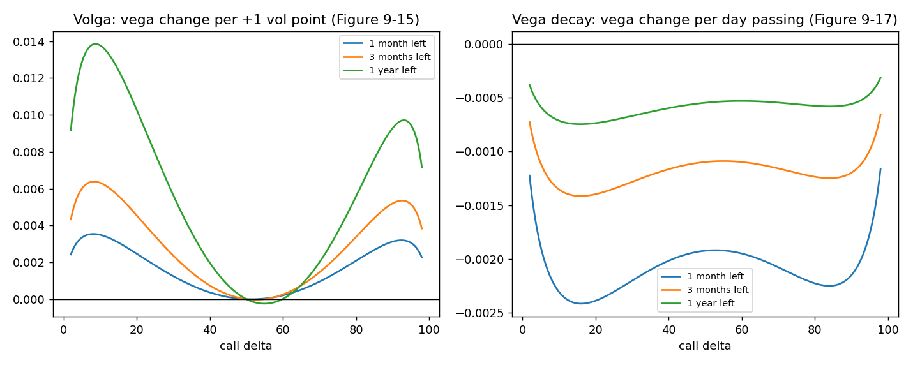
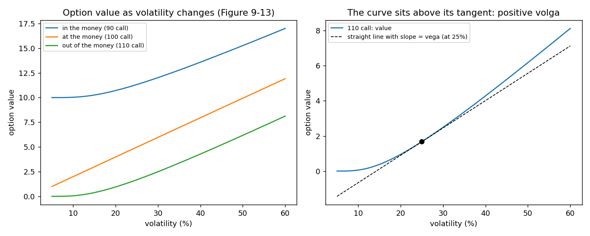
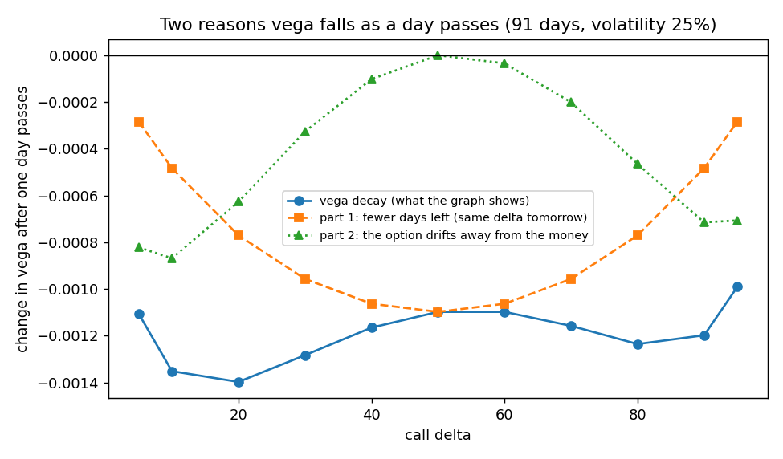

# Volga (vomma) and vega decay

**One-line definition:** **volga** (also **vomma**) is how much an option's vega changes when volatility moves one point; **vega decay** is how much its vega changes as a day passes. Volga is largest for calls with deltas of about 10 and 90; vega decay is negative for every option and largest in size for short-dated options.

## Intuition
Vega is the slope of "option value against volatility". Is that line straight or curved?
- **At the money** it is nearly straight, so vega barely changes: volga is about 0.
- **Out and in the money** it curves upward: the option is nearly worthless at low volatility, then wakes up. Each extra volatility point adds more than the last. That "speeding up" is the volga.

*Name.* Both volga and vomma are contractions of "volatility gamma": the gamma (curvature) with respect to volatility rather than to the underlying price. (The book writes the phrase twice in a row; it is a duplicated phrase, not two different meanings.)

Vega decay is simply that vega **shrinks as time passes**: fewer days left means volatility has less time to matter.

## The maths
$$\text{volga} = \frac{\text{change in vega}}{\text{1 volatility point}} \qquad \text{vega decay} = \frac{\text{change in vega}}{\text{1 day passing}}$$

**Volga** (left panel, calls; puts mirror):
- About 0 at the money (call delta near 50).
- Largest for call deltas around **10 and 90**. Our model puts the peaks at about 8 and 93.
- **Bigger with more time**: at delta 10, the 1-year curve is about twice the 3-month curve, which is about twice the 1-month curve. Long-dated options have greater volga than short-dated ones.
- Bigger in a low-volatility market (the book's summary lists "low volatility").
- Positive for in- and out-of-the-money options, so their vega rises with volatility ([[concepts/09-risk-measurement-ii/vega-in-different-conditions]]).

**Vega decay** (right panel): negative everywhere (vega falls each day). It is roughly flat for deltas between 10 and 90 and drops toward zero at the extremes, so the options whose vega is most sensitive to the passing of time are those with deltas between about 10 and 90, with the largest in size around 15 to 20 and 80 to 85. It is bigger when little time is left: at the money, vega decays $-0.0005$ per day with a year left, $-0.0011$ with three months and $-0.0019$ with one month.

## Why volga is positive (the convexity argument)
**Volga is gamma for volatility.** Gamma is the curvature of option value against the *price*: the option gains more when the price moves one way than it loses when it moves the other way by the same amount. Volga is the same curvature against *volatility*, which is why the name is "volatility gamma".

Value change when volatility moves 10 points either way from 25% (91 days):

| Option | Volatility up 10 points | Volatility down 10 points |
|---|---|---|
| 100 call (at the money) | +1.986 | −1.989 |
| 110 call (out of the money) | +1.693 | −1.297 |
| 90 call (in the money) | +1.463 | −1.058 |

At the money the gain and the loss are equal: the value line is straight and volga is about 0 (very slightly negative, which is the book's footnote 5). In and out of the money the option gains more than it loses, so the line bends upward.

*Left:* the book's Figure 9-13. *Right:* the 110 call against the straight line that has the same slope (the vega) at 25%. The curve sits above it, and the gap is the $\tfrac12\,\text{volga}\,(\Delta\sigma)^2$ term in the worked example below.

**Why an out-of-the-money option bends.** Its value comes from the far tail of the possible prices, and the tail is very sensitive to the width of the spread. Say the strike is 2 standard deviations away (about a 2.3% chance of finishing beyond it). Widen the spread by 10% and the strike is only 1.8 standard deviations away, about a 3.5% chance: a 10% wider spread gives roughly 50% more chance. So each extra point of volatility adds more than the one before. At the money the option is worth about the width of the spread, and the width grows evenly with volatility, so the line is straight ([[concepts/09-risk-measurement-ii/estimating-atm-theta-with-the-square-root-of-time]]).

**Why an in-the-money option bends the same way.** With no interest, a call equals its intrinsic value plus the out-of-the-money put at the same strike ($C - P = S - K$; [[concepts/07-risk-measurement-i/synthetic-forward-and-put-call-parity]]). The intrinsic value does not depend on volatility, so the call's value moves exactly as that put's does, and the put is out of the money. (Check: the 90 call is worth 10.257 at 15% volatility, which is 10 plus the 90 put's 0.257.) This is why **both** humps of the volga graph point up: unlike vanna and charm, volga has no sign flip.

**The rest of the shape.**
- About 0 at call delta 50: the line is straight.
- Biggest near deltas 10 and 90, where the tail effect is strongest.
- Back to 0 at deltas 0 and 100: the option is almost surely worthless or almost surely in the money, so volatility hardly matters and there is nothing to bend.
- Bigger with more time: everything about volatility is magnified when there is more time for it to work.

## Why vega decay has this shape
When a day passes, two things happen to an option's vega:
1. **It has fewer days left.** This cuts the vega of every option (roughly in proportion to $\sqrt{t}$ at the money).
2. **It drifts away from the money.** An out-of-the-money option drifts further out and an in-the-money one further in (that is charm), and the further from the money an option is, the less vega it has.

- At delta 50 only part 1 acts (the option stays at the money), so the total equals part 1.
- Around deltas 10-20 and 80-90 both parts act, so the loss is largest there.
- At the extremes (deltas near 0 and 100) the total falls toward zero: there is hardly any vega left to lose.

Together they give a broad plateau between about 10 and 90, slightly deeper at 15-20 and 80-85 (about $-0.0014$ per day against $-0.0011$ at 50, with 91 days left and volatility 25%). With less time left the whole curve is deeper, because both parts get bigger.

How each point of the volga and vega decay graphs is calculated, step by step: [[concepts/09-risk-measurement-ii/how-the-higher-order-graphs-are-made]].

## Worked example
A 110 call, underlying 100, 91 days, volatility 25%: value 1.676, vega 0.1558, volga 0.0036. If volatility rises 5 points to 30%:

| Method | Calculation | Estimate |
|---|---|---|
| Vega only | $5 \times 0.1558$ | $+0.779$ |
| Vega plus volga | $0.779 + \tfrac12 \times 0.0036 \times 5^2$ | $+0.824$ |
| Model | $2.493 - 1.676$ | $+0.818$ |

If volatility **falls** 5 points to 20%: vega only $-0.779$; with volga $-0.779 + 0.045 = -0.734$; model $-0.725$. The $\tfrac12 \times \text{volga} \times (\Delta\sigma)^2$ term works just like $\tfrac12 \times \Gamma \times (\Delta S)^2$ in [[concepts/07-risk-measurement-i/estimating-option-value-with-delta-and-gamma]]. (This extension is our own, not printed in the book.)

**Why it matters.** With positive volga, a long option position gains **more** when volatility rises than its vega predicts and loses **less** when volatility falls; a short position is the reverse. The book uses this idea in Chapter 21: a position's vega-based estimate of its breakeven volatility is 34.90%, yet the graph crosses at about 36%, which it blames on the position's positive volga (the line curves upward). Compare [[concepts/07-risk-measurement-i/breakeven-volatility-of-a-position]].

## Common confusions
- **Volga is not vega.** Vega is the slope; volga is the *bend* of the same curve.
- **A "close to 0" volga at the money is not "no volatility risk".** It means the vega is steady there; the vega itself is largest.
- **Vega decay and volga respond to different inputs** (time and volatility), but they point the same way: more volatility *or* more time raises the vega of an in- or out-of-the-money option ([[concepts/09-risk-measurement-ii/time-and-volatility-have-similar-effects]]).
- **Volga and vega decay do not flip sign.** Volga is positive on both sides (both humps point up); vega decay is negative everywhere in our convention. The book measures time *to* expiration, so if its Figure 9-17 is drawn the other way up, that is the same sign-convention point as for charm ([[concepts/09-risk-measurement-ii/vanna-and-charm]]).

## Related
- Chapter: [[chapters/09-risk-measurement-ii]]
- Maths needed: [[00-maths-refresher/sensitivity-of-a-sensitivity]]
- How the graphs are made and read: [[concepts/09-risk-measurement-ii/how-the-higher-order-graphs-are-made]]
- Previous: [[concepts/09-risk-measurement-ii/vega-in-different-conditions]]
- Next: [[concepts/09-risk-measurement-ii/gamma-in-different-conditions]]
- See also: [[glossary]], [[formulas]]
