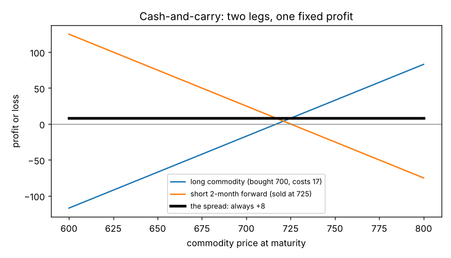

# Cash-and-carry and calendar spreads

**One-line definition:** a **cash-and-carry** spread buys the physical commodity and sells the overpriced forward, then carries the position to maturity; a **calendar spread** in futures buys one maturity and sells another, trading the *price difference* between months.

## Intuition
Both spreads work because a forward price is not a guess: it is the cash price plus the cost of owning the thing until the forward date ([[concepts/02-forward-pricing/forward-price-cost-and-benefit]]). If the market price of the forward is **above** that cost, you can buy the thing now, sell the forward, and pocket the difference. Every cash flow is fixed on day one, so the profit does not depend on where the commodity price goes.

For the calendar spread, you do not even need the physical commodity. You compare *two forward prices* with each other: the later one should be higher than the earlier one by exactly the cost of carrying the commodity between the two dates. If the market spread is wider than that, sell the spread.

## The maths (with each step explained)
**Fair forward price.** Cash 700, interest 6% a year, storage and insurance 5 a month, two months:

$$F_2 = 700 + \underbrace{700 \times 0.06 \times \tfrac{2}{12}}_{\text{interest} = 7} + \underbrace{2 \times 5}_{\text{storage} = 10} = 717$$

(The interest part is simple interest on a fraction of a year; see [[00-maths-refresher/simple-interest-and-time-fractions]].)

**Four-month forward.** Now we must finance twice. In months 1-2 we borrow 700. In months 3-4 we now own a commodity that has cost us $700 + 7 + 10 = 717$ so far, and we borrow *that* amount:

$$\text{interest} = 700 \times \tfrac{0.06}{6} + 717 \times \tfrac{0.06}{6} = 7.00 + 7.17 = 14.17$$

$$F_4 = 700 + 14.17 + 4 \times 5 = 734.17$$

(Why $0.06/6$? Two months is $2/12 = 1/6$ of a year.)

**Fair calendar spread.**

$$F_4 - F_2 = 734.17 - 717 = 17.17$$

That is two more months of storage (10) plus two more months of interest on the larger amount (7.17).

## Worked example 1: cash-and-carry (page 159)
Suppose the two-month forward actually trades at 725, which is 8 above its fair value of 717.

| Cash flow | Amount |
|---|---|
| Borrow 700 for two months at 6% (interest) | -7 |
| Buy the commodity | -700 |
| Store and insure for two months | -10 |
| Deliver it at maturity against the forward | +725 |
| **Total** | **+8** |

The 8 is exactly the mispricing. Whether the commodity ends at 600 or 800, you still hold a commodity you must deliver at 725, so the profit is 8. In the figure, the long leg and the short leg slide up and down in opposite directions; their sum is a flat line.

*Why not the opposite trade (sell the commodity, buy the forward)?* In commodity markets you usually cannot borrow a commodity and sell it short, so this reverse arbitrage is not normally available. For financial instruments it often is. [[concepts/02-forward-pricing/short-selling-and-borrowing-costs]]

## Worked example 2: a futures calendar spread (pages 160-161)
Fair spread 17.17, but the market spread is 20, so it is $20 - 17.17 = 2.83$ too expensive. We cannot say whether either contract is mispriced on its own, only that their *difference* is too big. So: **sell the spread** (sell the four-month, buy the two-month), say buying at 717 and selling at 737.

Two ways to make the 2.83:
1. **The spread comes back to 17.17.** Buy the spread back (buy four-month, sell two-month) and close.
2. **Carry to maturity.** At the two-month maturity, take delivery at 717 (borrow 717, interest -7.17; pay 717; store for two months, -10), then deliver at the four-month price of 737:

$$-7.17 - 717.00 - 10.00 + 737.00 = +2.83$$

Using futures is often easier than the physical route: a trader may have easy access to a futures exchange but limited access to the physical market, which is dominated by large corporations.

## What can still go wrong
Cash-and-carry removes direction risk because the long cash position and short forward move in opposite directions. But it relies on **assumptions held fixed**: the borrowing rate (the book assumed it was fixed) and the storage and insurance costs. In the *futures-only* calendar spread, if interest rates or storage costs **rise** after you sold the spread at 20, the fair spread widens, your profit shrinks, and a large enough rise could turn it into a loss.

## Common confusions
- **The first-period interest does not repeat.** The second two months' interest is on 717, not 700, because by then you own a commodity that has already cost 717.
- **A calendar spread is not a bet on direction.** If both months rise together the spread barely changes; only a change in their gap matters.
- **"Sell the spread" does not mean sell both.** It means sell the more expensive (later) leg and buy the earlier one.
- **The book ignores interest on the storage costs** (footnote 2); including it would add a very small extra cost.

## Related
- Chapter: [[chapters/10-introduction-to-spreading]]
- Previous: [[concepts/10-introduction-to-spreading/what-is-a-spread]]
- Next: [[concepts/10-introduction-to-spreading/intermarket-and-ratio-spreads]]
- Earlier: [[concepts/02-forward-pricing/arbitrage-and-cash-and-carry]], [[concepts/02-forward-pricing/forward-price-cost-and-benefit]], [[concepts/02-forward-pricing/contango-backwardation-convenience-yield]]
- Maths needed: [[00-maths-refresher/simple-interest-and-time-fractions]]
- See also: [[glossary]], [[formulas]]
