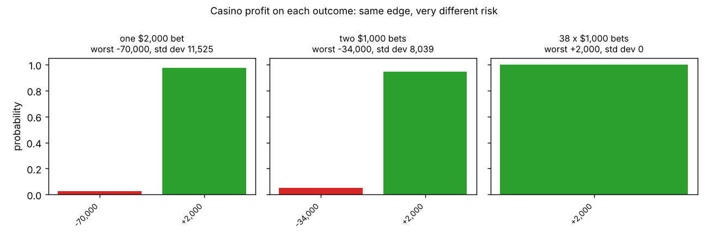

# The casino, spreading, and short-term bad luck

**One-line definition:** a positive theoretical edge only pays off in the long run, so the way to survive the short run is to spread the risk around; the casino spreading bets over the roulette table is the book's picture of why an option trader spreads.

## Intuition
A casino has a small edge on every bet. If it takes thousands of bets, the edge shows up. But the *long run* is only available to a casino that is still open. One huge bet on one number is a coin flip with a monster prize: unlikely to hurt, but if it hits, the loss can be bigger than the casino's bankroll, and then the long run never arrives.

Now imagine the same money split over different numbers. The casino's *expected* profit is unchanged, but no single result can sink it. **Same edge, less risk** is the whole point.

## The maths (pages 167-168, with exact numbers)
A roulette wheel with 38 numbers pays 35 to 1. A winning 1 bet gets back its 1 stake plus 35, so the casino hands over **36** (page 167: "72,000 payoff" for a 2,000 bet is $2{,}000 \times 36$).

**Expected return and edge** for the player, per 1 bet:

$$\text{expected payback} = \frac{1}{38} \times 36 = \frac{36}{38} = 0.947 \quad \Rightarrow \quad \text{casino edge} = \frac{2}{38} \approx 5.26\%$$

(The book rounds to "95 cents" and "5 percent"; see [[concepts/05-theoretical-pricing-models/expected-value-and-theoretical-value]].)

**Three ways to take 2,000 of bets.** Let $W$ be the casino's profit.

| Scenario | Casino outcomes | Expected profit | Worst case | Std dev |
|---|---|---|---|---|
| One 2,000 bet on one number | $+2{,}000$ with prob. $\tfrac{37}{38}$; $-70{,}000$ with prob. $\tfrac{1}{38}$ | 105.26 | -70,000 | about 11,525 |
| Two 1,000 bets on different numbers | $+2{,}000$ with prob. $\tfrac{36}{38}$; $-34{,}000$ with prob. $\tfrac{2}{38}$ | 105.26 | -34,000 | about 8,039 |
| 38 bets of 1,000, one on every number | $+2{,}000$ for certain | 2,000 | +2,000 | 0 |

How each loss is computed:
- Single bet: casino keeps the 2,000 stake but pays 72,000 if it hits: $2{,}000 - 72{,}000 = -70{,}000$.
- Two bets: it holds 2,000 from both players, pays 36,000 to the winner: $2{,}000 - 36{,}000 = -34{,}000$. The bets are mutually exclusive, so only one can win.
- 38 bets: it holds 38,000, pays 36,000 to the one winner: **+2,000 for sure.** (The expected profit is $2{,}000$ on $38{,}000$ bet, again $2/38 = 5.26\%$.)

**Expected profit is the same in the first two:**
- Single: $\tfrac{37}{38}(2000) + \tfrac{1}{38}(-70000) = \tfrac{74000 - 70000}{38} = 105.26$
- Two bets: $\tfrac{36}{38}(2000) + \tfrac{2}{38}(-34000) = \tfrac{72000 - 68000}{38} = 105.26$

Both are 5.26% of the 2,000 bet. The book's point: "it might seem that the casino must give up some of its theoretical edge. We tend to assume that there is a tradeoff between risk and reward. But the edge to the casino in both cases is still the same."

**The bankroll test (book).** If the casino has only 50,000 behind it, the single 2,000 bet can bankrupt it (loss 70,000 > 50,000) with probability $\tfrac{1}{38} \approx 2.6\%$. The two 1,000 bets cannot (worst loss 34,000 < 50,000). A casino with millions is not threatened by either. This is why casinos have **betting limits**.

## The player's side
If the player knows the odds are against him and wants the **greatest chance** of a profit, his best course is to put the maximum on **one** outcome and hope. Each extra bet gives the casino's law of large numbers more chance to catch up with him. The casino wants the opposite: many players, many bets, many outcomes.

## Why this is an option-trading lesson
An option trader is in the casino's seat. His theoretical edge only pays out in the long run ([[concepts/05-theoretical-pricing-models/expected-value-and-theoretical-value]]), and the short run can overwhelm him if one position is too big or too concentrated. So he learns to **spread off risk in as many ways as possible**: other options, futures, cash. There is rarely a perfect spread (like all 38 numbers covered), but he can often reduce risk a great deal.

This also explains why an **experienced trader can trade much larger** than a beginner: not (only) because he has more money, but because he knows many ways to spread off the risk, so his *actual* risk can be smaller than that of a much smaller trader who only knows a few spreads. [[concepts/10-introduction-to-spreading/margin-for-error-and-trade-size]]

## Common confusions
- **Spreading does not reduce the edge.** The expected profit per dollar bet is still $2/38$ in all three cases. It reduces the *variation* around that expectation.
- **"Sure profit" only with the perfect spread.** Covering every number is the ideal; in options there is rarely a perfect one.
- **"Long run" is a condition, not a promise.** A trader who runs out of money after a run of bad luck never sees it. [[concepts/08-dynamic-hedging/series-of-bets-and-dynamic-hedging]]
- **Standard deviation here is just a measure of how spread out the outcomes are.** Larger means a bigger range of results. [[00-maths-refresher/standard-deviation-and-variance]]

## Related
- Chapter: [[chapters/10-introduction-to-spreading]]
- Previous: [[concepts/10-introduction-to-spreading/margin-for-error-and-trade-size]]
- Earlier: [[concepts/05-theoretical-pricing-models/expected-value-and-theoretical-value]], [[concepts/05-theoretical-pricing-models/models-and-their-limits]]
- Maths needed: [[00-maths-refresher/probability-and-expected-value]], [[00-maths-refresher/standard-deviation-and-variance]]
- See also: [[glossary]], [[formulas]]
