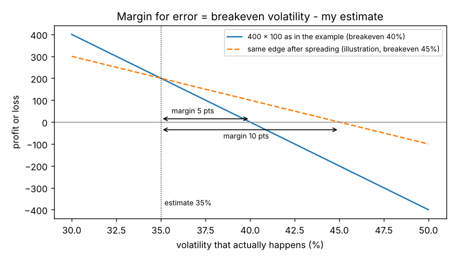

# Margin for error and trade size

**One-line definition:** the **margin for error** is how far your estimate of volatility (or another input) can be wrong before the position stops making money; a good spread widens that margin, which is what lets a trader do it in larger size.

## Intuition
A theoretical edge only tells you what you earn **if you are right** about the inputs. You never know that you are. So before sizing a trade you should ask: "how wrong can I be and still survive?" That distance is your safety margin, like the gap between how heavy a lift is and how much the rope can hold.

If theoretical edge were the only consideration, you could multiply the size forever: the edge would grow in proportion and there would be no reason to stop. The reason to stop is the **risk if your estimate is wrong**, and that grows with size too.

## The maths (page 166-167)
**Edge adds up with size.** Theoretical edge per option is the theoretical value minus the price paid (or, for a sale, the price received minus the value):

$$\text{total edge} = \text{number of options} \times |\text{price} - \text{theoretical value}|$$

The trader's estimate of volatility is 35%. A call trades at 4.00; at 35% its theoretical value is 3.50. The call has delta 25, so he sells **four calls** per **one underlying contract** bought (4 x 25 = 100 deltas = one contract) and hedges dynamically as in Chapter 8. Edge per call $= 4.00 - 3.50 = 0.50$.

| Size (calls x underlying) | Total theoretical edge |
|---|---|
| 4 x 1 | $4 \times 0.50 = 2.00$ |
| 40 x 10 | 20.00 |
| 400 x 100 | 200.00 |

"Why stop now?" is the temptation. The answer comes from asking what happens when the estimate is wrong.

**If volatility turns out higher.** At 45% volatility the calls we sold at 4.00 are worth 4.50. The loss per call is $4.50 - 4.00 = 0.50$, and for 400 calls:

$$400 \times 0.50 = 200 \text{ lost}$$

so the hoped-for profit of 200 turns into a **loss of 200**.

**Margin for error.**

$$\text{margin for error} = \text{breakeven volatility} - \text{my estimate}$$

- If he decides he can survive if volatility goes no higher than **40%**, the margin is $40 - 35 = 5$ points, and he will do only **40 x 10**.
- If a spread could push the breakeven to **45%**, the margin is 10 points and he would be willing to do **400 x 100**.

## Worked example, with a picture (ours, to see the shape)
We need the call's value at volatilities between the two the book gives. **Our assumption:** draw a straight line through the book's two points (3.50 at 35%, 4.50 at 45%). That gives 0.10 per volatility point, and the call is worth 4.00 (what we sold it for) at exactly 40%, so 40% is the breakeven for the naked-call position. Profit for 400 calls:

$$\text{P\&L} = 400 \times \big(4.00 - (3.50 + 0.10 \times (\sigma - 35))\big)$$

| True volatility | Call worth | P&L of 400 x 100 |
|---|---|---|
| 35% | 3.50 | +200 |
| 40% | 4.00 | 0 |
| 45% | 4.50 | -200 |

The solid line crosses zero at 40%. The dashed line is an **illustration** (not from the book) of a spread with the same edge at 35% but a breakeven of 45%: it is flatter, so it loses less when you are wrong, and it earns the same when you are right. The wider the gap between your estimate and the zero crossing, the larger you can afford to trade.

## How this connects to earlier chapters
- The **breakeven volatility** of a position is the volatility at which its theoretical edge becomes zero, i.e. its implied volatility. [[concepts/07-risk-measurement-i/breakeven-volatility-of-a-position]]
- Theoretical edge assumes the model inputs are right. [[concepts/07-risk-measurement-i/theoretical-edge]] and [[concepts/05-theoretical-pricing-models/models-and-their-limits]]
- Chapter 8's hedge captured the edge only if realized volatility matched the estimate. [[concepts/08-dynamic-hedging/realized-volatility-and-the-race]]

## Common confusions
- **A bigger edge is not a bigger trade by itself.** Size is limited by what you lose if you are wrong, not by what you win if you are right.
- **Margin for error is in volatility points, not in price.** A 5-point margin means volatility can rise 5 points above your estimate before you start losing.
- **The book calls this a "margin for error in estimating the inputs".** Volatility is the main input discussed; the idea applies to interest rates and dividends too.
- **Spreading does not remove the need for a good estimate.** It only makes the estimate matter less.

## Related
- Chapter: [[chapters/10-introduction-to-spreading]]
- Previous: [[concepts/10-introduction-to-spreading/mispricing-in-volatility-terms]]
- Next: [[concepts/10-introduction-to-spreading/casino-spreading-and-short-term-bad-luck]]
- Earlier: [[concepts/07-risk-measurement-i/breakeven-volatility-of-a-position]], [[concepts/07-risk-measurement-i/theoretical-edge]]
- Maths needed: [[00-maths-refresher/slope-and-straight-lines]]
- See also: [[glossary]], [[formulas]]
