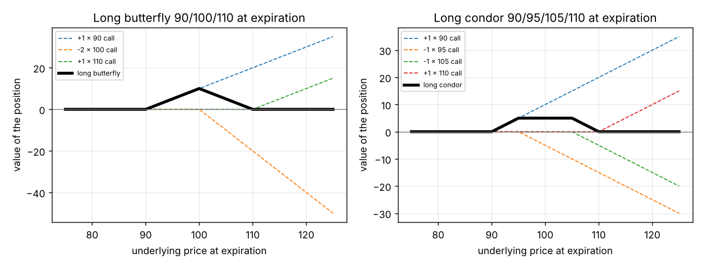

# Butterflies and condors (wingspreads)

**One-line definition:** a **butterfly** is three equally spaced strikes in the ratio $1 \times 2 \times 1$ (one of each outside "wing", two of the inside "body"); a **condor** is four strikes in the ratio $1 \times 1 \times 1 \times 1$ (one of each). In a **long** one you buy the wings and sell the body; **short** is the reverse. Both are made of all calls or all puts with one expiration.

## Intuition
A short straddle makes money if the market sits still, but loses without limit if it moves. A **long butterfly is a short straddle with a seat belt**: it makes money if the market sits near the middle, but the worst it can do is lose what you paid.

The seat belt is the two wings you bought. Far from the middle they cancel the body you sold, so the position is worth zero and cannot get worse.

Likewise a **condor** is a strangle with a seat belt: a wider profit zone and, again, limited risk.

## The payoff of a long butterfly, step by step
Call butterfly: $+1$ March 90 call, $-2$ March 100 calls, $+1$ March 110 call.

| Underlying at expiration | 80 | 100 | 120 |
|---|---|---|---|
| $+1$ 90 call | 0 | $+10$ | $+30$ |
| $-2$ 100 calls | 0 | 0 | $-20$ |
| $+1$ 110 call | 0 | 0 | $+10$ |
| **Total** | **0** | **+10** | **0** |

- **Below 90**: all calls are worthless, total 0.
- **Above 110**: the 90 and 110 calls together gain the same as the two 100 calls lose. Check at 120: $30 + 10 = 40$ and $-2 \times 20 = -40$, total 0.
- **At 100** (the body): only the 90 call has value, and it is worth 10.

So the value is **0 outside the wings and at most 10 in the body**; the maximum is always **the gap between strikes** (here 10). In between, the value rises from 0 at 90 to 10 at 100 and falls back to 0 at 110: a **tent** (figure below).

*Left: the three legs (dashed) and the butterfly (thick). Right: a long condor 90/95/105/110; the tent has a flat top of height 5 (the gap between the two lower strikes) from 95 to 105.*

## Why a long butterfly is always a debit
The position can **never be worth less than zero** and can be worth up to 10. If it paid you to take it on, there would be a riskless profit. So you always have to pay something, between 0 and 10. How much depends on how likely the underlying is to end near the body:

- High probability near 100: you might pay 8.00 for a chance at 10.
- Low probability (the market will probably end outside 90 to 110): perhaps 1.00 or 2.00.

Paying a debit makes you **long** the spread. That is why the version with the wings bought is the "long" one.

## The condor
$+1$ March 90 call, $-1$ 95 call, $-1$ 105 call, $+1$ 110 call. The distance between the two **lowest** strikes must equal the distance between the two **highest** strikes (here 5 and 5), but the gap between the two inside strikes can vary. Value at expiration is between 0 and the wing gap (5), and a buyer expects the market to finish **between the two inside strikes**, where it pays the maximum. A seller takes in a credit expecting it to finish **outside the extreme strikes**.

## Greeks and the straddle comparison
When the inside strike of a butterfly is about at the money (or the condor is centred), the delta is about zero. Then:

| | Gamma | Theta | Vega | Behaves like |
|---|---|---|---|---|
| Long butterfly / long condor | $-$ | $+$ | $-$ | short straddle / short strangle, but risk **limited** |
| Short butterfly / short condor | $+$ | $-$ | $+$ | long straddle / long strangle, but reward **limited** |

Evaluation-table example (stock 100, April, 20%): long call butterfly $+10$ April 95 calls, $-20$ April 100 calls, $+10$ April 105 calls costs 11.70, delta 0, gamma $-16.0$, theta $+0.090$, vega $-0.50$. Compare the short straddle: gamma $-132$, vega $-4.50$: the butterfly's Greeks are **much smaller**.

## Size is not risk
"A trader may find that buying 300 butterflies ($300 \times 600 \times 300$) is actually less risky than selling 100 straddles." The butterfly's loss is capped at the debit; the straddle's is not. **Risk depends on the structure, not just the size.**

## Call butterfly and put butterfly are the same
If all options are European (no early exercise), a call butterfly and a put butterfly with the same strikes and expiration are worth the same at expiration (10 at 100, 0 outside the wings). If they traded at different prices, buy the cheap one and sell the dear one for a sure profit (for American options early exercise can spoil this).

## Common confusions
- **Equal spacing is required for a butterfly** (90/100/110); for a condor the **outer** gaps must be equal.
- **Maximum value = gap between strikes** (butterfly) or the outer gap (condor).
- **Long = you pay a debit.** For wingspreads long means buying the wings; for time butterflies the word flips ([[concepts/11-volatility-spreads/time-butterflies]]).
- **Small risk means small profit.** The butterfly's profit when right is also smaller than a straddle's.

## Related
- Chapter: [[chapters/11-volatility-spreads]]
- Previous: [[concepts/11-volatility-spreads/straddles-and-strangles]]
- Next: [[concepts/11-volatility-spreads/ratio-spreads-building-and-payoff]]
- Earlier: [[concepts/04-expiration-profit-and-loss/parity-graphs]], [[concepts/04-expiration-profit-and-loss/equivalent-positions]]
- Maths needed: [[00-maths-refresher/max-function]]
- See also: [[glossary]], [[formulas]]
