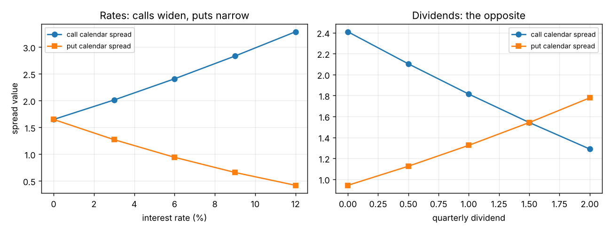

# Calendar spreads and interest rates and dividends (rho and "dividend risk")

**One-line definition:** a stock-option calendar spread has two different **forward prices** (one per expiration), and interest rates and dividends move those forward prices by different amounts, so a long call calendar has **positive rho** and **negative dividend risk**, and a long put calendar has the opposite.

## Intuition
Recall from Chapter 2 and Chapter 7 that an option on a stock is really an option on the stock's **forward price** for its expiration date ([[concepts/07-risk-measurement-i/interest-rates-dividends-and-option-values]]). The forward price is today's price plus interest cost minus dividends:

$$F = S\,(1 + r\,t) - D$$

(simple interest as in Chapter 2).

- If **all options expire on the same date**, a change in the rate or dividend moves one forward price, and **every option** in the spread feels the same shift. The spread value barely changes.
- In a **calendar spread** there are **two** forward prices: one for the near expiration, one for the far. The far forward has more time for interest to build up (or dividends to be paid), so **it moves more**. The two options feel different shifts, and the spread value changes.

## Interest rates: worked through
Stock 100, no dividend, interest 8%. March has 3 months left; June has 6 months left. You buy the call calendar: $+10$ June 100 calls, $-10$ March 100 calls.

| | Forward at 8% | Forward at 10% | Change |
|---|---|---|---|
| March (0.25 years) | $100 \times (1 + 0.08 \times 0.25) = 102.00$ | $100 \times (1 + 0.10 \times 0.25) = 102.50$ | $+0.50$ |
| June (0.50 years) | $100 \times (1 + 0.08 \times 0.50) = 104.00$ | $100 \times (1 + 0.10 \times 0.50) = 105.00$ | $+1.00$ |

The June forward moves **twice as much**. If the two calls have about the same delta, each option's value changes by roughly its delta times the change in the forward. The June call gains about **twice** as much as the March call, and the calendar spread **widens**. Lower rates narrow it. So a **long call calendar has positive rho**.

For **puts** the delta is negative, so a higher forward price **hurts** a put. The June put loses more than the March put, the put calendar narrows when rates rise: a **long put calendar has negative rho**.

Book table (Figure 11-28; stock 100, volatility 20%, March 3 months, June 6 months, no dividend):

| Interest rate | 0% | 3% | 6% | 9% | 12% |
|---|---|---|---|---|---|
| June 100 call | 5.64 | 6.37 | 7.16 | 7.99 | 8.87 |
| March 100 call | 3.99 | 4.36 | 4.75 | 5.16 | 5.58 |
| **Call calendar spread** | **1.65** | **2.01** | **2.41** | **2.83** | **3.29** |
| June 100 put | 5.64 | 4.88 | 4.20 | 3.59 | 3.05 |
| March 100 put | 3.99 | 3.61 | 3.26 | 2.93 | 2.63 |
| **Put calendar spread** | **1.65** | **1.27** | **0.94** | **0.66** | **0.42** |

The size of the effect depends mainly on **how far apart the expirations are**: six months apart (March/September) matters much more than one month apart (March/April).

## Dividends: the opposite
A larger dividend **lowers** the forward price (the stock is worth less after paying it), a cut **raises** it. If at least one dividend falls **between the two expirations**, only the far option "sees" it:

- Higher dividend $\rightarrow$ far forward falls more $\rightarrow$ call calendar **narrows**, put calendar **widens**.
- Lower dividend $\rightarrow$ the reverse.

There is no Greek letter for dividend risk, but we can say: a **call calendar has negative dividend risk** (its value falls as dividends rise); a **put calendar has positive dividend risk**.

Book table (interest 6%, March 3 months, June 6 months, quarterly dividend):

| Quarterly dividend | 0 | 0.50 | 1.00 | 1.50 | 2.00 |
|---|---|---|---|---|---|
| Call calendar spread | 2.41 | 2.11 | 1.81 | 1.54 | 1.28 |
| Put calendar spread | 0.94 | 1.13 | 1.32 | 1.54 | 1.78 |

(The book does not say when the dividends are paid. Our reconstruction: one dividend before March and two before June, at 1.5 and 4.5 months, each discounted at 6% and subtracted from the stock price. That reproduces the book's table to within a rounding of 0.01.)

*Left: interest rates lift the call calendar and push down the put calendar. Right: dividends do the opposite. The two panels are mirror images.*

## Extreme cases
- **Put calendar can go negative.** If rates are raised high enough, the long-term put can be worth *less* than the short-term put (because the long-term forward is so high). Raise dividends enough and the same happens to the **call** calendar.
- **Floor for a call calendar with no dividends:** even at very low volatility it should be worth at least the cost of carrying the stock between the two expirations. This holds *only if* you can carry a **short stock** position over that period. If no stock can be borrowed, the holder of the call calendar may be forced to **exercise the long-term call**, losing its time value. The book calls this a **short squeeze** ([[concepts/02-forward-pricing/short-selling-and-borrowing-costs]]).

## Futures options
Futures have no carrying cost, so rates have only a **minor** effect, and the effect on volatility spreads is small.

## Common confusions
- **Same-expiration spreads are nearly immune** (every option shifts together). The effect is a *calendar* effect.
- **It is the forward price that moves, not the stock price.** The spot price is unchanged.
- **Signs for puts are the opposite of calls** in both cases, because put deltas are negative.
- **Small compared with gamma, theta and vega** for short gaps between expirations, but not negligible for large calendars or long gaps.

## Related
- Chapter: [[chapters/11-volatility-spreads]]
- Previous: [[concepts/11-volatility-spreads/time-butterflies]]
- Next: [[concepts/11-volatility-spreads/diagonal-spreads]]
- Earlier: [[concepts/07-risk-measurement-i/rho]], [[concepts/07-risk-measurement-i/interest-rates-dividends-and-option-values]], [[concepts/02-forward-pricing/stock-dividends-and-key-dates]]
- Maths needed: [[00-maths-refresher/simple-interest-and-time-fractions]]
- See also: [[glossary]], [[formulas]]
