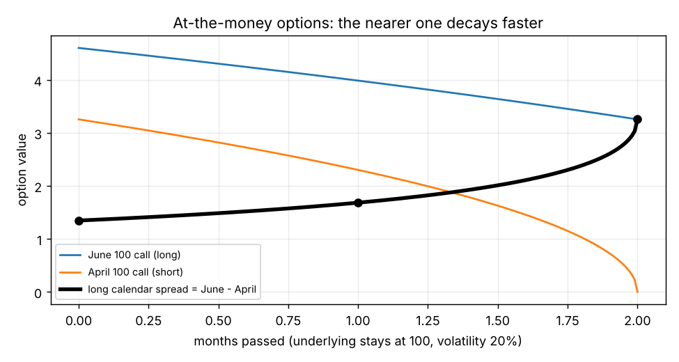
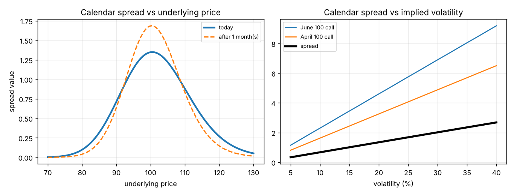

# Calendar spreads, part 1: why time helps a long calendar spread

**One-line definition:** a **calendar spread** (also **time spread** or **horizontal spread**) is two options of the **same type** and the **same strike** but **different expirations**. You are **long the calendar** if you buy the far (long-term) option and sell the near (short-term) option, which costs a debit; **short the calendar** if you do the opposite.

## Intuition
Picture two ice cubes melting, a small one (the near option) and a big one (the far option). The small one is not just smaller, it also **melts faster per hour as it shrinks** (an at-the-money option loses value faster and faster as expiration approaches). You hold the big cube and have sold someone the small cube. As time passes, the small one you owe disappears faster than the big one you own. Your net position improves. Time is your friend.

That is the key difference from every spread earlier in the chapter. In a straddle, strangle, butterfly or condor, all options expire together, so time decay is a pure cost to the buyer. In a calendar spread, **the two legs decay at different speeds**, and the difference is what you collect.

## Why a nearer at-the-money option decays faster (the maths, step by step)
From Chapter 9 ([[concepts/09-risk-measurement-ii/estimating-atm-theta-with-the-square-root-of-time]]): the value of an at-the-money option is roughly proportional to the **square root of the time left**.

For the book's numbers (underlying 100, volatility 20%, no interest) the value of an at-the-money option with $m$ months left is about:

$$V(m) \approx 2.30 \times \sqrt{m}$$

Check: $m = 4$ gives $2.30 \times 2 = 4.60$ (book: June 100 call, 4.60). $m = 2$ gives $2.30 \times 1.414 = 3.25$ (book 3.26). $m = 1$ gives 2.30 (book 2.30). Good fit.

Now watch both options as time passes (June starts with 4 months, April with 2):

| Months passed | June (long), $m = 4 - \text{passed}$ | April (short), $m = 2 - \text{passed}$ | Spread = June $-$ April |
|---|---|---|---|
| 0 | 4.60 | 3.26 | **1.34** |
| 1 | 3.99 | 2.30 | **1.69** |
| 2 | 3.26 | 0 | **3.26** |

(These are the book's numbers, Figure 11-19. Our code reproduces them with 0% interest; with 6% interest the June call would be 5.62, so the book's table must use no interest.)

**What happened in month 1:**
- April lost $3.26 - 2.30 = 0.96$.
- June lost only $4.60 - 3.99 = 0.61$.
- The spread gained $0.96 - 0.61 = 0.35$.

**Month 2:** April gives up its whole 2.30; June loses 0.73; the spread gains another $2.30 - 0.73 = 1.57$.

Why? The square root curve is **steep near zero**: the last few months of an option's life remove the most value. The near option is already on the steep part of the curve while the far option is still on the gentle part.

*Dots mark the book's three times. The thick line (the spread) rises slowly then very quickly, as the short April option dies.*

## What happens if the underlying moves?
The calendar spread only benefits from time if both options **stay near the strike**. An option has its largest time value at the money. As an option goes deeply in the money or far out of the money, its time value fades. Eventually even the far option has lost almost all its time value, and the spread has nothing left to collect.

Book table (Figure 11-20), underlying today at different prices (April/June 100 call spread):

| Underlying | 80 | 90 | 100 | 110 | 120 |
|---|---|---|---|---|---|
| Spread value | 0.09 | 0.71 | 1.34 | 0.88 | 0.27 |

A tent shape: highest at the strike (100), collapsing on both sides. That tent is the picture of **negative gamma**: movement in either direction costs you.

*Left:* the tent today (solid) and one month later (dashed). Time makes the peak higher (that is the positive theta) but also narrower (so a move away from 100 now costs more: gamma gets more negative as time passes). *Right:* see [[concepts/11-volatility-spreads/calendar-spreads-volatility-and-opposite-wishes]].

## The Greek signs, derived
For an at-the-money option ([[concepts/09-risk-measurement-ii/summary-tables-where-each-measure-is-largest]]):

$$\gamma \propto \frac{1}{\sqrt{T}} \qquad \theta \propto -\frac{1}{\sqrt{T}} \qquad \text{vega} \propto \sqrt{T}$$

(gamma and the size of theta are bigger for shorter-dated at-the-money options; vega is bigger for longer-dated ones.) A long calendar is long the far option ($T_f$) and short the near option ($T_n$), with $T_f > T_n$. So:

$$\gamma_{\text{spread}} \propto \frac{1}{\sqrt{T_f}} - \frac{1}{\sqrt{T_n}} < 0 \qquad \text{vega}_{\text{spread}} \propto \sqrt{T_f} - \sqrt{T_n} > 0$$

and theta is positive because it moves with the opposite sign of gamma. Numerically (April 2 months, June 4 months): gamma ratio far/near $= 0.707 = \sqrt{2/4}$ and vega ratio $= 1.414 = \sqrt{4/2}$ (checked in our notebook).

**Summary: a long calendar spread is negative gamma, positive theta, positive vega.** (Book: Figure 11-30.)

## Risk and reward
Maximum loss is the **debit you paid**: if the underlying races away, both options end up worthless and so does the spread. Maximum gain is limited too, because the spread's value is capped by the far option's value once the near one has expired.

## Common confusions
- **"Long" is the far option.** The book's naming is by cash flow: you pay a debit for the far option, so you are long the calendar.
- **Time is on your side *only if the underlying sits still near the strike*.** A big move kills the spread even though theta is positive.
- **Why not sit still and collect forever?** Because the spread's value at the strike is small to begin with (1.34 in the example), and once the near option expires you hold a single long option, a different position.
- **The decay is not linear.** The jump from 1.69 to 3.26 in the second month is much bigger than the first month's 1.34 to 1.69.
- **Delta neutral because at the money.** At-the-money options have deltas near 50, and with one long and one short they cancel. (More exactly, at-the-*forward* options have deltas closest to 50; the book's footnote 6.)

## Related
- Chapter: [[chapters/11-volatility-spreads]]
- Previous: [[concepts/11-volatility-spreads/christmas-trees-and-ladders]]
- Next: [[concepts/11-volatility-spreads/calendar-spreads-volatility-and-opposite-wishes]]
- Earlier: [[concepts/09-risk-measurement-ii/theta-in-different-conditions]], [[concepts/09-risk-measurement-ii/estimating-atm-theta-with-the-square-root-of-time]], [[concepts/07-risk-measurement-i/theta]]
- Maths needed: [[00-maths-refresher/proportionality-and-percentage-change]]
- See also: [[glossary]], [[formulas]]
