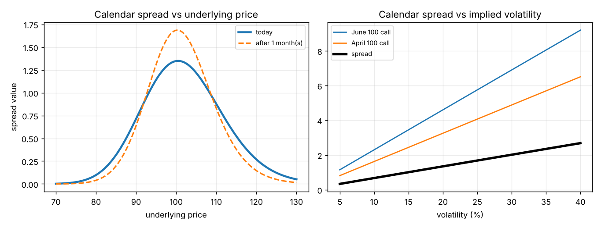

# Calendar spreads, part 2: implied volatility, and why a calendar wants two opposite things

**One-line definition:** a long calendar spread has **negative gamma** (it wants the underlying to sit still) and **positive vega** (it wants implied volatility to rise): two wishes that look contradictory, which is what makes calendar spreads different from every other volatility spread in the chapter.

## Intuition
In a long straddle, the two good things come together: you want the underlying to *move a lot* (positive gamma) and you want *everyone to expect big moves* (positive vega, rising implied volatility). Realized and implied volatility are on the same side.

A long calendar splits them:

- **Realized volatility** (what the underlying does): you want it **low**. Movement drags the spread away from the strike, where time value vanishes.
- **Implied volatility** (what the market expects): you want it **high**. The long-dated option you own reacts more to a change in implied volatility than the short-dated option you sold.

So the ideal for a long calendar is: *nothing happens, but everybody becomes more nervous about what might happen*. That sounds impossible, but it is quite common.

## Why the far option reacts more to volatility (vega)
At the money, vega is proportional to $\sqrt{T}$ (Chapter 9, [[concepts/09-risk-measurement-ii/vega-in-different-conditions]]): the longer-dated option has more vega. In the book's example (underlying 100, no interest):

| Volatility | 10% | 15% | 20% | 25% | 30% |
|---|---|---|---|---|---|
| June 100 call (far) | 2.30 | 3.45 | 4.60 | 5.75 | 6.90 |
| April 100 call (near) | 1.63 | 2.44 | 3.26 | 4.07 | 4.88 |
| **Spread (June − April)** | **0.67** | **1.01** | **1.34** | **1.68** | **2.02** |

(Book Figure 11-21; tiny differences are rounding.)

Each 5-point rise in volatility:
- adds $5.75 - 4.60 = 1.15$ to June, but only $4.07 - 3.26 = 0.81$ to April;
- so the spread widens by about $0.34$.

That is a vega of about $+0.067$ per volatility point for the spread (0.23 for June, 0.163 for April, difference 0.067). The spread is even **proportional to volatility** here: at 10% it is 0.67, at 20% it is 1.34 (double), at 30% it is 2.02 (triple). Doubling the market's expectation of movement doubles the spread.

(Right-hand panel.) The spread (thick line) is a straight line rising with volatility. The far option (June) rises faster than the near option (April).

## The four "who wins" combinations
| | $+$ vega (helped by rising implied volatility) | $-$ vega (helped by falling implied volatility) |
|---|---|---|
| **$+$ gamma** (helped by movement) | long straddle, long strangle, short butterfly... both wishes point the same way | **short calendar spread** |
| **$-$ gamma** (helped by calm) | **long calendar spread** | short straddle, short strangle, long butterfly... again the same way |

The calendar is in the mixed boxes. See [[concepts/11-volatility-spreads/long-short-premium-and-the-four-categories]].

## When do "quiet underlying, rising implied volatility" happen together? The CEO example
The book's example (page 188): a company announces its CEO will make an important statement **a week from today**, and nobody knows what it will say.

- For the next week the stock price probably barely moves: **no movement** in the underlying.
- But traders expect the statement to move the price, perhaps a lot, so **implied volatility rises**.

Long calendar spreads widen: time decay hits the near option while the vega gain hits the far option. Now the statement is made and it turns out to be irrelevant ("he and his wife just became grandparents"). The expectation of future movement disappears, implied volatility falls, and **calendar spreads narrow**.

The general pattern: **events that do not have an immediate effect on the underlying but may have a future effect** (pending news, an election or an announcement due next week) lift implied volatility without moving the price.

## The guidelines that follow (page 201)
- **Long calendar spreads** tend to pay when implied volatility is **low but expected to rise**.
- **Short calendar spreads** tend to pay when implied volatility is **high but expected to fall**.
- These are guidelines, not laws. A long calendar can make sense in a high-implied-volatility market if the trader expects the **underlying to stagnate and implied volatility to stay high**: the near option decays, the far option keeps its value. A short calendar can make sense in a low-implied-volatility market if the trader expects a **large move without a matching rise in implied volatility**.

## A modelling remark
Traditional models assume one volatility for the life of the option. For options that expire together, that one number decides whether a spread wins. But with different expirations, the question "how will implied volatility *change*, and will it change equally for near and far options?" also matters. In our examples (and the book's tables) we assume all expirations have the **same** implied volatility. In practice they often differ, which can even change whether something is a debit or a credit (the book's footnote 7 on time butterflies).

## Common confusions
- **Vega is a statement about implied volatility, not about the underlying.** In theory vega refers to the volatility of the underlying over the option's life; in practice traders read it as the sensitivity to *implied* volatility (page 197).
- **The two wishes are not contradictory in the market.** They contradict only if you think implied volatility always follows the underlying's actual movement.
- **A short calendar is the mirror image, not a different idea.** You buy the near option and sell the far one, taking in a credit. It wants a big move (positive gamma) and falling implied volatility (negative vega).

## Related
- Chapter: [[chapters/11-volatility-spreads]]
- Previous: [[concepts/11-volatility-spreads/calendar-spreads-time-decay]]
- Next: [[concepts/11-volatility-spreads/calendar-spreads-in-futures-markets]]
- Earlier: [[concepts/06-volatility/implied-volatility]], [[concepts/07-risk-measurement-i/vega]], [[concepts/09-risk-measurement-ii/time-and-volatility-have-similar-effects]]
- Maths needed: [[00-maths-refresher/proportionality-and-percentage-change]]
- See also: [[glossary]], [[formulas]]
