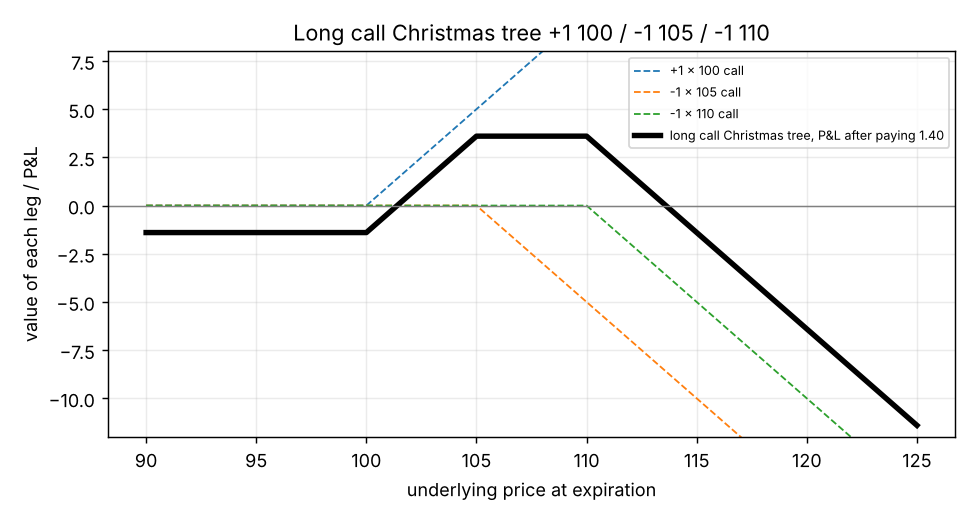

# Christmas trees (ladders)

**One-line definition:** a **call Christmas tree** buys one call at a lower strike and sells one call each at two higher strikes (or the reverse); a **put Christmas tree** buys one put at a higher strike and sells one put each at two lower strikes (or the reverse). All options are the same type and expire together. Traders also call them **ladders**.

## Intuition
A ratio spread copies a **straddle** but clips one side. A Christmas tree copies a **strangle** but clips one side.

- A short strangle makes money when the market stays between two strikes, and loses without limit if it goes too far up **or** too far down.
- A long call Christmas tree makes money when the market ends between its two higher strikes, loses a *limited* amount if the market falls (you only lose what you paid), and loses without limit if the market rises a long way.

The shape of the payoff, when you look at it, has a flat top like a strangle's, and the picture is a three-step ladder (hence the name), or a tree with branches of different heights.

## Step 1: the payoff, leg by leg
The book's long call tree from the evaluation table (page 209): **buy 1 April 100 call, sell 1 April 105 call, sell 1 April 110 call.** Prices: 3.76, 1.71, 0.65.

$$\text{cash today} = -3.76 + 1.71 + 0.65 = -1.40 \quad (\text{a debit of } 1.40)$$

Use slopes ([[concepts/04-expiration-profit-and-loss/slope-method-for-combined-positions]]): each long call adds $+1$ above its strike, each short call adds $-1$.

| Underlying at expiration $S$ | Which calls are alive | Slope of the value | Value of the legs at expiration |
|---|---|---|---|
| $S \le 100$ | none | 0 | 0 |
| $100 < S \le 105$ | the 100 call (long) | $+1$ | $S - 100$ |
| $105 < S \le 110$ | 100 long, 105 short | $+1 - 1 = 0$ | 5 (flat) |
| $S > 110$ | 100 long, 105 short, 110 short | $+1 - 1 - 1 = -1$ | $5 - (S - 110)$ |

Then P&L = value $- 1.40$.

- Below 100: P&L $= -1.40$ (limited loss: the debit).
- Flat top between 105 and 110: P&L $= 5 - 1.40 = +3.60$ (maximum profit).
- Above 110: the P&L falls one-for-one with the price. It reaches zero when $5 - (S - 110) - 1.40 = 0$, which gives $S = 113.6$ (upper breakeven). Beyond that the loss is unlimited.
- Lower breakeven: $S - 100 - 1.40 = 0$ gives $S = 101.4$.

*Dashed lines: the three legs. Thick line: the tree's P&L after paying 1.40. Profit zone 101.4 to 113.6; limited loss to the left; unlimited loss to the right.*

## Step 2: why delta neutral and why "mimics a strangle"
Deltas from the table: $+56 - 33 - 16 = +7$ per tree (the book's 10 trees give $+70$). That is small compared with 100 deltas per contract, so the position is roughly neutral. Its Greeks (10 trees): gamma $-26$, theta $+0.140$, vega $-0.90$. Negative gamma, positive theta, negative vega: **like a short strangle**.

The **short** tree is the mirror: sell 1 at the lower strike, buy 1 at each of two higher strikes. Book example: $-10$ April 90 calls, $+10$ April 100 calls, $+10$ April 105 calls, with gamma $+75$, theta $-0.420$, vega $+2.50$: like a **long strangle**, but with limited profit on the side protected by the short option.

## All four trees (Figures 11-14 to 11-17)
| Tree | Build | Acts like | Risk / reward |
|---|---|---|---|
| Long call tree | $+1$ lower call, $-1$ each at two higher calls | short strangle | limited risk down, unlimited risk up |
| Short call tree | $-1$ lower call, $+1$ each at two higher calls | long strangle | limited reward down, unlimited reward up |
| Long put tree | $+1$ higher put, $-1$ each at two lower puts | short strangle | limited risk up, risk down to zero |
| Short put tree | $-1$ higher put, $+1$ each at two lower puts | long strangle | limited reward up, large reward down |

("Long" means executed for a debit and "short" for a credit, the book's convention.) The book draws each tree twice in the same figure with different strikes (for example $+1$ October 90 call, $-1$ October 95 call, $-1$ October 105 call, and also an April version); those are just two example sets of strikes, not a spread across expirations.

## Tree versus ratio spread
| | Ratio spread | Christmas tree |
|---|---|---|
| Strikes | 2 | 3 |
| Quantities | unequal (e.g. $2:1$) | one at each (1, 1, 1) |
| Mimics | straddle (one peak or trough) | strangle (a flat top or bottom) |

A handy way to see a long call tree: it equals a **bull call spread** (buy 100, sell 105) **minus one more 110 call** that you sell, which is what turns the payoff down again at the top.

## Common confusions
- **"One bought, two sold" is about the total number.** Both sold calls are at *different* strikes, not the same one; that separates it from a 1:2 ratio spread.
- **Long tree = debit.** In the book's examples the long call tree costs 1.40; but with a different set of strikes or prices it can be a credit. "Long" means debit by definition, so check the cash flow.
- **"Ladder" also has another meaning**, an exotic option (footnote 4 on page 182). In this chapter it is just another word for a Christmas tree.

## Related
- Chapter: [[chapters/11-volatility-spreads]]
- Previous: [[concepts/11-volatility-spreads/ratio-spreads-gamma-theta-vega-and-risk]]
- Next: [[concepts/11-volatility-spreads/calendar-spreads-time-decay]]
- Earlier: [[concepts/11-volatility-spreads/straddles-and-strangles]]
- Maths needed: [[00-maths-refresher/slope-and-straight-lines]]
- See also: [[glossary]], [[formulas]]
