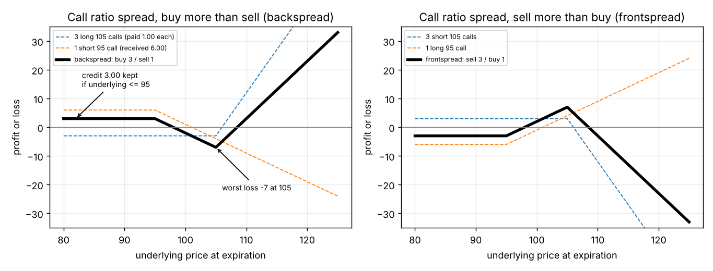

# Ratio spreads: how to build one and what the payoff looks like

**One-line definition:** a **ratio spread** buys and sells **unequal numbers** of options of the **same type** (all calls or all puts) with the **same expiration** but **different exercise prices**, with the numbers chosen so the position starts roughly delta neutral.

## Intuition
A straddle says "buy one call and one put". It is symmetrical: it likes a big move up and a big move down equally. But you often have a leaning: "I think the market will move, and if it does I think it is more likely to go up." A ratio spread is a way to **keep most of the straddle's appetite for movement, but tilt it toward one side**.

How? Take two calls with different strikes. Buy several of one, sell fewer of the other. The extra options on one side give you a steep slope on that side. The option you sold on the other side acts like a brake.

Here is the whole idea in one sentence you can come back to:

> **A ratio spread is a call (or put) spread where you did not use equal numbers, so that the delta cancels instead of the quantity.**

## Step 1: why the numbers are unequal (balancing the delta)
Two options with different strikes have different deltas ([[concepts/07-risk-measurement-i/delta]]). Say the underlying is at 100:

| Option | Delta | Meaning |
|---|---|---|
| October 95 call (in the money) | 75 | acts like 0.75 of a share |
| October 105 call (out of the money) | 25 | acts like 0.25 of a share |

If you sold **one** 95 call (delta $-75$) and bought **one** 105 call (delta $+25$), you would be net $-50$ deltas. That is a directional bet that the market falls. To cancel it we need $+75$ from the 105 calls, and each gives only $+25$:

$$\text{number of 105 calls} = \frac{75}{25} = 3$$

So **three** 105 calls against **one** 95 call:

$$3 \times (+25) + 1 \times (-75) = 75 - 75 = 0 \text{ deltas}$$

That is the book's example (page 179): $+3$ October 105 calls, $-1$ October 95 call. The general rule:

$$\boxed{\;\text{ratio} = \frac{\text{delta of the option you sell}}{\text{delta of the option you buy}}\;}$$

The farther out of the money an option is, the smaller its delta, so you need **more** of them to balance one nearer-the-money option. That is why the side with more contracts is always the side **farther out of the money**.

## Step 2: the payoff at expiration, leg by leg
Prices from the book: the 105 calls cost 1.00 each (we **buy** 3), the 95 call is worth 6.00 (we **sell** 1).

$$\text{cash today} = -3 \times 1.00 + 1 \times 6.00 = +3.00 \quad (\text{a credit of } 3.00)$$

Now ask, for each region of the price at expiration, **which options are alive** (in the money) and what each contributes. Use the slope method from Chapter 4 ([[concepts/04-expiration-profit-and-loss/slope-method-for-combined-positions]]): each long call adds a slope of $+1$ once the price is above its strike, each short call adds $-1$.

| Underlying at expiration $S$ | What is alive | Slope | P&L (including the credit 3.00) |
|---|---|---|---|
| $S \le 95$ | nothing | 0 | $+3.00$ (the credit, kept) |
| $95 < S \le 105$ | the short 95 call | $-1$ | $3.00 - (S - 95) = 98 - S$ |
| $S > 105$ | short 95 call and the 3 long 105 calls | $-1 + 3 = +2$ | $3.00 - (S-95) + 3(S - 105) = 2S - 217$ |

**Check against the book's three rows (page 179):**
- $S = 80$: $+3.00$ (book total $+3.00$)
- $S = 100$: $98 - 100 = -2.00$ (book $-2.00$)
- $S = 120$: $2 \times 120 - 217 = +23.00$ (book $+23.00$)

**Breakevens** (where the P&L crosses zero):
- In the middle region: $98 - S = 0$ gives $S = 98$.
- In the upper region: $2S - 217 = 0$ gives $S = 108.5$.

**Worst loss** is at $S = 105$, the strike of the options we bought: $98 - 105 = -7.00$. In words: the 95 call has lost 10 points (price 105, strike 95), minus the credit of 3, and the 105 calls are exactly worthless.

$$\text{max loss} = (\text{gap between strikes}) - \text{credit} = (105 - 95) - 3.00 = 7.00$$

**How to read the left panel.** The dashed blue line is what the three 105 calls alone do: flat at $-3$ (what we paid) until 105, then a steep climb. The dashed orange line is the short 95 call alone: flat at $+6$ (what we received) until 95, then a steady fall. Add the two and you get the thick black line: **a flat shelf at $+3$, a slide down to $-7$ at 105, then a climb that overtakes everything**. Profit on both ends, loss in the middle.

## Step 3: the mirror image (selling more than buying)
Flip every sign: sell three 105 calls, buy one 95 call. Every number in the table flips sign. It is the **right-hand panel** of the figure:

- Initial cash is a **debit** of 3.00 (you pay 6.00 for the 95 call and receive only 3.00 for the 105 calls).
- Below 95 the position is worthless, so you **lose the 3.00** (limited risk on the downside).
- Best case $+7.00$ at 105. Above about 108.5 it loses, without limit.

That is why the book describes this as a position that "acts like a short straddle but with limited downside risk" (page 181): you want the market quiet, and you are protected on one side (the call side below the strikes) but not on the other.

## Step 4: puts
Everything works the same way with puts, mirrored left to right:

- **Put ratio spread, buy more than sell** (Figure 11-11): buy several puts at a **lower** strike and sell fewer at a **higher** strike. You want movement, with unlimited profit as the underlying falls (down to zero), and you keep a credit if the market rises above the higher strike.
- **Put ratio spread, sell more than buy** (Figure 11-13): the reverse; limited risk on the **upside**, large risk on the downside.

## Names and ratios
- **Backspread** = buy more than sell (older name). **Frontspread** = sell more than buy. Most traders now just say "call ratio spread, long more than short".
- Typical ratios are $2:1$; also $3:1$, $4:1$, $3:2$ (page 182). In real trading the ratio is rounded to something simple even if the deltas suggest $2.7:1$.

## Worked example from the book's evaluation table (Figure 11-31, page 200)
Stock 100, April options, 2 months, volatility 20%, rate 6%:

| Leg | Quantity | Value | Delta |
|---|---|---|---|
| April 110 call | $+20$ | 0.65 | 16 |
| April 105 call | $-10$ | 1.71 | 33 |

- Delta: $20 \times 16 - 10 \times 33 = 320 - 330 = -10$ (close to neutral).
- Cash: $-20 \times 0.65 + 10 \times 1.71 = -13.00 + 17.10 = +4.10$, a **credit**.

The ratio here is $2:1$ because $33/16 \approx 2$. Greeks of this position are in [[concepts/11-volatility-spreads/ratio-spreads-gamma-theta-vega-and-risk]].

## Common confusions
- **"Buy more than sell" is about the number of contracts, not the strikes.** For calls the extra contracts are at the **higher** strike; for puts at the **lower** strike. Both are the options farther out of the money.
- **A credit does not mean free money.** The 3.00 is simply what you keep in the best-case "wrong direction" scenario; the worst case (the market ends exactly at the strike you bought) loses 7.00.
- **Delta neutral only at the start.** After the market moves, the deltas change and the position is no longer neutral. See [[concepts/11-volatility-spreads/adjusting-a-volatility-spread]].
- **The book's "the spread will be worthless if... a large enough downward move" for calls** means the *options* are worthless, so your profit is just the credit you took in.
- **The credit is important.** If the same spread had cost a debit, the whole downside would be a loss and you would only profit on a large rise: a directional bet, not a volatility spread. The book says a delta-neutral spread that buys more than it sells is always a credit under a traditional model (we test that in [[code/volatility_spreads.ipynb]]: it held for every strike pair from 80 to 130).

## Related
- Chapter: [[chapters/11-volatility-spreads]]
- Next: [[concepts/11-volatility-spreads/ratio-spreads-gamma-theta-vega-and-risk]]
- Earlier: [[concepts/04-expiration-profit-and-loss/slope-method-for-combined-positions]], [[concepts/07-risk-measurement-i/delta]]
- Maths needed: [[00-maths-refresher/slope-and-straight-lines]], [[00-maths-refresher/signs-and-running-totals]], [[00-maths-refresher/ratios-and-32nds]]
- See also: [[glossary]], [[formulas]]
