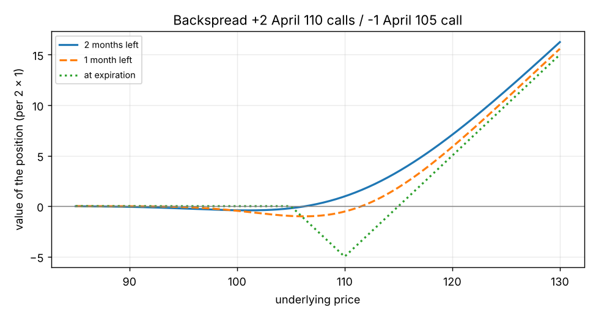

# Ratio spreads: gamma, theta, vega, and why a ratio spread is "a straddle with one side clipped"

**One-line definition:** a ratio spread that **buys more than it sells** has positive gamma, negative theta and positive vega (like a long straddle) but with limited reward on one side; one that **sells more than it buys** has negative gamma, positive theta and negative vega (like a short straddle) but with limited risk on one side.

## Intuition
Think of a long straddle as a "V": you win when the market goes far in either direction. Now clip one arm of the V so it goes flat instead of climbing. That is a call backspread (buy more than sell): the right arm is a steep climb (unlimited), the left arm is a flat shelf (you only keep the credit). It is a V with a **limp left arm**.

The Greek signs come from a simple counting rule:

- **More options bought than sold** means you hold more option "stuff" than you have sold. Options bought carry positive gamma and positive vega and cost time decay (negative theta). So the whole position has **+gamma, +vega, -theta**.
- **More options sold than bought** flips all three: **-gamma, -vega, +theta**.

The delta takes care of itself because we balanced it when we built the spread. That is what makes it a *volatility* position rather than a direction position ([[concepts/11-volatility-spreads/hedging-with-other-options]]).

## The numbers (Figure 11-31, page 200)
Stock 100, April options (2 months), volatility 20%, rate 6%. Each row gives the totals for the whole position.

| Position | Cash | Delta | Gamma | Theta | Vega |
|---|---|---|---|---|---|
| **Call ratio, buy more**: $+20$ April 110 calls, $-10$ April 105 calls | $+4.10$ | $-10$ | $+16.0$ | $-0.080$ | $+0.50$ |
| **Call ratio, sell more**: $+20$ April 95 calls, $-30$ April 100 calls | $-26.80$ | $-100$ | $-72.0$ | $+0.430$ | $-2.40$ |
| **Put ratio, buy more**: $+40$ April 95 puts, $-10$ April 110 puts | $+54.00$ | $0$ | $+114.0$ | $-0.630$ | $+3.80$ |
| **Put ratio, sell more**: $+10$ April 105 puts, $-30$ April 95 puts | $-25.50$ | $-40$ | $-64.0$ | $+0.350$ | $-2.10$ |

**How to rebuild the first row** (all Greeks for the position = quantity times the Greek of each option, added up):

| | Quantity | Gamma | Theta | Vega |
|---|---|---|---|---|
| April 110 call | $+20$ | $20 \times 3.0 = +60.0$ | $20 \times (-0.019) = -0.380$ | $20 \times 0.10 = +2.00$ |
| April 105 call | $-10$ | $-10 \times 4.4 = -44.0$ | $-10 \times (-0.030) = +0.300$ | $-10 \times 0.15 = -1.50$ |
| **Total** | | $+16.0$ | $-0.080$ | $+0.50$ |

Notice how the **bought** options contribute more gamma and vega ($60 > 44$, $2.00 > 1.50$) even though each 110 call has *less* gamma than a 105 call: **twice as many** of them wins.

**How to read the Greeks** (see [[concepts/07-risk-measurement-i/reading-a-position-risk-table]]):
- Gamma $+16$: each 1-point move in the underlying changes the position's delta by $+16$. A rise makes you longer, a fall makes you shorter: you buy low and sell high when you adjust ([[concepts/08-dynamic-hedging/gamma-and-the-unhedged-amount]]).
- Theta $-0.080$: you lose about 8 cents per day on the whole position if nothing else changes.
- Vega $+0.50$: a one-point rise in implied volatility adds about 0.50.

## The value before expiration
The expiration payoff is the *end* of the story. Before expiration the curve is smooth and sits above the expiration curve in the region where the options have time value.

*Backspread: $+2$ April 110 calls, $-1$ April 105 call (value of the whole position per $2 \times 1$, not including the credit).* The solid line is today (2 months left), the dashed line is one month later, the dotted line is expiration. Notice:
- **The dip in the middle gets deeper as time passes** (from about $-0.4$ to about $-1$ to $-5$ at expiration): that is the negative theta. The place the spread wants the market *not* to be is near the strike of the options you bought (110).
- **On the right, today's curve is above the expiration line**: the long options still carry time value you can lose. This is the +vega: if volatility falls, the whole smooth curve sinks toward the dotted line.

## Why risk is limited on one side only
This follows from the leg-by-leg payoff in [[concepts/11-volatility-spreads/ratio-spreads-building-and-payoff]]:

| Spread | Downside | Upside |
|---|---|---|
| Call ratio, **buy** more | limited **reward** (the credit) | **unlimited reward** |
| Put ratio, **buy** more | unlimited reward (down to zero) | limited reward (the credit) |
| Call ratio, **sell** more | limited **risk** (the debit; position worthless below the lower strike) | **unlimited risk** |
| Put ratio, **sell** more | unlimited risk (down to zero) | limited risk |

(The footnote in the book: this table covers "the great majority" of delta-neutral ratio spreads, which are credits when buying more and debits when selling more.)

"Unlimited" for a put on the downside really means "large, but the underlying cannot go below zero" (our remark).

The reason for the limit is simple. A call is only worth something when the market is **above** its strike. Below the lowest strike in the spread, **every call expires worthless**, so the position can neither gain nor lose anything more: you simply keep the credit you took in or lose the debit you paid. That is the "limited" side. Above the highest strike, the *quantities* decide: with more calls sold than bought you are net short calls and keep losing as the market rises, without limit; with more bought than sold you are net long calls and keep gaining. (For puts everything is mirrored: they are only worth something **below** their strike.)

## Where ratio spreads sit in the risk range
Straddles and strangles have the biggest gamma and vega, so the biggest profits and losses. Butterflies and condors have the smallest. **Ratio spreads and Christmas trees fall in between** (page 198).

## When would you use one?
- You expect movement and have a **slight directional preference**: a backspread (buy more) with the extra options on the side you prefer.
- You think implied volatility is **low** (options cheap): positive-vega spreads are what you want ([[concepts/11-volatility-spreads/choosing-a-spread-by-implied-volatility]]).
- You think implied volatility is **high** and the market will be quiet: sell-more ratio spreads, which take in a lot of time decay, but only if you accept the risk on the unlimited side.

## Common confusions
- **+gamma does not mean "cannot lose".** The backspread loses most if the market ends near the strike you bought. It wants *movement*, not a particular price.
- **Gamma and theta have opposite signs** in any such spread ([[concepts/07-risk-measurement-i/gamma-and-theta-trade-off]]): the position that is helped by movement pays for it with time decay.
- **The sell-more spread's "limited risk" is about the side protected by the long option**, not about the whole position.
- **Selling more options at a *different* strike is not the same as selling extra options at the same strike.** The long option is what stops the loss on one side.

## Related
- Chapter: [[chapters/11-volatility-spreads]]
- Previous: [[concepts/11-volatility-spreads/ratio-spreads-building-and-payoff]]
- Next: [[concepts/11-volatility-spreads/christmas-trees-and-ladders]]
- Earlier: [[concepts/07-risk-measurement-i/gamma]], [[concepts/07-risk-measurement-i/theta]], [[concepts/07-risk-measurement-i/vega]]
- Maths needed: [[00-maths-refresher/signs-and-running-totals]]
- See also: [[glossary]], [[formulas]]
