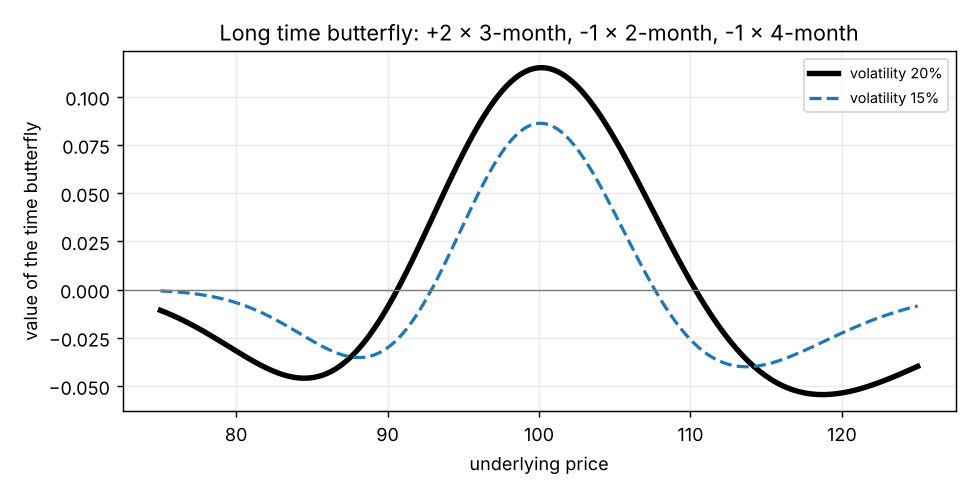

# Time butterflies (time flies)

**One-line definition:** a **time butterfly** has options at the **same strike** but **three different expirations**: you trade the middle expiration (the **body**) against the nearer and farther expirations (the **wings**), with the same amount of time between expirations. All options are the same type.

## Intuition
A normal butterfly spreads across **strikes** (90/100/110) with one expiration. A time butterfly spreads across **expirations** (for example May/June/July) with one strike. Same shape of position: one of each wing, two of the body.

It is also two calendar spreads glued together. The May/June/July 100 call time butterfly is:

$$\underbrace{(\text{buy May}, \text{sell June})}_{\text{sell the short-term calendar}} \;+\; \underbrace{(\text{sell June}, \text{buy July})}_{\text{buy the long-term calendar}}$$

(or the reverse). The June options appear in both, so the position is $\pm(\,+1 \text{ May},\, -2 \text{ June},\, +1 \text{ July})$.

## Which one is "long" (and why it is confusing)
"Long" means you paid a **debit**. For ordinary butterflies, buying the wings and selling the body is a debit. For a time butterfly it is the **opposite**.

Reason: if all options stay at the money, time makes a calendar spread worth **more**. So the *short-term* calendar spread (May/June) must be worth **more** than the *long-term* calendar spread (June/July). The square-root curve explains it: it is steeper at the near end.

Using the book's at-the-money values with 2, 3 and 4 months left (underlying 100, volatility 20%, no interest; our example):

| Months left | 2 | 3 | 4 |
|---|---|---|---|
| ATM call value | 3.26 | 3.99 | 4.60 |

- Short-term calendar (3-month minus 2-month): $3.99 - 3.26 = 0.73$.
- Long-term calendar (4-month minus 3-month): $4.60 - 3.99 = 0.61$.

So to **buy the body** (two 3-month options) and **sell the wings** (one 2-month and one 4-month option):

$$\text{cost} = 2 \times 3.99 - 3.26 - 4.60 = 0.12 \quad (\text{a debit})$$

(exactly, with unrounded values: 0.115.) A debit means **long the time butterfly**: you bought the body and sold the wings. Conversely **selling the body and buying the wings is a credit: short the time butterfly.** The book flags this reversal explicitly (page 192).

## The risk signs
The shape against the underlying price is a peak at the strike (all options at the money, calendars at their widest) that collapses when the underlying moves away: **negative gamma**, which means **positive theta**. And it widens when volatility rises: **positive vega**. A long time butterfly therefore behaves like a long calendar spread (page 192).

Check with the at-the-money rules ($\gamma \propto 1/\sqrt{T}$, vega $\propto \sqrt{T}$), one option each in months 2 and 4 and two in month 3:

$$\gamma \propto \frac{2}{\sqrt{3}} - \frac{1}{\sqrt{2}} - \frac{1}{\sqrt{4}} = 1.155 - 0.707 - 0.500 = -0.052 < 0$$

$$\text{vega} \propto 2\sqrt{3} - \sqrt{2} - \sqrt{4} = 3.464 - 1.414 - 2.000 = +0.050 > 0$$

*A small peak at the strike: the value is only about 0.12 at the top and goes to zero away from it. The dashed line (15% volatility) sits lower: positive vega.*

## Examples from the book
- $+1$ May 100 call, $-2$ June 100 calls, $+1$ July 100 call is a **short** time butterfly (it takes in a credit).
- $-1$ May 100 call, $+2$ June 100 calls, $-1$ July 100 call is a **long** time butterfly (figures 11-26 and 11-27).
- The same idea with puts, or with different strikes such as 25 or 70 (all three expirations still at one strike).

## Common confusions
- **The word "long" flips.** Normal butterfly: long = buy wings. Time butterfly: long = buy the **body**. In both cases long = debit.
- **If implied volatility differs by expiration**, the sign of the cash flow can change (footnote 7): the debit above assumes the same implied volatility in all three months.

## Related
- Chapter: [[chapters/11-volatility-spreads]]
- Previous: [[concepts/11-volatility-spreads/calendar-spreads-in-futures-markets]]
- Next: [[concepts/11-volatility-spreads/calendar-spreads-interest-rates-and-dividends]]
- Earlier: [[concepts/11-volatility-spreads/butterflies-and-condors]], [[concepts/11-volatility-spreads/calendar-spreads-time-decay]]
- Maths needed: [[00-maths-refresher/proportionality-and-percentage-change]]
- See also: [[glossary]], [[formulas]]
